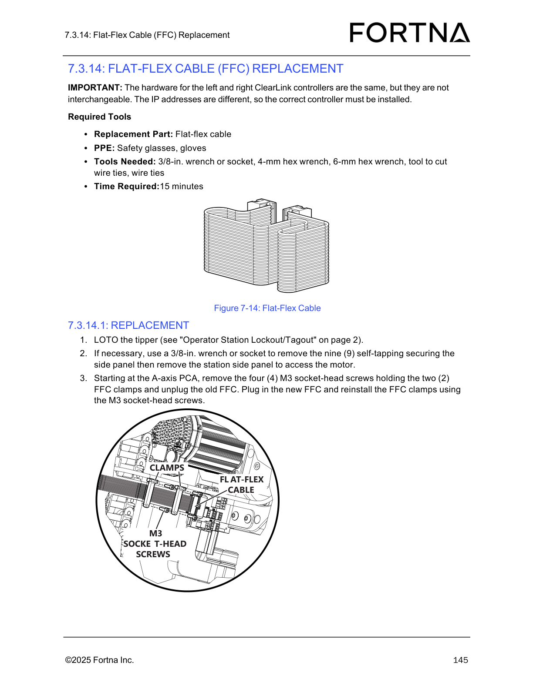

# Replace Flat-Flex Cable (FFC) at A-axis PCA (ClearLink tipper)

## Runbook Header

| Field | Value |
| --- | --- |
| Procedure ID | `proc_replace_flat_flex_cable_ffc_at_a_axis_pca_clearlink_tipper_v1` |
| Title | Replace Flat-Flex Cable (FFC) at A-axis PCA (ClearLink tipper) |
| Procedure Type | `recovery` |
| Primary Role | `L2_support` |
| Supporting Roles | `operator` |
| Support Safe | Yes |
| Capability Tags | `tipper_station_fault` |
| Access Surface | `tipper_hmi`, `physical_floor` |
| Audience Roles | `L2_support`, `operator` |
| Failure Pattern Tags | None |
| Validation Status | `needs_sme_review` |
| Merge Status | `source_finalized` |

## Summary

Lock out/tag out the ClearLink tipper, access the A-axis PCA, remove the two FFC clamps (four M3 socket-head screws), unplug the old flat-flex cable (FFC), plug in the correct replacement FFC, and reinstall the clamps with the four M3 socket-head screws. Reinstall the station side panel if it was removed.

## When To Use

Use when the ClearLink tipper’s A-axis PCA flat-flex cable (FFC) needs replacement, following the manual’s replacement steps (including LOTO of the tipper and correct controller/FFC assembly selection).

## Do Not Use For

* Do not use if you cannot perform tipper lockout/tagout (LOTO) as required by the procedure.
* Do not use to swap left/right ClearLink controller hardware/FFC assemblies interchangeably; the manual states they are not interchangeable due to different IP addresses.

## Safety And Operational Notes

* Perform LOTO of the tipper before working at the A-axis PCA.
* Wear safety glasses and gloves during the procedure.

## Access Or Tools Needed

* Replacement part: Flat-flex cable (FFC)
* PPE: safety glasses, gloves
* Tools: 3/8-in. wrench or socket
* Tools: 4-mm hex wrench
* Tools: 6-mm hex wrench
* Tool to cut wire ties
* Wire ties
* LOTO capability for the tipper (see "Operator Station Lockout/Tagout" on page 2)

## Visual References

*Figure 7-14 diagram of the Flat-Flex Cable (FFC) assembly at the A-axis PCA, including the two FFC clamps and four M3 socket-head screws.*

## Procedure Steps

### Step 1 — Perform LOTO of the tipper

**Responsible role:** operator

**Instruction:**
Lock out/tag out the tipper using the site’s Operator Station Lockout/Tagout procedure (referenced by the manual on page 2).

**Expected result:**
The tipper is in a locked out/tagged out state prior to removing the side panel or working at the A-axis PCA.

**Stop or Escalate If:**

* If tipper LOTO cannot be applied, stop and escalate for further guidance.

---

### Step 2 — Remove the station side panel if necessary to access the motor

**Responsible role:** operator

**Instruction:**
If necessary, use a 3/8-in. wrench or socket to remove the nine (9) self-tapping securing the station side panel, then remove the station side panel to access the motor.

**Expected result:**
Station side panel is removed (when necessary) to access the motor area.

**Stop or Escalate If:**

* If the side panel cannot be removed as described, stop and escalate for further guidance.

---

### Step 3 — Remove the four M3 socket-head screws holding the two FFC clamps

**Responsible role:** operator

**Instruction:**
Starting at the A-axis PCA, remove the four (4) M3 socket-head screws holding the two (2) FFC clamps.

**Expected result:**
All four M3 socket-head screws are removed and the FFC clamps are released from the A-axis PCA.

**Stop or Escalate If:**

* If the FFC cannot be unplugged/plugged or clamps cannot be resecured with the M3 socket-head screws, stop and escalate for further guidance.

---

### Step 4 — Unplug the old FFC from the A-axis PCA connection point

**Responsible role:** operator

**Instruction:**
Unplug the old FFC from the A-axis PCA connection point.

**Expected result:**
Old FFC is fully unplugged from the A-axis PCA connection point.

**Stop or Escalate If:**

* If the FFC cannot be unplugged/plugged, stop and escalate for further guidance.

---

### Step 5 — Plug in the new replacement FFC

**Responsible role:** operator

**Instruction:**
Plug in the new FFC.

**Expected result:**
New FFC is seated/connected at the A-axis PCA connection point.

**Stop or Escalate If:**

* Do not install the wrong controller hardware: left and right ClearLink controllers have the same hardware but are not interchangeable because IP addresses differ; ensure the correct controller/FFC assembly is installed as applicable.
* If the FFC cannot be unplugged/plugged or clamps cannot be resecured with the M3 socket-head screws, stop and escalate for further guidance.

---

### Step 6 — Reinstall the FFC clamps and secure with the four M3 socket-head screws

**Responsible role:** operator

**Instruction:**
Reinstall the FFC clamps and secure them using the M3 socket-head screws.

**Expected result:**
FFC clamps are reinstalled and secured with the four (4) M3 socket-head screws at the A-axis PCA.

**Stop or Escalate If:**

* If clamps cannot be resecured with the M3 socket-head screws, stop and escalate for further guidance.

---

### Step 7 — Verify the FFC clamps are reinstalled with the four M3 socket-head screws

**Responsible role:** operator

**Instruction:**
Verify the FFC clamps are reinstalled with the four (4) M3 socket-head screws at the A-axis PCA.

**Expected result:**
Four M3 socket-head screws are present securing the two FFC clamps at the A-axis PCA.

**Stop or Escalate If:**

* If verification fails (missing/incorrect clamp screw installation), stop and escalate for further guidance.

---

## Success Criteria

* New FFC is plugged in at the A-axis PCA.
* FFC is secured by the two FFC clamps using the four M3 socket-head screws.
* Station side panel is reinstalled if it was removed.

## Failure Conditions

* Wrong controller/FFC assembly installed (left/right ClearLink not interchangeable due to different IP addresses).
* FFC cannot be unplugged/plugged.
* FFC clamps cannot be resecured with the M3 socket-head screws.

## Escalation Guidance

* If the FFC cannot be unplugged/plugged or clamps cannot be resecured with the M3 socket-head screws, stop and escalate for further guidance.
* If there is any uncertainty about left vs right ClearLink controller/FFC assembly selection, stop and ensure the correct controller/FFC assembly is installed (IP addresses differ).

## Missing Details / Known Gaps

* The manual references "Operator Station Lockout/Tagout" on page 2, but the specific LOTO steps/controls are not included in the provided source section bundle for this candidate.
* The manual section provided does not include explicit post-installation functional test steps beyond the mechanical verification and side panel reinstallation expectation.

## Source Lineage

- Candidate IDs: optisweep_7_3_14_1_flat_flex_cable_ffc_replacement
- Source ID: `manual_optisweep_om_v3`
- Source Type: `manual`
