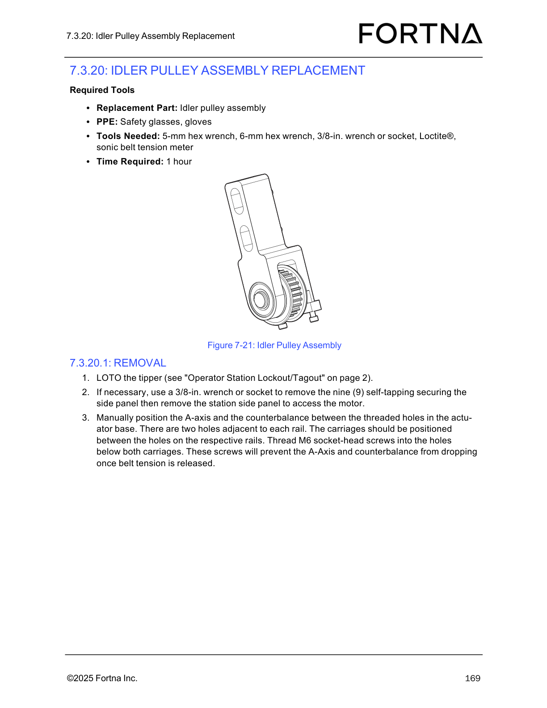

# 7.3.20.1 Idler Pulley Assembly Replacement - Removal (LOTO, side panel access, carriage positioning)

## Runbook Header

| Field | Value |
| --- | --- |
| Procedure ID | `proc_7_3_20_1_idler_pulley_assembly_replacement_removal_v1` |
| Title | 7.3.20.1 Idler Pulley Assembly Replacement - Removal (LOTO, side panel access, carriage positioning) |
| Procedure Type | `recovery` |
| Primary Role | `operator` |
| Supporting Roles | None |
| Support Safe | Yes |
| Capability Tags | `tipper_station_fault` |
| Access Surface | `physical_floor` |
| Audience Roles | `operator` |
| Failure Pattern Tags | None |
| Validation Status | `needs_sme_review` |
| Merge Status | `source_finalized` |

## Summary

Perform LOTO on the OptiSweep tipper, remove the station side panel if needed to access the motor, then manually position the A-axis and counterbalance between the threaded holes in the actuator base and secure them with M6 socket-head screws to prevent dropping once belt tension is released.

## When To Use

Use this procedure to prepare the OptiSweep tipper for the idler pulley assembly replacement removal steps by completing LOTO, gaining motor access via the station side panel (if necessary), and securing the A-axis/counterbalance so it cannot drop when belt tension is released.

## Safety And Operational Notes

* Do not proceed without completing LOTO (escalation note).
* The procedure includes securing the A-axis and counterbalance to prevent dropping once belt tension is released.

## Access Or Tools Needed

* PPE: safety glasses, gloves
* 5-mm hex wrench
* 6-mm hex wrench
* 3/8-in. wrench or socket
* Loctite®
* sonic belt tension meter
* Access to the station side panel securing screws and motor area
* Replacement part: Idler pulley assembly (for later steps in the full replacement procedure)

## Visual References

*Figure 7-21: Idler Pulley Assembly diagram showing A-axis/counterbalance carriage positions relative to the threaded holes and the M6 socket-head screws used to prevent dropping.*

## Procedure Steps

### Step 1 — LOTO the tipper

**Responsible role:** operator

**Instruction:**
Complete LOTO on the tipper using the procedure referenced as "Operator Station Lockout/Tagout" on page 2.

**Expected result:**
Tipper is LOTO.

**Stop or Escalate If:**

* Do not proceed without completing LOTO.

---

### Step 2 — Remove the station side panel (if necessary) to access the motor

**Responsible role:** operator

**Instruction:**
If necessary, use a 3/8-in. wrench or socket to remove the nine (9) self-tapping securing the station side panel, then remove the station side panel to access the motor.

**Expected result:**
Station side panel is removed (if needed) to access the motor.

**Stop or Escalate If:**

* Stop and ensure LOTO is complete before proceeding with any side panel removal.

---

### Step 3 — Position the A-axis and counterbalance between the threaded holes

**Responsible role:** operator

**Instruction:**
Manually position the A-axis and the counterbalance between the threaded holes in the actuator base. There are two holes adjacent to each rail; position the carriages between the holes on the respective rails.

**Expected result:**
A-axis and counterbalance carriages are positioned between the threaded holes adjacent to each rail.

**Stop or Escalate If:**

* If the A-axis/counterbalance cannot be positioned between the threaded holes as described, stop and escalate before releasing belt tension.

---

### Step 4 — Thread M6 socket-head screws below both carriages to prevent dropping

**Responsible role:** operator

**Instruction:**
Thread M6 socket-head screws into the holes below both carriages.

**Expected result:**
M6 socket-head screws are threaded into the holes below both carriages to prevent dropping once belt tension is released.

**Stop or Escalate If:**

* Stop and escalate if the A-axis/counterbalance was not positioned between the threaded holes as described (the screws are intended to prevent dropping).

---

## Success Criteria

* Tipper is LOTO.
* Station side panel is removed (if necessary) to access the motor.
* A-axis and counterbalance carriages are positioned between the threaded holes adjacent to each rail.
* M6 socket-head screws are threaded into the holes below both carriages to prevent dropping once belt tension is released.

## Failure Conditions

* LOTO not completed.
* Carriages cannot be positioned between the threaded holes as described.
* M6 socket-head screws not installed below both carriages.

## Escalation Guidance

* If the A-axis/counterbalance cannot be positioned between the threaded holes as described, stop and escalate before releasing belt tension.

## Missing Details / Known Gaps

* This candidate only covers the provided Removal steps (1-3). Later removal steps and installation are not present in the provided section_text.

## Source Lineage

- Candidate IDs: optisweep_7_3_20_1_idler_pulley_assembly_replacement_removal
- Source ID: `manual_optisweep_om_v3`
- Source Type: `manual`
