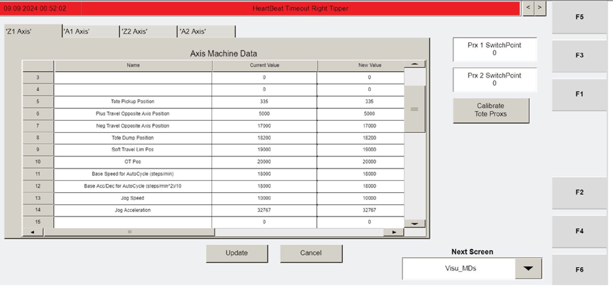

# Set Z-Axis Home Position (Tipper Commissioning)

## Runbook Header

| Field | Value |
| --- | --- |
| Procedure ID | `proc_set_z_axis_home_position_tipper_commissioning_v1` |
| Title | Set Z-Axis Home Position (Tipper Commissioning) |
| Procedure Type | `operation` |
| Primary Role | `L2_support` |
| Supporting Roles | None |
| Support Safe | Yes |
| Capability Tags | `tipper_station_fault` |
| Access Surface | `tipper_hmi` |
| Audience Roles | `L2_support` |
| Failure Pattern Tags | None |
| Validation Status | `needs_sme_review` |
| Merge Status | `source_finalized` |

## Summary

On the OptiSweep tipper HMI, use the "Visu_MDs" (F2) screen to enter the previously recorded Z-axis "Home Offset" values into the "New Value" column for each Z-axis, press UPDATE to apply, and repeat for the other Z-axis.

## When To Use

Use during tipper commissioning when you need to set each tipper Z-axis "Home Offset" to the previously recorded value and confirm the update on the "Visu_MDs" screen.

## Access Or Tools Needed

* Access to the OptiSweep HMI
* Keyboard/function keys to use F2

## Visual References

*Manual image context for the tipper commissioning step "SET Z-AXIS HOME POSITION" showing navigation to "Visu_MDs" (F2) and the Z-axis motor positioning check context.*

## Procedure Steps

### Step 1 — Navigate to the "Visu_MDs" (F2) screen

**Responsible role:** L2_support

**Instruction:**
On the OptiSweep HMI, navigate to the "Visu_MDs" screen using the F2 function key.

**Expected result:**
The "Visu_MDs" screen is displayed and ready for editing the Z-axis "Home Offset" settings.

---

### Step 2 — Enter recorded Z-axis "Home Offset" values into "New Value"

**Responsible role:** L2_support

**Instruction:**
For each Z-axis, locate the "Home Offset" setting and enter the previously recorded value into the "New Value" column.

**Expected result:**
Each Z-axis "Home Offset" field shows the entered value in the "New Value" column.

---

### Step 3 — Press UPDATE to confirm the change

**Responsible role:** L2_support

**Instruction:**
Press UPDATE to confirm the change for the Z-axis.

**Expected result:**
After pressing UPDATE, the "Home Offset" setting reflects the entered "New Value" for that Z-axis.

**Stop or Escalate If:**

* If UPDATE does not apply the entered "New Value" (values do not change as expected), stop and escalate for support.

---

### Step 4 — Repeat for the other Z-axis

**Responsible role:** L2_support

**Instruction:**
Repeat the "Home Offset" "New Value" entry and UPDATE confirmation for the other Z-axis.

**Expected result:**
The other Z-axis "Home Offset" reflects its entered "New Value" after pressing UPDATE.

**Stop or Escalate If:**

* If UPDATE does not apply the entered "New Value" for the other Z-axis (values do not change as expected), stop and escalate for support.

---

## Success Criteria

* After pressing UPDATE for each Z-axis, the "Home Offset" setting(s) on the "Visu_MDs" screen reflect the entered "New Value" values.

## Failure Conditions

* Pressing UPDATE does not change the "Home Offset" value to match the entered "New Value" for a Z-axis.

## Escalation Guidance

* If UPDATE does not apply the entered "New Value" (values do not change as expected), stop and escalate for support.

## Missing Details / Known Gaps

* The packet does not specify the exact on-screen confirmation behavior after pressing UPDATE (e.g., whether a pop-up appears or which field changes). Use the observable change in the "Home Offset" value on the "Visu_MDs" screen as the confirmation.

## Source Lineage

- Candidate IDs: optisweep_7_3_23_8_set_z_axis_home_position
- Source ID: `manual_optisweep_om_v3`
- Source Type: `manual`
