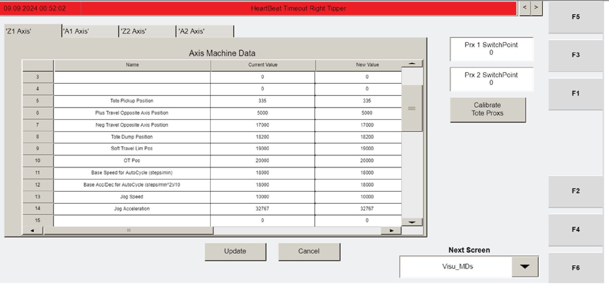

# Check Z-Axis Motor Positioning Within the Frame (Tipper Commissioning)

## Runbook Header

| Field | Value |
| --- | --- |
| Procedure ID | `proc_check_z_axis_motor_positioning_within_the_frame_tipper_commissioning_v1` |
| Title | Check Z-Axis Motor Positioning Within the Frame (Tipper Commissioning) |
| Procedure Type | `diagnostic` |
| Primary Role | `L2_support` |
| Supporting Roles | None |
| Support Safe | Yes |
| Capability Tags | `tipper_station_fault` |
| Access Surface | `tipper_hmi` |
| Audience Roles | `L2_support` |
| Failure Pattern Tags | None |
| Validation Status | `needs_sme_review` |
| Merge Status | `source_finalized` |

## Summary

On the OptiSweep tipper operator station HMI, use the Visu_MCP_Dual (F3) jogging screen to jog the Z-axis upward using the '+' button until it is as close as possible to the overtravel switch without the motor hitting the frame. If the motor reaches the overtravel switch, move it back down approximately 1/3 in.

## When To Use

Use during tipper commissioning when verifying the Z-axis motor can travel close to the overtravel switch without contacting the frame.

## Safety And Operational Notes

* Stop jogging and escalate if the motor hits the frame during movement.

## Access Or Tools Needed

* Access to the OptiSweep tipper HMI (Visu_MCP_Dual screen).
* Keyboard/function keys to use F3.
* Ability to observe motor position relative to the frame and identify the overtravel switch.

## Visual References

*Manual image context for 7.3.23.9 showing the Visu_MCP_Dual (F3) navigation and jogging step for checking Z-axis positioning within the frame.*

*Manual image showing the Visu_MCP_Dual (F3) and the jogging interface context for the Z-axis check against the frame/overtravel switch.*

## Procedure Steps

### Step 1 — Navigate to Visu_MCP_Dual (F3)

**Responsible role:** L2_support

**Instruction:**
On the tipper operator station HMI, navigate to the "Visu_MCP_Dual" screen using F3.

**Expected result:**
The "Visu_MCP_Dual" (F3) screen is displayed.

---

### Step 2 — Open the jogging screen (CYCLE STOP then JOG)

**Responsible role:** L2_support

**Instruction:**
On the "Visu_MCP_Dual" (F3) screen, press CYCLE STOP and then press JOG to open the jogging screen.

**Expected result:**
The jogging screen is open and jogging controls are available.

---

### Step 3 — Jog Z-axis upward close to the overtravel switch without hitting the frame

**Responsible role:** L2_support

**Instruction:**
Jog the Z-axis for the tipper using the '+' button as far as it will go without the motor hitting the frame.

**Expected result:**
The Z-axis is positioned such that it does not hit the frame while being jogged upward as far as possible.

**Stop or Escalate If:**

* If the motor hits the frame during jogging, stop and escalate for support.

---

### Step 4 — If Z-axis reaches overtravel switch, move it back down ~1/3 in

**Responsible role:** L2_support

**Instruction:**
If the motor is able to travel all the way to the overtravel switch, move it back down approximately 1/3 in.

**Expected result:**
The Z-axis is backed down approximately 1/3 in from the overtravel-switch-reaching position.

---

## Success Criteria

* Z-axis can be jogged upward close to the overtravel switch without the motor hitting the frame.
* If the overtravel switch is reached, the Z-axis is moved back down approximately 1/3 in.

## Failure Conditions

* Motor hits the frame during jogging.
* Overtravel switch is reached and the motor is not backed down approximately 1/3 in.

## Escalation Guidance

* If the motor hits the frame during jogging, stop and escalate for support.

## Missing Details / Known Gaps

* The packet does not specify the exact visual indicator or label used on the jogging screen to confirm the overtravel switch has been reached; it only states to move back down approximately 1/3 in if the motor reaches it.

## Source Lineage

- Candidate IDs: optisweep_7_3_23_9_checking_motor_positioning_within_the_frame
- Source ID: `manual_optisweep_om_v3`
- Source Type: `manual`
