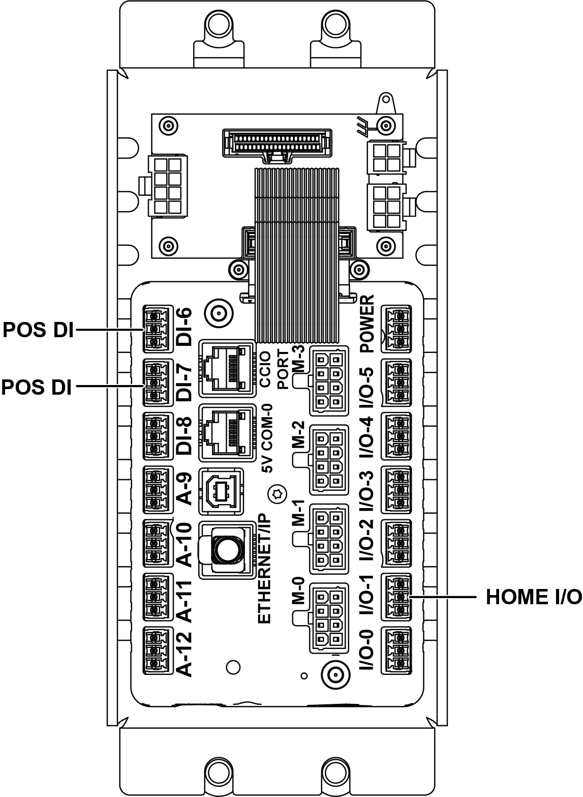
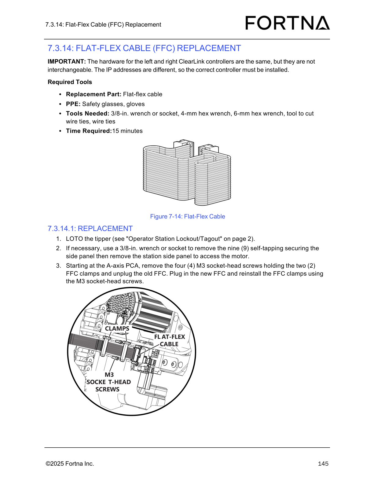
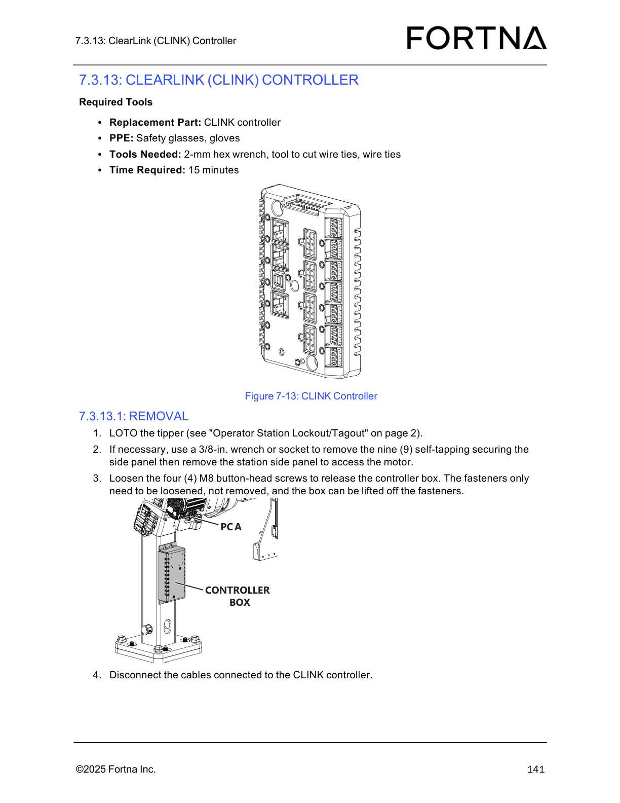

# Remove and unplug Limit/Home sensor (A-axis or Z-axis)

## Runbook Header

| Field | Value |
| --- | --- |
| Procedure ID | `proc_remove_and_unplug_limit_home_sensor_a_axis_or_z_axis_v1` |
| Title | Remove and unplug Limit/Home sensor (A-axis or Z-axis) |
| Procedure Type | `recovery` |
| Primary Role | `operator` |
| Supporting Roles | None |
| Support Safe | Yes |
| Capability Tags | `tipper_station_fault` |
| Access Surface | `physical_floor` |
| Audience Roles | `operator` |
| Failure Pattern Tags | None |
| Validation Status | `needs_sme_review` |
| Merge Status | `source_finalized` |

## Summary

LOTO the tipper, unplug and remove a defective Limit/Home proximity sensor (A-axis or Z-axis), and route the sensor cable through the wire routing hole for replacement.

## When To Use

Use when a Limit/Home proximity sensor is defective and must be removed (A-axis sensor or Z-axis sensor) so it can be replaced, including preparing the cable routing for the new sensor.

## Safety And Operational Notes

* Perform LOTO of the tipper before unplugging/removing the sensor.

## Access Or Tools Needed

* Replacement part: Limit sensor or home sensor
* PPE: safety glasses, gloves
* 1.5-mm hex wrench
* Tool to cut wire ties
* Wire ties
* Access to tipper for LOTO and to sensor connection points (PCA near A-axis motor or CLINK controller inside control box)

## Visual References

*A-Axis PCA connections showing A-axis wire routing through the wire routing hole and fastening with an M3 button-head screw; also shows where A-axis sensor wires plug into the PCA.*

*Z-Axis CLINK connections showing Z-axis wires dropping through the column and out the lower grommet into the control box and plugging into I/O1, DI6, or DI7.*

*Flat-Flex Cable (FFC) diagram at the A-axis PCA showing the M3 socket-head screws and FFC clamps (useful for understanding the A-axis PCA connection area).*

*CLINK controller diagram showing the controller box and cable connections (useful for understanding the Z-axis sensor connection point inside the control box).*

## Procedure Steps

### Step 1 — Identify whether the defective sensor is A-axis or Z-axis

**Responsible role:** operator

**Instruction:**
Use the sensor location guidance to determine whether the defective Limit/Home sensor is an A-axis sensor or a Z-axis sensor.

**Expected result:**
You can classify the sensor as either A-axis or Z-axis based on its location/connection point.

**Stop or Escalate If:**

* If the sensor connection point cannot be identified (PCA near A-axis motor vs CLINK controller inside control box), stop and re-check sensor location guidance.

---

### Step 2 — LOTO the tipper

**Responsible role:** operator

**Instruction:**
LOTO the tipper using the manual’s Operator Station Lockout/Tagout procedure.

**Expected result:**
The tipper is locked out/tagged out prior to unplugging the sensor.

---

### Step 3 — Unplug the sensor

**Responsible role:** operator

**Instruction:**
Unplug the sensor from its connection point.

**Expected result:**
The sensor is unplugged from its connection point (PCA near A-axis motor for A-axis; CLINK controller inside control box for Z-axis).

**Stop or Escalate If:**

* If the sensor connection point cannot be identified (PCA near A-axis motor vs CLINK controller inside control box), stop and re-check sensor location guidance.

---

### Step 4 — Remove the sensor mounting screw and feed the sensor through the wire routing hole

**Responsible role:** operator

**Instruction:**
Remove the M3 button-head screw holding the sensor in place, then feed the sensor through the hole where the wire is routed.

**Expected result:**
The M3 button-head screw is removed and the sensor is fed through the wire routing hole.

---

### Step 5 — Pull the sensor out (A-axis vs Z-axis handling)

**Responsible role:** operator

**Instruction:**
If removing an A-axis sensor, pull the sensor away from the column area; if removing a Z-axis sensor, pull the sensor from the column. If the A-axis sensor is defective, cut the wire tie if needed.

**Expected result:**
The defective sensor is removed from its mounting location: A-axis sensor pulled away from the column area; Z-axis sensor pulled from the column.

**Stop or Escalate If:**

* If the sensor does not pull free, cut the wire tie (noted as potentially required for a defective A-axis sensor).

---

### Step 6 — Optional: use the new sensor to pull through cable routing

**Responsible role:** operator

**Instruction:**
If beneficial, connect the new sensor to the one being replaced to pull through the cable routing so it is routed properly and easier.

**Expected result:**
Cable routing is prepared so the replacement sensor can be routed properly through the wire routing path.

---

## Success Criteria

* Defective Limit/Home sensor is unplugged and removed from its mounting location (A-axis sensor pulled away from column area; Z-axis sensor pulled from the column).
* Sensor cable is routed through the hole where the wire is routed, with any wire tie cut as needed.

## Failure Conditions

* Sensor does not pull free and wire tie was not cut when needed (A-axis defective sensor case).
* Sensor connection point cannot be identified (PCA near A-axis motor vs CLINK controller inside control box).

## Escalation Guidance

* If you cannot identify whether the sensor is A-axis or Z-axis, stop and re-check the sensor location guidance referenced by the manual’s Sensors page.
* If the sensor cannot be removed after cutting the wire tie (when applicable), stop and escalate to maintenance/engineering support for further inspection of the mounting and routing.

## Missing Details / Known Gaps

* The provided source section contains removal steps and tool/PPE requirements; installation/replacement steps are not present in the provided text.
* The manual references a separate "Sensors" page for sensor locations; the packet does not include that page’s image/OCR for direct step-level verification.

## Source Lineage

- Candidate IDs: optisweep_7_3_2_1_limit_home_sensors_removal
- Source ID: `manual_optisweep_om_v3`
- Source Type: `manual`
