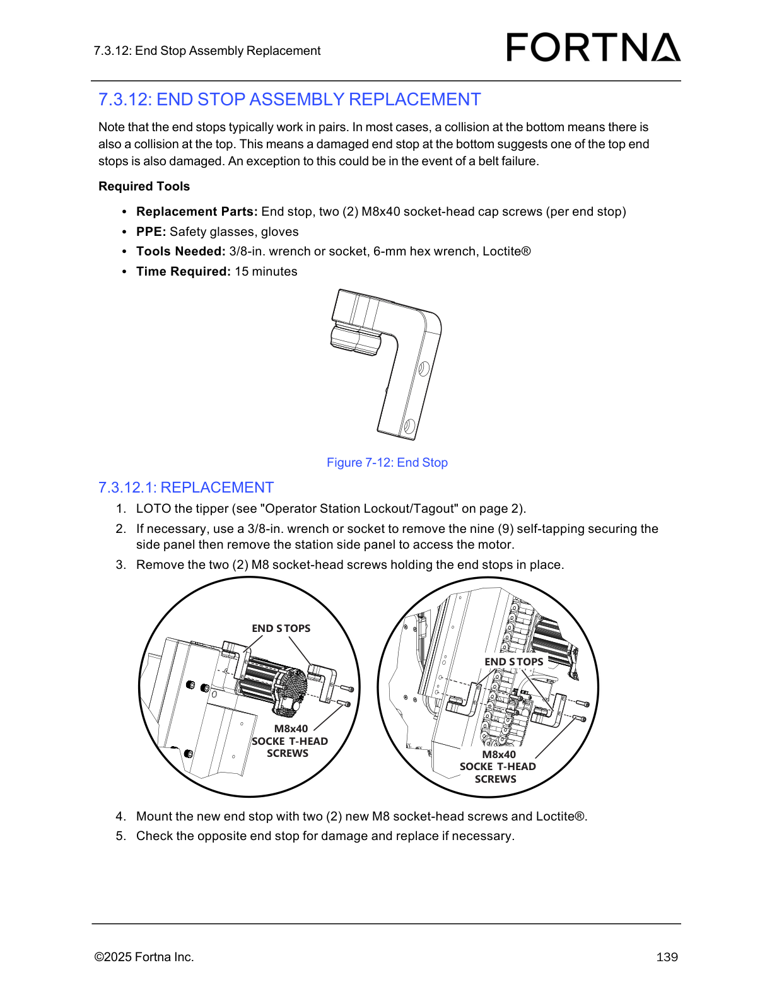

# Replace OptiSweep End Stop Assembly (End Stops typically work in pairs)

## Runbook Header

| Field | Value |
| --- | --- |
| Procedure ID | `proc_replace_optisweep_end_stop_assembly_v1` |
| Title | Replace OptiSweep End Stop Assembly (End Stops typically work in pairs) |
| Procedure Type | `recovery` |
| Primary Role | `operator` |
| Supporting Roles | None |
| Support Safe | Yes |
| Capability Tags | `tipper_station_fault` |
| Access Surface | `physical_floor` |
| Audience Roles | `operator` |
| Failure Pattern Tags | None |
| Validation Status | `needs_sme_review` |
| Merge Status | `source_finalized` |

## Summary

LOTO the OptiSweep tipper, replace the damaged end stop assembly using two new M8x40 socket-head screws with Loctite®, and inspect the opposite end stop for damage (end stops typically work in pairs).

## When To Use

Use when an OptiSweep tipper end stop assembly is damaged and needs replacement, and you must also check the opposite end stop because end stops typically work in pairs.

## Safety And Operational Notes

* Perform LOTO of the tipper before removing the side panel (if necessary) and before removing/mounting end stop hardware.

## Access Or Tools Needed

* Replacement parts: End stop; two (2) M8x40 socket-head cap screws (per end stop)
* PPE: safety glasses, gloves
* Tools: 3/8-in. wrench or socket, 6-mm hex wrench, Loctite®
* Operator Station Lockout/Tagout procedure access (page 2)

## Visual References

*Figure 7-12: End Stop diagram showing the end stop assembly and the M8x40 socket-head screws used for mounting (top/bottom end stops).*

## Procedure Steps

### Step 1 — Review the end-stop pairing note and collision implication

**Responsible role:** operator

**Instruction:**
Before starting the physical work, apply the pairing logic: a collision at the bottom often indicates a collision at the top; therefore, a damaged bottom end stop suggests one of the top end stops is also damaged (exception: belt failure).

**Expected result:**
You are prepared to inspect the opposite end stop for damage after replacing the damaged one.

---

### Step 2 — LOTO the tipper

**Responsible role:** operator

**Instruction:**
LOTO the tipper using the “Operator Station Lockout/Tagout” procedure on page 2.

**Expected result:**
The tipper is locked out/tagged out per the Operator Station Lockout/Tagout procedure before you remove hardware.

---

### Step 3 — Remove the station side panel if needed to access the motor

**Responsible role:** operator

**Instruction:**
If necessary, use a 3/8-in. wrench or socket to remove the nine (9) self-tapping securing screws of the side panel, then remove the station side panel to access the motor.

**Expected result:**
Station side panel is removed (only if necessary) and the motor area is accessible for end stop screw removal.

**Stop or Escalate If:**

* If access to the motor is not possible without removing the side panel, ensure LOTO is maintained before proceeding.

---

### Step 4 — Remove the two M8 socket-head screws holding the end stops

**Responsible role:** operator

**Instruction:**
Remove the two (2) M8 socket-head screws holding the end stops in place.

**Expected result:**
The end stop assembly is unfastened and can be removed/replaced.

---

### Step 5 — Mount the new end stop using two new M8x40 socket-head screws with Loctite®

**Responsible role:** operator

**Instruction:**
Mount the new end stop with two (2) new M8 socket-head screws and Loctite®.

**Expected result:**
New end stop is mounted using two new M8 socket-head screws with Loctite®.

---

### Step 6 — Check the opposite end stop for damage and replace if necessary

**Responsible role:** operator

**Instruction:**
Check the opposite end stop for damage and replace it if necessary.

**Expected result:**
Opposite end stop is inspected; if damaged, it is replaced.

**Stop or Escalate If:**

* If the opposite end stop is found damaged, replace it as well (end stops typically work in pairs).

---

### Step 7 — Reinstall side panels if necessary and restart the operator station

**Responsible role:** operator

**Instruction:**
Reinstall the top and/or bottom side panels, if necessary, then re-start the operator station (see “Starting The Operator Station” on page 66).

**Expected result:**
Side panels are reinstalled (if removed) and the operator station is restarted.

---

## Success Criteria

* Damaged end stop is replaced with a new end stop mounted using two new M8 socket-head screws with Loctite®.
* Opposite end stop is checked for damage and replaced if necessary.
* Side panels are reinstalled (if removed) and the operator station is restarted.

## Failure Conditions

* Opposite end stop remains damaged after inspection.
* End stop mounting does not use two new screws and Loctite® as specified.
* Side panels are left removed after the replacement.

## Escalation Guidance

* If you cannot access the motor without removing the side panel, maintain LOTO before proceeding.
* If the opposite end stop is found damaged, replace it as well (end stops typically work in pairs).

## Missing Details / Known Gaps

* The source does not specify whether the removed end stop is the top or bottom unit in the replacement step; the procedure relies on checking the opposite end stop after replacement.

## Source Lineage

- Candidate IDs: optisweep_end_stop_assembly_replacement_7_3_12
- Source ID: `manual_optisweep_om_v3`
- Source Type: `manual`
