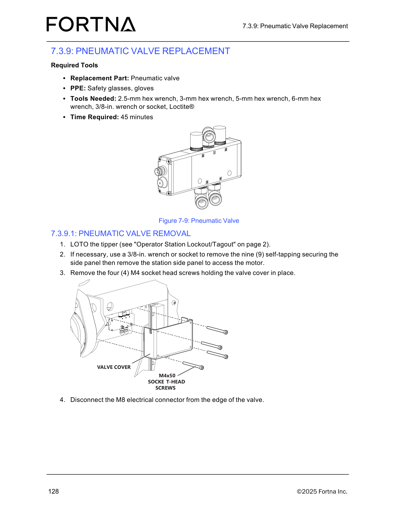

# 7.3.9.1 Pneumatic Valve Removal (LOTO, side panel access, valve cover removal, M8 connector disconnect)

## Runbook Header

| Field | Value |
| --- | --- |
| Procedure ID | `proc_7_3_9_1_pneumatic_valve_removal_v1` |
| Title | 7.3.9.1 Pneumatic Valve Removal (LOTO, side panel access, valve cover removal, M8 connector disconnect) |
| Procedure Type | `recovery` |
| Primary Role | `operator` |
| Supporting Roles | None |
| Support Safe | Yes |
| Capability Tags | `tipper_station_fault` |
| Access Surface | `physical_floor` |
| Audience Roles | `operator` |
| Failure Pattern Tags | None |
| Validation Status | `needs_sme_review` |
| Merge Status | `source_finalized` |

## Summary

Perform LOTO on the OptiSweep tipper, remove the station side panel if needed to access the motor/valve area, remove the valve cover secured by four M4x50 socket-head screws, and disconnect the M8 electrical connector from the edge of the pneumatic valve.

## When To Use

Use when removing the pneumatic valve at the OptiSweep tipper station requires LOTO, side panel access, valve cover removal, and disconnecting the valve’s M8 electrical connector (as part of the pneumatic valve replacement/removal task).

## Do Not Use For

* Do not continue if the station side panel cannot be removed after removing the nine (9) self-tapping securing screws.
* Do not continue if the M8 electrical connector cannot be disconnected from the edge of the valve.

## Safety And Operational Notes

* Apply LOTO to the tipper before starting the removal steps.

## Access Or Tools Needed

* PPE: Safety glasses, gloves
* Tools: 2.5-mm hex wrench, 3-mm hex wrench, 5-mm hex wrench, 6-mm hex wrench, 3/8-in. wrench or socket, Loctite®
* LOTO capability for the tipper (see "Operator Station Lockout/Tagout" on page 2)

## Visual References

*Figure 7-9 pneumatic valve maintenance diagram showing valve cover, four M4x50 socket-head screws, and M8 connector location on the valve edge.*

## Procedure Steps

### Step 1 — LOTO the tipper

**Responsible role:** operator

**Instruction:**
Perform LOTO on the tipper (use the lockout/tagout reference labeled "Operator Station Lockout/Tagout" on page 2).

**Expected result:**
The tipper is LOTO’d.

---

### Step 2 — Remove station side panel (if necessary) to access the motor

**Responsible role:** operator

**Instruction:**
If necessary, use a 3/8-in. wrench or socket to remove the nine (9) self-tapping securing screws for the station side panel, then remove the station side panel to access the motor.

**Expected result:**
Station side panel is removed (or remains in place if not necessary) and the motor access area is available.

**Stop or Escalate If:**

* If the side panel cannot be removed after removing the nine (9) self-tapping securing screws, stop and re-check that all securing screws are removed before continuing.

---

### Step 3 — Remove valve cover screws

**Responsible role:** operator

**Instruction:**
Remove the four (4) M4 socket head screws holding the valve cover in place.

**Expected result:**
Valve cover is no longer secured by the four (4) M4 socket head screws.

---

### Step 4 — Disconnect M8 electrical connector from valve edge

**Responsible role:** operator

**Instruction:**
Disconnect the M8 electrical connector from the edge of the valve.

**Expected result:**
The M8 electrical connector has been disconnected from the edge of the pneumatic valve.

**Stop or Escalate If:**

* If the M8 electrical connector cannot be disconnected from the edge of the valve, stop and re-check connector seating/retention before applying additional force.

---

## Success Criteria

* Tipper is LOTO’d.
* Station side panel is removed when necessary to access the motor/valve area.
* Valve cover is no longer secured by the four (4) M4 socket head screws.
* M8 electrical connector is disconnected from the edge of the pneumatic valve.

## Failure Conditions

* Side panel cannot be removed after removing the nine (9) self-tapping securing screws.
* M8 electrical connector cannot be disconnected from the edge of the valve.

## Escalation Guidance

* If side panel removal or M8 connector disconnection fails as specified in the stop conditions, stop work and re-check the stated screw/connector seating/retention before applying additional force.

## Missing Details / Known Gaps

* The packet includes LOTO reference by name ("Operator Station Lockout/Tagout" on page 2) but does not include the actual LOTO procedure text/steps; operators must use their site’s referenced lockout/tagout procedure for the tipper.

## Source Lineage

- Candidate IDs: optisweep_pneumatic_valve_removal_7_3_9_1
- Source ID: `manual_optisweep_om_v3`
- Source Type: `manual`
