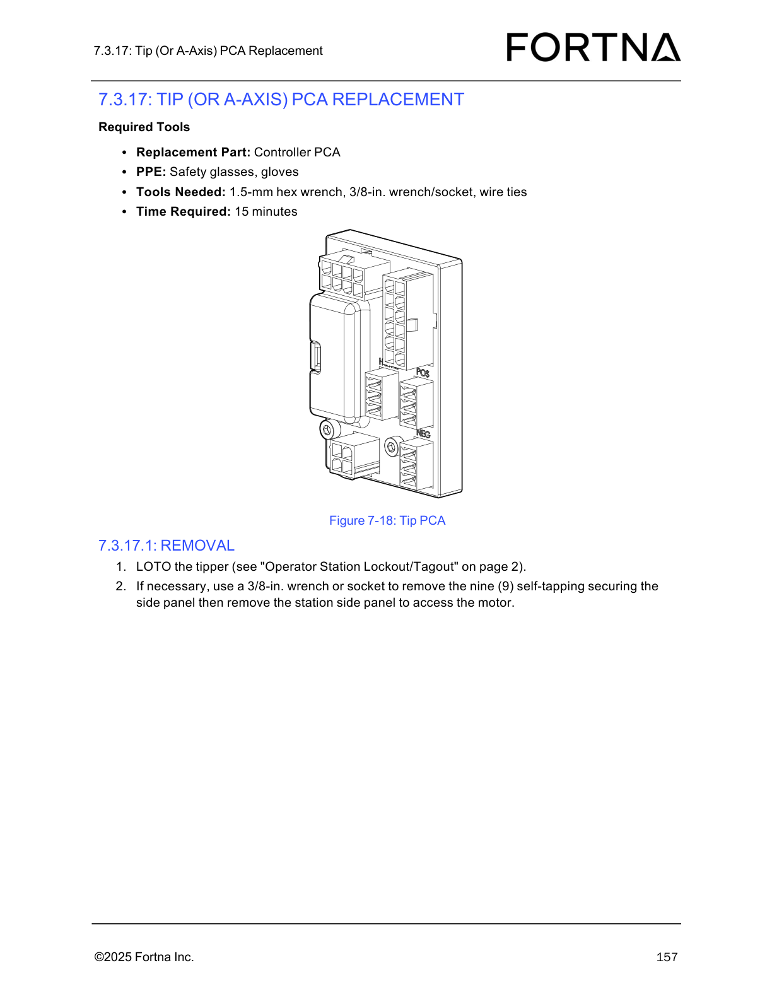
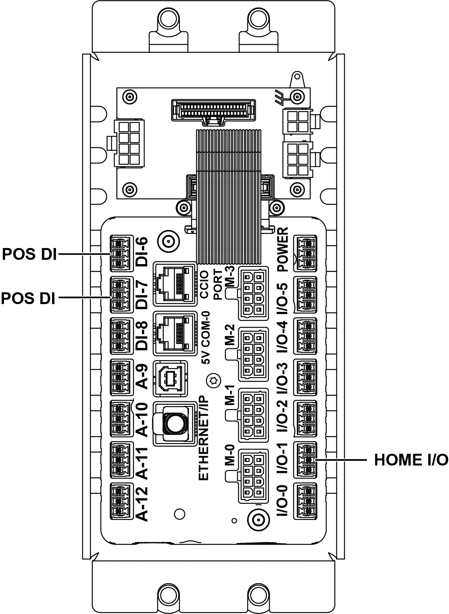
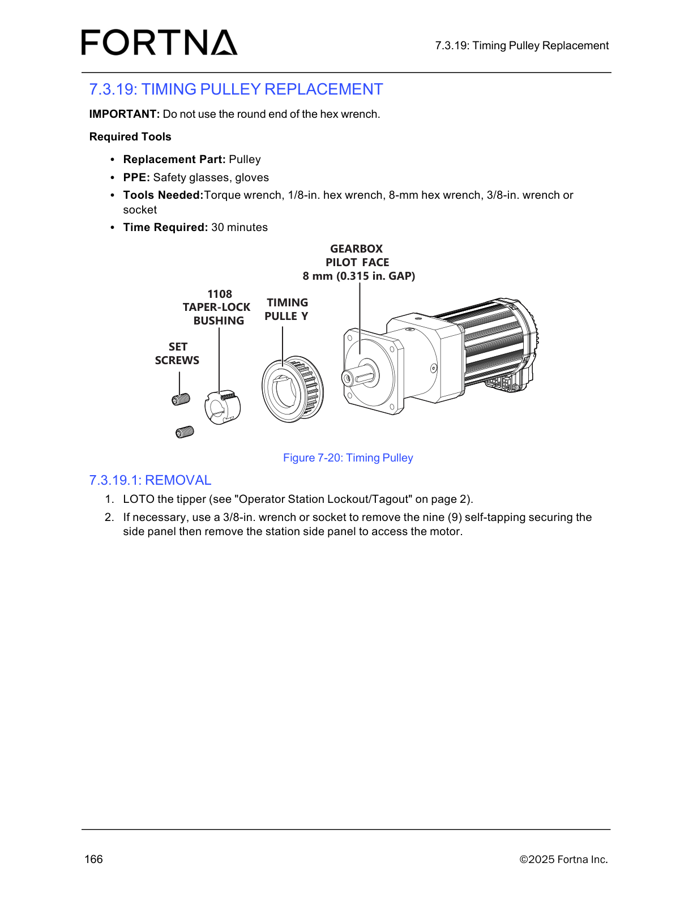
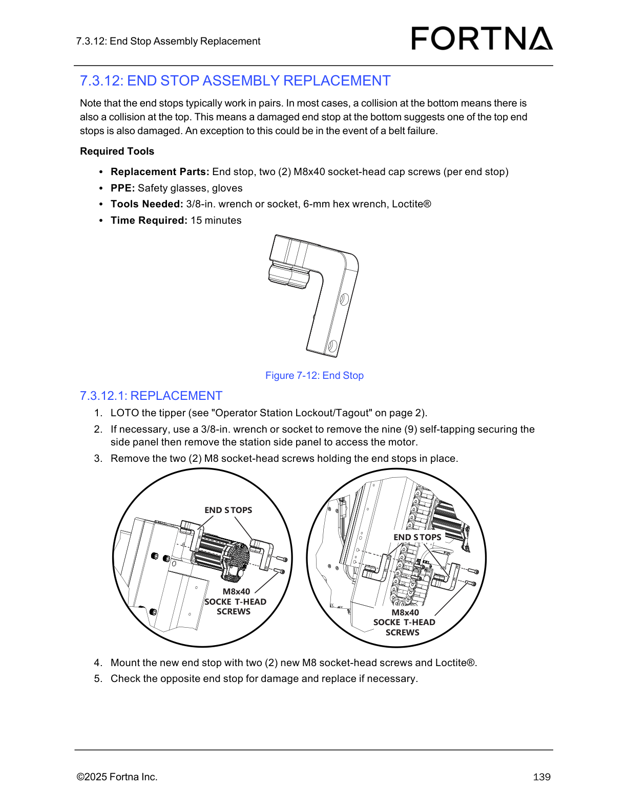
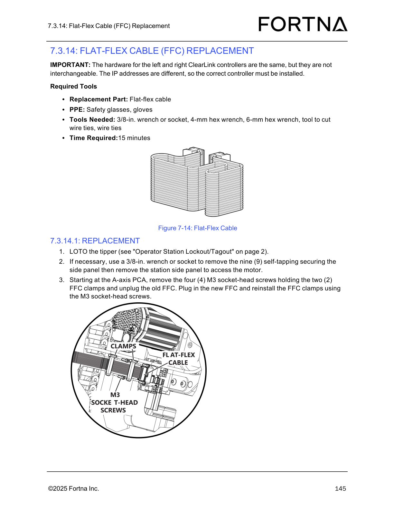
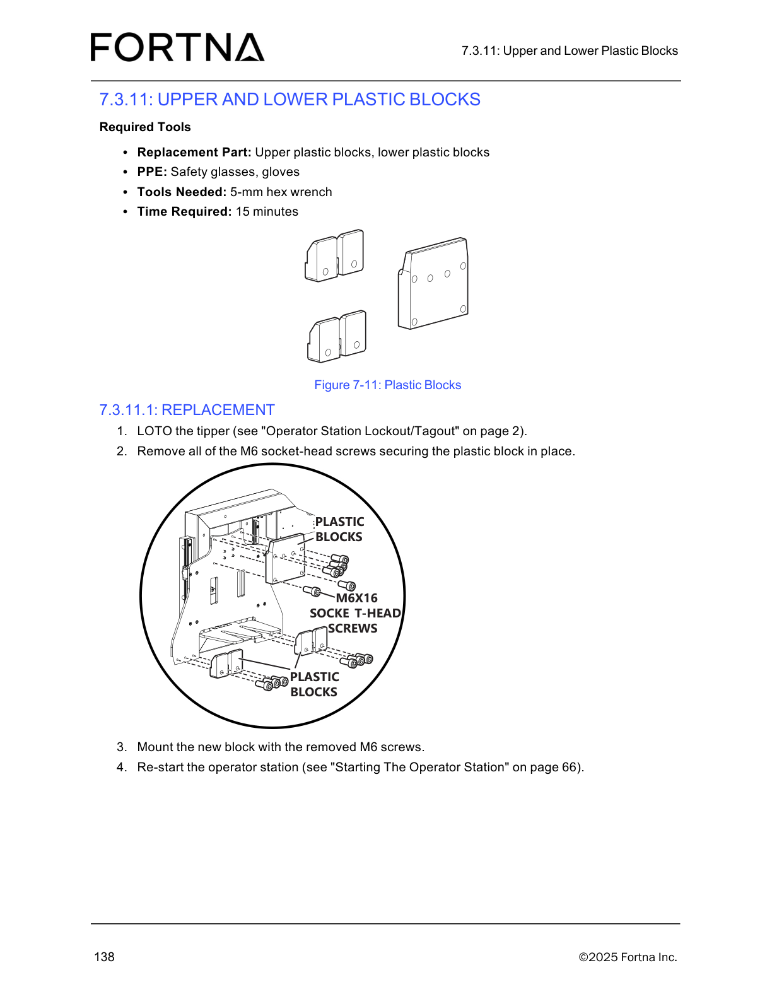

# Tipper Replacement - Installation (7.3.22.2)

## Runbook Header

| Field | Value |
| --- | --- |
| Procedure ID | `proc_tipper_replacement_installation_7_3_22_2_v1` |
| Title | Tipper Replacement - Installation (7.3.22.2) |
| Procedure Type | `recovery` |
| Primary Role | `operator` |
| Supporting Roles | None |
| Support Safe | Yes |
| Capability Tags | `tipper_station_fault` |
| Access Surface | `physical_floor`, `tipper_hmi` |
| Audience Roles | `operator` |
| Failure Pattern Tags | None |
| Validation Status | `needs_sme_review` |
| Merge Status | `source_finalized` |

## Summary

Install the new tipper onto the existing sub-plate, reconnect conduit/power/air/Ethernet to the column and control box, remount optional components if needed, reinstall side panels if necessary, and restart the operator station.

## When To Use

Use when a tipper has been removed and the area is prepared, and you need to install the replacement tipper and reconnect conduit/power/air/Ethernet so the operator station can be restarted.

## Safety And Operational Notes

* PPE required by the procedure: safety glasses and gloves.

## Access Or Tools Needed

* Replacement Part: Tipper
* PPE: Safety glasses, gloves
* Tools needed: not specified in this installation section

## Visual References

*Tip (A-Axis) PCA diagram referenced by the tipper replacement procedure (useful for identifying the tipper assembly components during installation/remounting).*

*Z-Axis CLINK connections diagram (wiring route reference for conduit/power/air/Ethernet reconnection context).*

*A-Axis PCA connections diagram (wiring route reference for PCA-related connections context).*

*Controller PCA diagram (controller box/PCA context for reconnection/remounting).*

*Timing pulley diagram (mechanical assembly context).*

*End stop assembly diagram (mechanical context).*

*Flat-flex cable (FFC) diagram (A-axis PCA cable context).*

*Upper and lower plastic blocks diagram (mechanical context).*

## Procedure Steps

### Step 1 — Install the new tipper onto the existing sub-plate

**Responsible role:** operator

**Instruction:**
Install the new tipper onto the existing sub-plate.

**Expected result:**
The new tipper is installed on the existing sub-plate.

---

### Step 2 — Reconnect conduit, power, air, and Ethernet to the column and control box

**Responsible role:** operator

**Instruction:**
Connect the conduit, power, air, and Ethernet to the column and control box.

**Expected result:**
Conduit/power/air/Ethernet are connected to the column and control box.

---

### Step 3 — Mount the gripper, if necessary

**Responsible role:** operator

**Instruction:**
Mount the gripper, if necessary (see "Gripper Replacement" on page 97).

**Expected result:**
If the gripper was removed or is not currently mounted, it is mounted.

---

### Step 4 — Reinstall top and/or bottom side panels, if necessary

**Responsible role:** operator

**Instruction:**
Reinstall the top and/or bottom side panels, if necessary.

**Expected result:**
Top and/or bottom side panels are reinstalled as needed.

---

### Step 5 — Re-start the operator station

**Responsible role:** operator

**Instruction:**
Re-start the operator station (see "Starting The Operator Station" on page 1).

**Expected result:**
The operator station is restarted.

**Stop or Escalate If:**

* If the operator station cannot be restarted after installation, stop and escalate per the manual’s operator station start guidance ("Starting The Operator Station" on page 1).

---

## Success Criteria

* New tipper is installed on the existing sub-plate.
* Conduit/power/air/Ethernet are connected to the column and control box.
* Any necessary gripper and side panels are reinstalled.
* Operator station is restarted.

## Failure Conditions

* Operator station cannot be restarted after installation.

## Escalation Guidance

* If the operator station cannot be restarted after installation, stop and escalate per the manual’s operator station start guidance ("Starting The Operator Station" on page 1).

## Missing Details / Known Gaps

* This installation section does not specify exact reconnection details (e.g., connector types/locations) beyond 'conduit, power, air, and Ethernet to the column and control box.'
* The procedure references 'Starting The Operator Station' on page 1, but the specific restart actions/observables are not included in the provided source section.

## Source Lineage

- Candidate IDs: optisweep_tipper_replacement_installation_7_3_22_2
- Source ID: `manual_optisweep_om_v3`
- Source Type: `manual`
