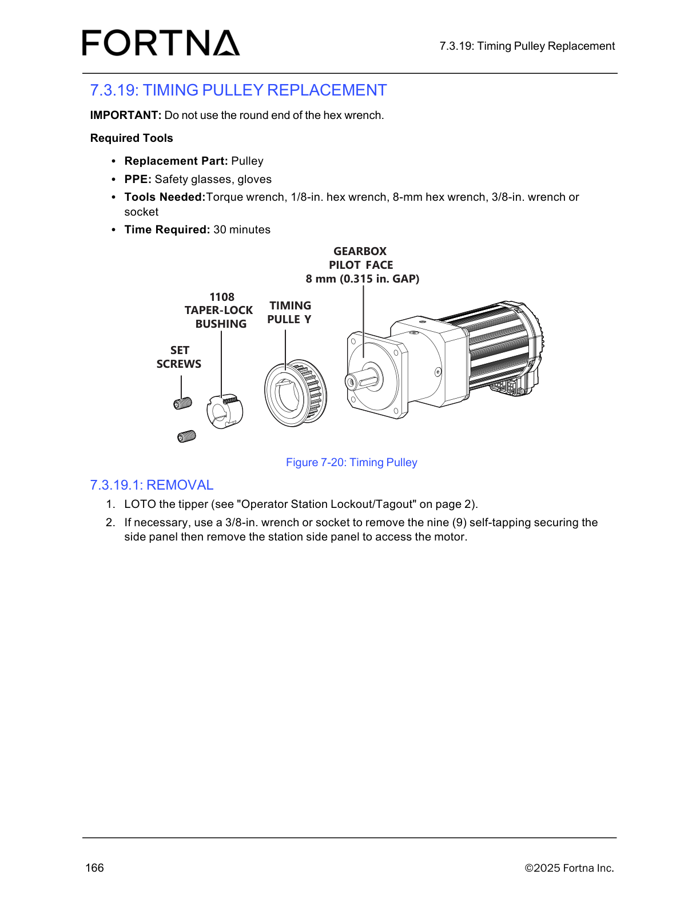

# 7.3.19.2 Installation: Timing Pulley replacement (taper lock bushing + pulley set screws)

## Runbook Header

| Field | Value |
| --- | --- |
| Procedure ID | `proc_7_3_19_2_installation_timing_pulley_replacement_taper_lock_bushing_v1` |
| Title | 7.3.19.2 Installation: Timing Pulley replacement (taper lock bushing + pulley set screws) |
| Procedure Type | `operation` |
| Primary Role | `operator` |
| Supporting Roles | None |
| Support Safe | Yes |
| Capability Tags | `tipper_station_fault` |
| Access Surface | `tipper_hmi` |
| Audience Roles | `operator` |
| Failure Pattern Tags | None |
| Validation Status | `needs_sme_review` |
| Merge Status | `source_finalized` |

## Summary

Loosely assemble the taper lock bushing into the timing pulley and align all three holes. Thread set screws into the two opposite holes (threads on the pulley half, smooth on the bushing half), then slip the assembly onto the shaft with keyway alignment (if present). Position the pulley 8 mm (0.315 in.) from the gearbox pilot face using a spacer and an 8-mm hex wrench. Tighten both opposite set screws in alternating small increments until the set screw torque reaches 5.6 Nm (49.5 in-lb). Reinstall top and/or bottom side panels if removed, then re-start the operator station.

## When To Use

Use this procedure to install the timing pulley using a taper lock bushing, align the keyway, set the pulley spacing from the gearbox pilot face to 8 mm (0.315 in.), and torque the pulley set screws to 5.6 Nm (49.5 in-lb).

## Safety And Operational Notes

* This installation procedure is part of the Timing Pulley Replacement section. The associated timing pulley replacement figure and removal steps specify LOTO the tipper and side panel removal for access (see related evidence in this packet).

## Access Or Tools Needed

* Taper lock bushing
* Timing pulley
* Set screws (two opposite holes)
* Spacer (between gearbox pilot face and pulley) to maintain 8 mm spacing
* 8-mm hex wrench
* Torque tool capable of 5.6 Nm (49.5 in-lb)
* Access to reinstall top and/or bottom side panels (if removed)
* Operator station restart capability

## Visual References

*Exploded view of the timing pulley assembly showing the 1108 taper-lock bushing, set screws, gearbox pilot face, and the critical 8 mm (0.315 in.) gap specification.*

## Procedure Steps

### Step 1 — Loosely assemble taper lock bushing into the pulley and align all three holes

**Responsible role:** operator

**Instruction:**
Loosely assemble the taper lock bushing into the pulley and align all three holes.

**Expected result:**
Taper lock bushing is seated in the pulley with all three holes aligned.

---

### Step 2 — Thread set screws into the two opposite holes with correct thread/smooth placement

**Responsible role:** operator

**Instruction:**
Thread set screws into the two holes that are opposite each other. Confirm they have threads on the pulley half and are smooth on the bushing half.

**Expected result:**
Two set screws are threaded into the opposite holes with correct thread/smooth placement across pulley vs bushing halves.

---

### Step 3 — Slip assembly onto shaft with keyway alignment (if present)

**Responsible role:** operator

**Instruction:**
Slip the assembly onto the shaft with the keyway slot aligned with the gearbox shaft key (if present).

**Expected result:**
Assembly is seated on the shaft with keyway slot aligned to the gearbox shaft key (if present).

---

### Step 4 — Set pulley position to 8 mm from gearbox pilot face using spacer

**Responsible role:** operator

**Instruction:**
Verify the final pulley position is 8 mm (0.315 in.) from the gearbox pilot face. Place a spacer between the gearbox pilot face and pulley to maintain the spacing. Use an 8-mm hex wrench for this task.

**Expected result:**
Pulley is positioned 8 mm (0.315 in.) from the gearbox pilot face using a spacer to maintain spacing.

**Stop or Escalate If:**

* If the pulley cannot be positioned to 8 mm (0.315 in.) from the gearbox pilot face using a spacer, stop and re-check alignment/spacing before proceeding to set-screw tightening.

---

### Step 5 — Tighten both opposite set screws in alternating increments to 5.6 Nm

**Responsible role:** operator

**Instruction:**
In small increments, tighten both set screws, alternating between them until the set screw torque reaches 5.6 Nm (49.5 in-lb).

**Expected result:**
Both opposite set screws are tightened to a torque of 5.6 Nm (49.5 in-lb) using alternating incremental tightening.

**Stop or Escalate If:**

* If set screw torque cannot be reached to 5.6 Nm (49.5 in-lb) after alternating incremental tightening, stop and re-check set screw seating and assembly alignment.

---

### Step 6 — Reinstall top and/or bottom side panels if necessary

**Responsible role:** operator

**Instruction:**
Reinstall the top and/or bottom side panels, if necessary.

**Expected result:**
Top and/or bottom side panels are reinstalled (as applicable).

---

### Step 7 — Re-start the operator station

**Responsible role:** operator

**Instruction:**
Re-start the operator station (see "Starting The Operator Station" on page 66).

**Expected result:**
Operator station is restarted after side panels are reinstalled.

---

## Success Criteria

* Timing pulley assembly is seated with keyway alignment (if present).
* Pulley is positioned 8 mm (0.315 in.) from the gearbox pilot face using a spacer.
* Both opposite set screws are tightened to 5.6 Nm (49.5 in-lb).
* Top and/or bottom side panels are reinstalled (if removed).
* Operator station is restarted.

## Failure Conditions

* Pulley cannot be positioned to 8 mm (0.315 in.) from the gearbox pilot face using a spacer.
* Set screw torque cannot be reached to 5.6 Nm (49.5 in-lb) after alternating incremental tightening.
* Keyway alignment is incorrect (if keyway/key is present).
* Side panels are not reinstalled when removed.
* Operator station does not restart successfully.

## Escalation Guidance

* If the pulley cannot be positioned to 8 mm (0.315 in.) from the gearbox pilot face using a spacer, stop and re-check alignment/spacing before proceeding to set-screw tightening.
* If set screw torque cannot be reached to 5.6 Nm (49.5 in-lb) after alternating incremental tightening, stop and re-check set screw seating and assembly alignment.

## Missing Details / Known Gaps

* The procedure references "Starting The Operator Station" on page 66, but the restart steps themselves are not included in the provided source section text for this candidate.

## Source Lineage

- Candidate IDs: timing_pulley_replacement_installation_taper_lock_bushing
- Source ID: `manual_optisweep_om_v3`
- Source Type: `manual`
