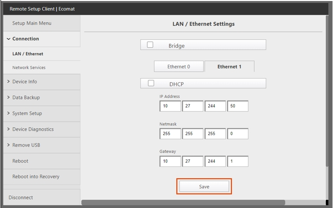
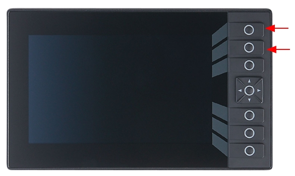

# Load tipper firmware via HMI USB dongle

## Runbook Header

| Field | Value |
| --- | --- |
| Procedure ID | `proc_load_tipper_firmware_via_hmi_usb_v1` |
| Title | Load tipper firmware via HMI USB dongle |
| Procedure Type | `recovery` |
| Primary Role | `operator` |
| Supporting Roles | None |
| Support Safe | Yes |
| Capability Tags | `tipper_station_fault` |
| Access Surface | `tipper_hmi`, `physical_floor` |
| Audience Roles | `operator` |
| Failure Pattern Tags | None |
| Validation Status | `needs_sme_review` |
| Merge Status | `source_finalized` |

## Summary

Update the tipper controller firmware using a USB drive and then reboot the controller to boot normally and reach the expected HMI screens (Visu_Default, then Visu_MCP_Dual).

## When To Use

Use when you need to load new firmware onto the tipper controller via the HMI USB dongle and then reboot so the HMI returns to the normal commissioning/operator screens.

## Access Or Tools Needed

* Tipper disconnect to turn off power
* HMI with top three buttons
* USB drive containing the new version of firmware
* USB dongle on the HMI
* INSTALL FROM FILE button on the HMI
* HMI function key F3

## Visual References

*Photograph of the Tipper Machine Control Panel ("Visu_MCP_Dual" screen) showing the primary operator interface buttons (AUTO, JOG, REF, CYCLE START, CYCLE STOP).*

*HMI screenshot showing the "Visu_Default" screen displaying IP and subnet mask settings after controller reboot.*

*HMI screenshot showing the gray screen appearance during the step where you hold the top buttons while powering on.*

## Procedure Steps

### Step 1 — Turn off power to the tipper using the disconnect

**Responsible role:** operator

**Instruction:**
Turn off power to the tipper with the disconnect.

**Expected result:**
Tipper controller power is off (HMI is not in normal operation).

---

### Step 2 — Enter firmware-load mode by holding the top three HMI buttons during power-on

**Responsible role:** operator

**Instruction:**
Press and hold the top three buttons on the HMI, then continue holding them while powering on the tipper.

**Expected result:**
A gray screen appears on the HMI while the top three buttons are still held.

**Stop or Escalate If:**

* If the gray screen does not appear while holding the top three HMI buttons during power-on, repeat the button-hold/power-on sequence as described.

---

### Step 3 — Plug USB drive into the HMI USB dongle

**Responsible role:** operator

**Instruction:**
Plug the USB drive containing the new version of firmware into the USB dongle on the HMI.

**Expected result:**
USB drive is physically connected to the HMI USB dongle while the gray screen mode is active.

---

### Step 4 — Start firmware installation from file

**Responsible role:** operator

**Instruction:**
Press the INSTALL FROM FILE button, then load the firmware from the USB.

**Expected result:**
Firmware installation process begins and completes loading from the USB.

---

### Step 5 — Power-cycle controller and allow normal boot without pressing buttons

**Responsible role:** operator

**Instruction:**
Power the controller off and back on. Allow the controller to boot normally: do not press any buttons.

**Expected result:**
Controller reboots normally without any button presses during boot.

**Stop or Escalate If:**

* If the controller does not boot normally after power off/on (or if buttons are pressed during boot), repeat the power off/on step and ensure no buttons are pressed during boot.

---

### Step 6 — Verify Visu_Default screen appears with IP and subnet mask settings

**Responsible role:** operator

**Instruction:**
Verify the "Visu_Default" screen appears on the HMI displaying the IP and subnet mask settings.

**Expected result:**
HMI shows the "Visu_Default" screen with IP and subnet mask settings.

---

### Step 7 — Navigate to Visu_MCP_Dual using F3

**Responsible role:** operator

**Instruction:**
Press F3 to go to the "Visu_MCP_Dual" screen.

**Expected result:**
The HMI displays the "Visu_MCP_Dual" screen.

---

## Success Criteria

* After firmware load and controller reboot, the HMI displays the "Visu_Default" screen showing IP and subnet mask settings.
* Pressing F3 brings up the "Visu_MCP_Dual" screen.

## Failure Conditions

* Gray screen does not appear while holding the top three HMI buttons during power-on.
* Controller does not boot normally after power off/on, or buttons are pressed during boot.
* Visu_Default screen does not appear or does not show IP and subnet mask settings.
* F3 does not navigate to the "Visu_MCP_Dual" screen.

## Escalation Guidance

* If the gray screen does not appear, repeat the button-hold/power-on sequence as described.
* If the controller does not boot normally after power off/on (or if buttons are pressed during boot), repeat the power off/on step and ensure no buttons are pressed during boot.

## Source Lineage

- Candidate IDs: tipper_load_firmware_via_hmi_usb
- Source ID: `manual_optisweep_om_v3`
- Source Type: `manual`
