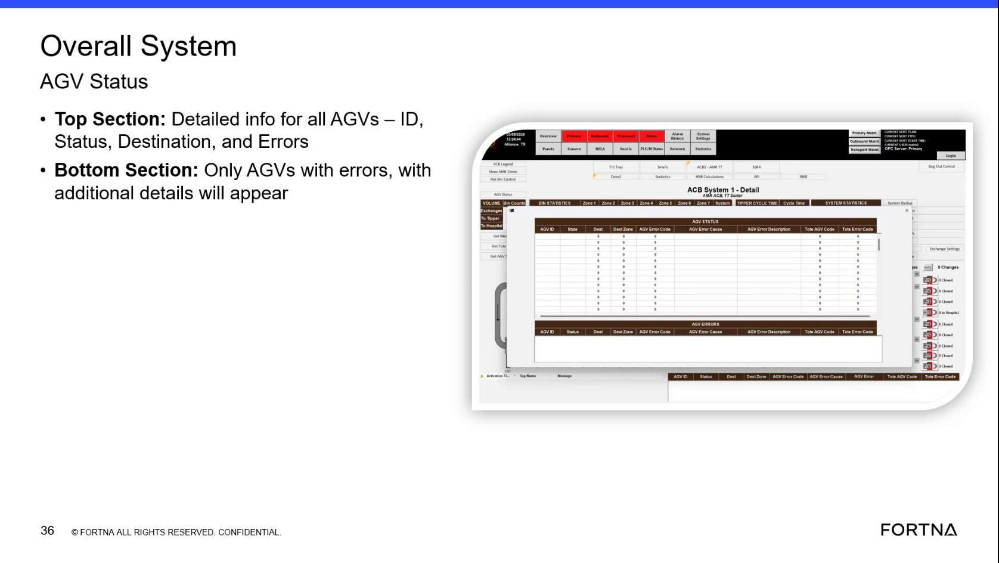

# Check Overall System AGV Status popup for AGVs with destination errors

## Runbook Header

| Field | Value |
| --- | --- |
| Procedure ID | `proc_check_overall_system_agv_status_popup_agv_destination_errors_v1` |
| Title | Check Overall System AGV Status popup for AGVs with destination errors |
| Procedure Type | `diagnostic` |
| Primary Role | `L1_support` |
| Supporting Roles | None |
| Support Safe | Yes |
| Capability Tags | `agv_active_errors` |
| Access Surface | `rms_ui` |
| Audience Roles | `L1_support` |
| Failure Pattern Tags | None |
| Validation Status | `needs_sme_review` |
| Merge Status | `source_finalized` |

## Summary

Use the live RMS / fleet status UI popup titled “Overall System AGV Status” to identify which AGVs currently have errors and review their Destination and Errors details. The popup shows a top section for all AGVs and a bottom section filtered to only AGVs with errors.

## When To Use

When you need to quickly determine which AGVs have active errors related to destination/error conditions and view their Destination and Errors details in the RMS fleet status UI.

## Access Or Tools Needed

* RMS / fleet status UI (rms_ui)

## Related Operational Context

* ctx_training_video_agv_status_popup_overview_v1
* ctx_training_video_agv_status_fields_v1
* ctx_training_video_agv_error_detail_section_v1

## Visual References

*Frame showing the “Overall System AGV Status” popup with top section (all AGVs: ID, Status, Destination, Errors) and bottom section (only AGVs with errors with additional detail).*

## Procedure Steps

### Step 1 — Open the RMS “Overall System AGV Status” popup

**Responsible role:** L1_support

**Instruction:**
In the RMS / fleet status UI (rms_ui), navigate to the popup/screen titled “Overall System AGV Status”.

**Expected result:**
The “Overall System AGV Status” popup is displayed.

---

### Step 2 — Confirm top section fields for all AGVs (ID, Status, Destination, Errors)

**Responsible role:** L1_support

**Instruction:**
In the “Overall System AGV Status” popup, check the top section table/list to confirm it includes fields/columns for ID, Status, Destination, and Errors.

**Expected result:**
The top section displays the fields/columns “ID”, “Status”, “Destination”, and “Errors”.

**Stop or Escalate If:**

* Escalate if the popup fails to display the expected fields (ID/Status/Destination/Errors).

---

### Step 3 — Confirm bottom section is filtered to AGVs with errors

**Responsible role:** L1_support

**Instruction:**
In the “Overall System AGV Status” popup, check the bottom section to confirm it lists only AGVs with errors and includes additional error/destination detail for those AGVs.

**Expected result:**
The bottom section lists only AGVs with errors (error cases) and shows additional detail for those error AGVs.

**Stop or Escalate If:**

* Escalate if the bottom section is empty while the top section indicates any AGV has a non-empty Errors value.
* Escalate if the bottom section does not behave as described (should show only AGVs with errors).

---

### Step 4 — Record AGV IDs and their Destination/Errors from the error-only bottom section

**Responsible role:** L1_support

**Instruction:**
For each AGV listed in the bottom (error-only) section, record/verify the AGV ID and the associated Destination and Errors details displayed in the popup.

**Expected result:**
You have a list of AGV IDs from the bottom section along with their displayed Destination and Errors values.

---

### Step 5 — Escalate if popup fields are missing or error-only list behavior is inconsistent

**Responsible role:** L1_support

**Instruction:**
If the popup does not show the expected “Overall System AGV Status” title/fields (ID, Status, Destination, Errors) or if the bottom section does not correctly show only AGVs with errors, stop and escalate.

**Expected result:**
Escalation is initiated when UI evidence is inconsistent with expected fields or filtering behavior.

**Stop or Escalate If:**

* Escalate if the popup does not show the expected “Overall System AGV Status” title/fields (ID, Status, Destination, Errors).
* Escalate if the bottom section does not behave as described (should show only AGVs with errors).

---

## Success Criteria

* The “Overall System AGV Status” popup displays the expected fields: ID, Status, Destination, Errors in the top section.
* The bottom section lists only AGVs with errors and shows additional detail for those error AGVs.
* For each AGV in the bottom (error-only) section, the AGV ID and its Destination and Errors values are captured.

## Failure Conditions

* Popup fails to display expected fields (ID/Status/Destination/Errors).
* Bottom section is empty while the top section indicates any AGV has a non-empty Errors value.
* Bottom section does not behave as an error-only list.

## Escalation Guidance

* Escalate when the popup UI does not match expected title/fields or when the bottom section filtering behavior is inconsistent with the top section Errors values.

## Missing Details / Known Gaps

* The packet does not provide an explicit click-path/navigation sequence within RMS to reach the “Overall System AGV Status” popup; it only states that the operator should navigate to that popup/screen.

## Source Lineage

- Candidate IDs: candidate_training_video_agv_status_popup_check_errors
- Source ID: `training_video_day1`
- Source Type: `training_video`
