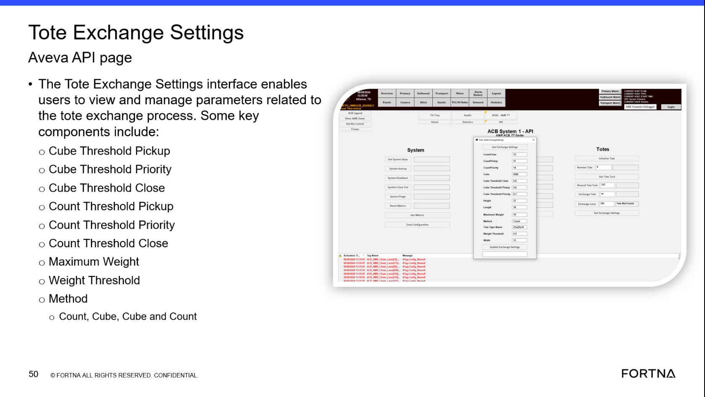

# Verify Tote Exchange Settings Thresholds and Method on AVEVA HMI

## Runbook Header

| Field | Value |
| --- | --- |
| Procedure ID | `proc_verify_tote_exchange_settings_thresholds_and_method_on_aveva_hmi_v1` |
| Title | Verify Tote Exchange Settings Thresholds and Method on AVEVA HMI |
| Procedure Type | `diagnostic` |
| Primary Role | `operator` |
| Supporting Roles | None |
| Support Safe | Yes |
| Capability Tags | `tote_exchange_sequence` |
| Access Surface | `aveva_hmi` |
| Audience Roles | `operator` |
| Failure Pattern Tags | None |
| Validation Status | `needs_sme_review` |
| Merge Status | `source_finalized` |

## Summary

On the AVEVA HMI Tote Exchange Settings page, verify the configured cube/count thresholds for Pickup, Priority, and Close, plus weight-related parameters (Maximum Weight, Weight Threshold) and the selected Method (Count, Cube, Cube and Count) so tote exchange behavior uses the correct evaluation logic.

## When To Use

Use when you need to confirm the active tote exchange configuration on the AVEVA HMI Tote Exchange Settings page—specifically the queue/pickup/priority/close thresholds for both Cube and Count, the weight-related parameters (Maximum Weight, Weight Threshold), and the selected evaluation Method (Count/Cube/Cube and Count).

## Access Or Tools Needed

* AVEVA HMI (site/customer access) with access to the Tote Exchange Settings page

## Related Operational Context

* ctx_training_video_tote_exchange_settings_interface_v1
* ctx_training_video_tote_exchange_threshold_categories_v1
* ctx_training_video_tote_exchange_method_options_v1
* ctx_training_video_tote_exchange_weight_parameters_v1

## Visual References

*Tote Exchange Settings Aveva API page showing Cube Threshold Pickup/Priority/Close, Count Threshold Pickup/Priority/Close, Maximum Weight, Weight Threshold, and Method (Count/Cube/Cube and Count).*

## Procedure Steps

### Step 1 — Open the AVEVA HMI Tote Exchange Settings page

**Responsible role:** operator

**Instruction:**
Using the AVEVA HMI interface, open the Tote Exchange Settings screen (Tote Exchange Settings interface).

**Expected result:**
The AVEVA HMI Tote Exchange Settings page is displayed with fields for Cube Threshold Pickup/Priority/Close, Count Threshold Pickup/Priority/Close, Maximum Weight, Weight Threshold, and a Method field.

---

### Step 2 — Verify Cube thresholds for Pickup, Priority, and Close

**Responsible role:** operator

**Instruction:**
On the AVEVA HMI Tote Exchange Settings page, locate and review the Cube threshold fields: Cube Threshold Pickup, Cube Threshold Priority, and Cube Threshold Close.

**Expected result:**
Cube Threshold Pickup, Cube Threshold Priority, and Cube Threshold Close are populated with valid values (not blank/invalid).

**Stop or Escalate If:**

* Escalate if any required threshold fields are blank/invalid.

---

### Step 3 — Verify Count thresholds for Pickup, Priority, and Close

**Responsible role:** operator

**Instruction:**
On the AVEVA HMI Tote Exchange Settings page, locate and review the Count threshold fields: Count Threshold Pickup, Count Threshold Priority, and Count Threshold Close.

**Expected result:**
Count Threshold Pickup, Count Threshold Priority, and Count Threshold Close are populated with valid values (not blank/invalid).

**Stop or Escalate If:**

* Escalate if any required threshold fields are blank/invalid.

---

### Step 4 — Verify weight-related parameters (Maximum Weight and Weight Threshold)

**Responsible role:** operator

**Instruction:**
On the AVEVA HMI Tote Exchange Settings page, locate and review the weight-related fields: Maximum Weight and Weight Threshold.

**Expected result:**
Maximum Weight and Weight Threshold are populated with valid values (not blank/invalid).

**Stop or Escalate If:**

* Escalate if any required threshold/weight fields are blank/invalid.

---

### Step 5 — Verify the Tote Exchange Settings Method selection

**Responsible role:** operator

**Instruction:**
On the AVEVA HMI Tote Exchange Settings page, locate the Method field and confirm it is set to one of the available options: Count, Cube, or Cube and Count.

**Expected result:**
Method is set to Count, Cube, or Cube and Count (not blank/undefined).

**Stop or Escalate If:**

* Escalate if the Method is not one of the expected options (Count/Cube/Cube and Count) or if any required threshold fields are blank/invalid.

---

### Step 6 — Confirm configured values match expected tote exchange configuration

**Responsible role:** operator

**Instruction:**
Compare the displayed Cube Threshold Pickup/Priority/Close, Count Threshold Pickup/Priority/Close, Maximum Weight/Weight Threshold, and Method selection against the expected tote exchange configuration for the active project/UAT-finalized settings. If values are consistent, stop; otherwise escalate for configuration correction.

**Expected result:**
All displayed threshold/weight fields and the Method selection match the expected configuration for the active project/UAT-finalized settings.

**Stop or Escalate If:**

* Escalate if the configured thresholds/weight parameters do not align with the expected tote exchange configuration for the active project/UAT-finalized settings.

---

## Success Criteria

* Cube Threshold Pickup/Priority/Close are populated with valid values.
* Count Threshold Pickup/Priority/Close are populated with valid values.
* Maximum Weight and Weight Threshold are populated with valid values.
* Method is set to Count, Cube, or Cube and Count.

## Failure Conditions

* Method is blank/undefined or not one of Count/Cube/Cube and Count.
* Any required threshold/weight field is blank/invalid.
* Displayed thresholds/weight parameters do not match the expected tote exchange configuration for the active project/UAT-finalized settings.

## Escalation Guidance

* Escalate for configuration correction if Method is not Count/Cube/Cube and Count, if any required threshold/weight fields are blank/invalid, or if the configured values do not align with the expected tote exchange configuration for the active project/UAT-finalized settings.

## Missing Details / Known Gaps

* No explicit navigation/menu clicks are provided in the packet to reach the Tote Exchange Settings page from the AVEVA HMI home screen.

## Source Lineage

- Candidate IDs: candidate_training_video_aveva_hmi_tote_exchange_settings_verify_thresholds
- Source ID: `training_video_day1`
- Source Type: `training_video`
