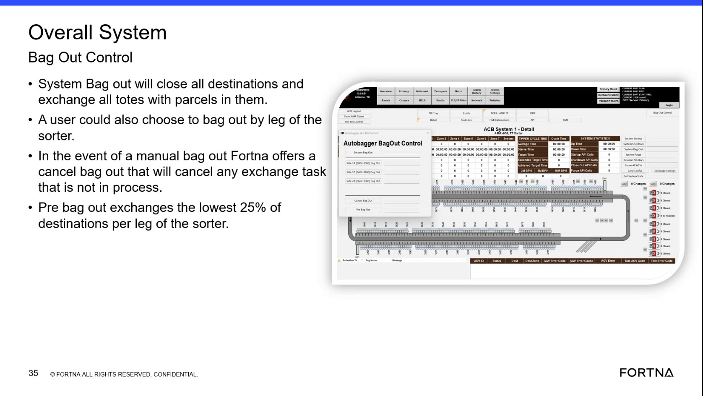

# Cancel Manual Bag Out (cancel exchange tasks not in process)

## Runbook Header

| Field | Value |
| --- | --- |
| Procedure ID | `proc_cancel_manual_bag_out_cancel_exchange_not_in_process_v1` |
| Title | Cancel Manual Bag Out (cancel exchange tasks not in process) |
| Procedure Type | `recovery` |
| Primary Role | `operator` |
| Supporting Roles | None |
| Support Safe | Yes |
| Capability Tags | `bag_out_or_closeout_state` |
| Access Surface | `aveva_hmi` |
| Audience Roles | `operator` |
| Failure Pattern Tags | None |
| Validation Status | `needs_sme_review` |
| Merge Status | `source_finalized` |

## Summary

When a manual bag out is initiated, cancel the bag out for exchange tasks that are not already in process, while ensuring any exchange already in process still completes.

## When To Use

Use when a manual bag out has been initiated and you need to cancel the bag out effect for exchange tasks that are not already in process, while allowing in-process exchanges to finish.

## Access Or Tools Needed

* AVEVA HMI / Overall System bag out view (bag out controls including “cancel bag out”)

## Related Operational Context

* ctx_training_video_cancel_bag_out_reference_v1

## Visual References

*Frame showing the Overall System Bag Out Control and the rule: cancel bag out cancels exchange tasks/chests that are not in process; in-exchange items must still finish.*

## Procedure Steps

### Step 1 — Open the AVEVA HMI Overall System bag out view

**Responsible role:** operator

**Instruction:**
On the AVEVA HMI (Overall System view), navigate to the bag out controls area where the “cancel bag out” option is available.

**Expected result:**
The AVEVA HMI bag out controls are visible, including the “cancel bag out” option.

---

### Step 2 — Confirm the bag out is manual (not system bag out)

**Responsible role:** operator

**Instruction:**
In the AVEVA HMI bag out controls, confirm the current bag out action is a manual bag out (not a system bag out).

**Expected result:**
You can identify that the active bag out is manual, so “cancel bag out” applies to exchange tasks not in process.

**Stop or Escalate If:**

* If you cannot clearly identify which exchanges are “in process,” stop and escalate for support to avoid incorrect conclusions.

---

### Step 3 — Select “cancel bag out”

**Responsible role:** operator

**Instruction:**
On the AVEVA HMI bag out controls, click/select “cancel bag out”.

**Expected result:**
The “cancel bag out” action is executed from the AVEVA HMI controls.

**Stop or Escalate If:**

* Escalate if cancel bag out fails to cancel exchanges that are not in process.

---

### Step 4 — Verify cancellation scope: exchanges not in process are canceled

**Responsible role:** operator

**Instruction:**
After clicking “cancel bag out,” verify that exchange tasks/chests that are NOT in process are canceled in the AVEVA HMI bag out/exchange status area.

**Expected result:**
Exchange tasks/chests that were not in process are canceled.

**Stop or Escalate If:**

* Escalate if cancel bag out fails to cancel exchanges that are not in process.

---

### Step 5 — Verify in-process exchanges still complete

**Responsible role:** operator

**Instruction:**
After clicking “cancel bag out,” verify that any exchange task that is already in process continues and completes.

**Expected result:**
Exchange tasks already in process continue and reach completion after cancel bag out.

**Stop or Escalate If:**

* Escalate if cancel bag out cancels exchanges that are already in process.

---

## Success Criteria

* After “cancel bag out,” exchange tasks/chests that were not in process are canceled.
* Any exchange task already in process continues and completes.

## Failure Conditions

* Cancel bag out cancels exchange tasks/chests that were already in process.
* Cancel bag out fails to cancel exchange tasks/chests that were not in process.
* Operator cannot clearly identify which exchanges are “in process.”

## Escalation Guidance

* Escalate if cancel bag out cancels exchanges that are already in process, or if it fails to cancel exchanges that are not in process.
* If you cannot clearly identify which exchanges are “in process,” stop and escalate for support to avoid incorrect conclusions.

## Missing Details / Known Gaps

* This packet does not include live AVEVA HMI UI evidence for the exact “manual bag out vs system bag out” indicator/control label, nor the exact exchange status field values/labels used to distinguish “in process” vs “not in process.”
* This packet does not show the specific AVEVA HMI exchange status screen/columns that would let an operator verify cancellation scope and in-process completion visually.

## Source Lineage

- Candidate IDs: candidate_training_video_bag_out_cancel_bag_out_not_in_process
- Source ID: `training_video_day1`
- Source Type: `training_video`
