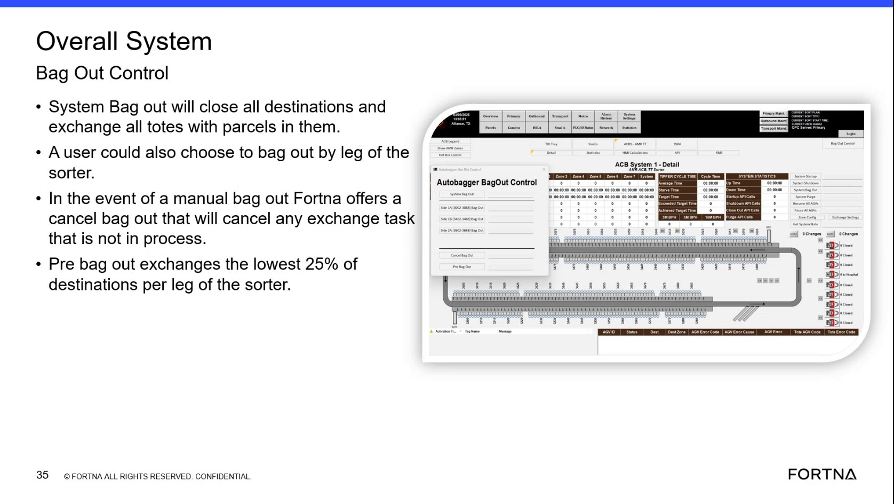
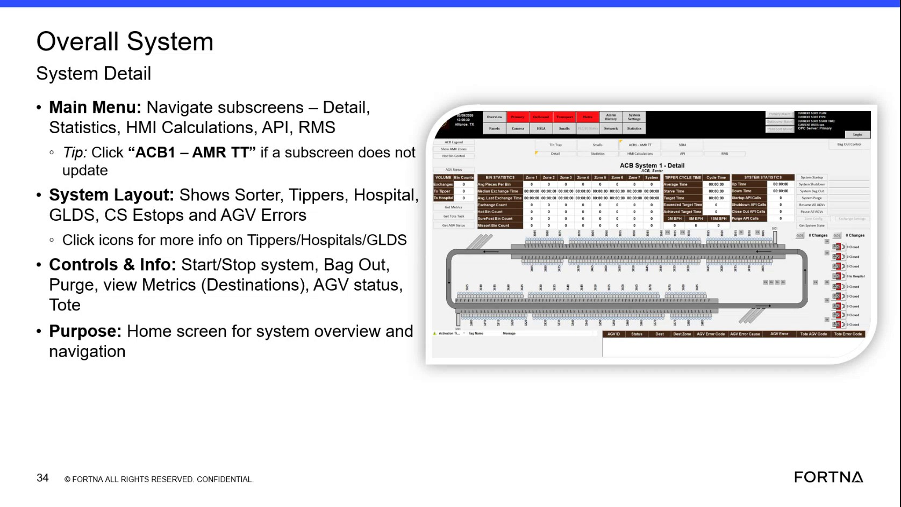

# Use AVEVA Overall System Bag Out Control to perform System Bag Out / Pre Bag Out / Bag Out by Sorter Leg

## Runbook Header

| Field | Value |
| --- | --- |
| Procedure ID | `proc_aveva_overall_system_bag_out_control_v1` |
| Title | Use AVEVA Overall System Bag Out Control to perform System Bag Out / Pre Bag Out / Bag Out by Sorter Leg |
| Procedure Type | `operation` |
| Primary Role | `operator` |
| Supporting Roles | None |
| Support Safe | Yes |
| Capability Tags | `bag_out_or_closeout_state` |
| Access Surface | `aveva_hmi` |
| Audience Roles | `operator` |
| Failure Pattern Tags | None |
| Validation Status | `needs_sme_review` |
| Merge Status | `source_finalized` |

## Summary

Use the AVEVA HMI “Overall System Bag Out Control” to run bag-out actions with the documented scope behavior: “System Bag Out” closes all destinations and exchanges all totes with parcels; “Bag out by leg of the sorter” limits the exchange to a selected sorter leg; “Pre bag out” exchanges the lowest 25% of destinations per sorter leg.

## When To Use

When you need to execute the documented overall bag-out actions (System Bag Out, Bag out by leg of the sorter, or Pre bag out) and verify that the resulting scope matches the selected mode (destinations closed and tote exchanges).

## Access Or Tools Needed

* AVEVA HMI (Overall System / bag-out related controls)

## Related Operational Context

* ctx_training_video_overall_system_bag_out_control_v1

## Visual References

*Frame showing “Overall System Bag Out Control” scope definitions for System Bag Out, bag out by leg of the sorter, and Pre bag out (lowest 25% per leg).*

*Additional frame containing the same “Overall System Bag Out Control” scope definitions (System Bag Out, bag out by leg, Pre bag out).*

*Frame indicating the AVEVA Overall System main overview area includes a “bag out” control in the right-hand side controls list.*

## Procedure Steps

### Step 1 — Open the AVEVA HMI “Overall System Bag Out Control” view

**Responsible role:** operator

**Instruction:**
On the AVEVA HMI (Overall System), navigate to the “Overall System Bag Out Control” screen/view that provides bag-out options.

**Expected result:**
The AVEVA “Overall System Bag Out Control” view is open and shows bag-out options including “System Bag Out” and the option to bag out by leg of the sorter; the view also supports “Pre bag out.”

---

### Step 2 — Select the desired bag-out mode (System Bag Out vs Bag out by leg of the sorter)

**Responsible role:** operator

**Instruction:**
In the AVEVA “Overall System Bag Out Control” view, select either “System Bag Out” (overall) or “Bag out by leg of the sorter” (leg-specific).

**Expected result:**
The selected mode is set so that the bag-out scope will follow the documented behavior for that mode.

---

### Step 3 — If needed, enable “Pre bag out” and set its scope to the lowest 25% per sorter leg

**Responsible role:** operator

**Instruction:**
If you are performing “Pre bag out,” set/choose the “Pre bag out” option so it exchanges the lowest 25% of destinations per leg of the sorter.

**Expected result:**
The “Pre bag out” option is selected such that the exchange scope will be limited to the lowest 25% of destinations per sorter leg.

---

### Step 4 — Initiate bag-out and verify the resulting scope matches the selected mode

**Responsible role:** operator

**Instruction:**
Initiate the bag-out action from the AVEVA “Overall System Bag Out Control” view, then observe that the bag-out scope matches the selected mode.

**Expected result:**
Observed scope matches the selected mode: (1) System Bag Out closes all destinations and exchanges all totes with parcels in them; (2) Bag out by leg applies to the chosen sorter leg; (3) Pre bag out exchanges the lowest 25% of destinations per leg.

**Stop or Escalate If:**

* Stop the procedure if the observed scope does not match the selected mode (e.g., destinations are not closed for System Bag Out, or tote exchange scope does not align with “all totes with parcels” / “lowest 25% per leg”).

---

## Success Criteria

* System Bag Out results in closing all destinations and exchanging all totes with parcels in them.
* Bag out by leg of the sorter limits the exchange to the chosen sorter leg.
* Pre bag out exchanges the lowest 25% of destinations per sorter leg.

## Failure Conditions

* System Bag Out does not close all destinations.
* Tote exchange scope does not match the selected mode (not all totes with parcels for System Bag Out; not the chosen leg for bag out by leg; not the lowest 25% per leg for Pre bag out).

## Escalation Guidance

* Escalate to FORTNA support if the bag-out scope on the live HMI does not match the documented behavior for the selected mode.

## Missing Details / Known Gaps

* The packet does not provide explicit, evidence-backed AVEVA UI control names/fields (e.g., the exact button/checkbox labels and how to choose a specific sorter leg) beyond the conceptual mode names shown in training frames.
* The packet does not provide an evidence-backed method for observing the live bag-out scope (e.g., the exact AVEVA status/summary fields that show “destinations closed” and “tote exchange scope”).

## Source Lineage

- Candidate IDs: candidate_training_video_bag_out_control_overall_system
- Source ID: `training_video_day1`
- Source Type: `training_video`
