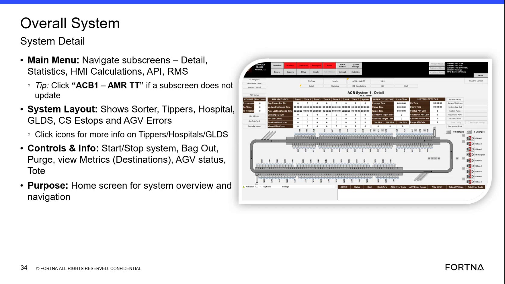
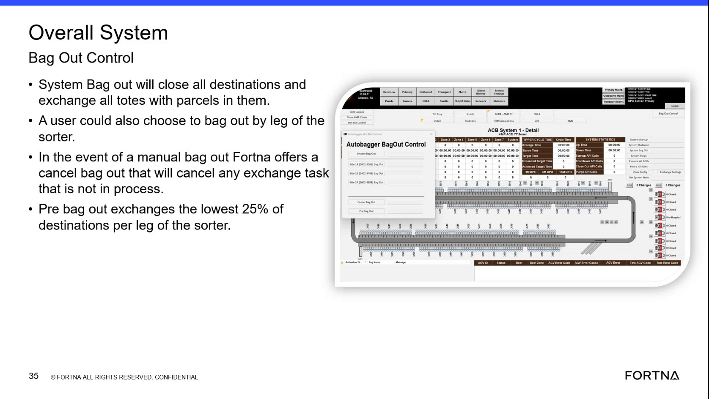

# Verify System Bag Out Behavior (close destinations + exchange totes with parcels)

## Runbook Header

| Field | Value |
| --- | --- |
| Procedure ID | `proc_verify_system_bag_out_behavior_close_destinations_exchange_totes_v1` |
| Title | Verify System Bag Out Behavior (close destinations + exchange totes with parcels) |
| Procedure Type | `diagnostic` |
| Primary Role | `operator` |
| Supporting Roles | None |
| Support Safe | Yes |
| Capability Tags | `bag_out_or_closeout_state` |
| Access Surface | `aveva_hmi` |
| Audience Roles | `operator` |
| Failure Pattern Tags | None |
| Validation Status | `needs_sme_review` |
| Merge Status | `source_finalized` |

## Summary

Verify that a system bag out action closes all destinations and exchanges totes/chutes that contain parcels, and that the bag out scope matches the documented behavior (system-wide vs bag out by leg of the sorter).

## When To Use

Use to live-verify that the system bag out behavior closes destinations and exchanges parcel-containing totes/chutes, and to confirm whether the operator-selected bag out scope is system-wide or by leg of the sorter.

## Do Not Use For

* Do not use this procedure as a generic response to any site stoppage without bag-out evidence; it is specifically for validating bag out behavior (destination closure + parcel-containing tote/chute exchange).

## Access Or Tools Needed

* AVEVA HMI / Overall System bag out view

## Related Operational Context

* ctx_training_video_system_bag_out_overview_v1

## Visual References

*Overall System System Detail main overview screen showing navigation and the presence of a Bag Out control area.*

*Overall System Bag Out Control screen/figure describing system bag out behavior (close all destinations; exchange totes with parcels) and the option to bag out by leg of the sorter.*

## Procedure Steps

### Step 1 — Open the AVEVA HMI overall system view that contains the bag out controls

**Responsible role:** operator

**Instruction:**
On the AVEVA HMI, navigate to the Overall System System Detail / overall system overview area that includes the Bag Out control.

**Expected result:**
The AVEVA HMI overall system view is open and shows the Bag Out control area (bag out is available from the overall system overview).

---

### Step 2 — Initiate/observe the system bag out action (overall system bag out)

**Responsible role:** operator

**Instruction:**
From the AVEVA HMI bag out control area on the overall system view, initiate the system bag out action and observe the resulting behavior.

**Expected result:**
After initiating system bag out, the system performs the documented behavior: destinations close and totes/chutes with parcels are exchanged.

---

### Step 3 — Observe destination status after bag out (destinations should be closed)

**Responsible role:** operator

**Instruction:**
On the AVEVA HMI overall system view, observe the destinations status after the system bag out action completes.

**Expected result:**
All destinations are closed as part of the system bag out behavior.

**Stop or Escalate If:**

* If destinations do not close, escalate.

---

### Step 4 — Observe tote/chute exchange behavior for parcel-containing items

**Responsible role:** operator

**Instruction:**
On the AVEVA HMI overall system view, observe tote/chute exchange behavior after system bag out, focusing on totes/chutes that contain parcels.

**Expected result:**
Parcel-containing totes/chutes are exchanged as part of bag out.

**Stop or Escalate If:**

* If parcel-containing totes/chutes do not show exchange behavior consistent with bag out, escalate.

---

### Step 5 — Confirm bag out scope: system-wide vs bag out by leg of the sorter

**Responsible role:** operator

**Instruction:**
On the AVEVA HMI bag out control area, confirm whether the bag out scope is set to full system bag out or “bag out by leg of the sorter.”

**Expected result:**
The UI indicates the bag out scope (system-wide vs by leg of the sorter) that matches the operator’s intent.

**Stop or Escalate If:**

* If the UI indicates bag out-by-leg but the operator intended full system bag out (or vice versa), stop and correct the scope before concluding a system fault.

---

## Success Criteria

* After system bag out, all destinations are closed.
* After system bag out, totes/chutes containing parcels show exchange behavior consistent with bag out.
* Bag out scope selection (system-wide vs by leg of the sorter) matches the operator’s intent.

## Failure Conditions

* One or more destinations remain open/active after bag out.
* Parcel-containing totes/chutes do not exchange as expected during bag out.
* Bag out scope selection does not match operator intent (system-wide vs by leg).

## Escalation Guidance

* Escalate if destinations do not close or if parcel-containing totes/chutes do not show exchange behavior consistent with bag out.
* If bag out scope is incorrect (bag out-by-leg vs full system), stop and correct the scope before concluding a system fault.

## Missing Details / Known Gaps

* The packet does not include a named live AVEVA HMI screen capture that explicitly shows the destination closed/active indicators after bag out; steps 3 and 4 describe what to observe but do not have step-specific UI evidence for the exact indicator labels/states.
* The packet does not include a specific screenshot/figure showing the exact tote/chute exchange state changes tied to bag out on the live AVEVA HMI view.

## Source Lineage

- Candidate IDs: candidate_training_video_bag_out_control_system_bag_out_behavior
- Source ID: `training_video_day1`
- Source Type: `training_video`
