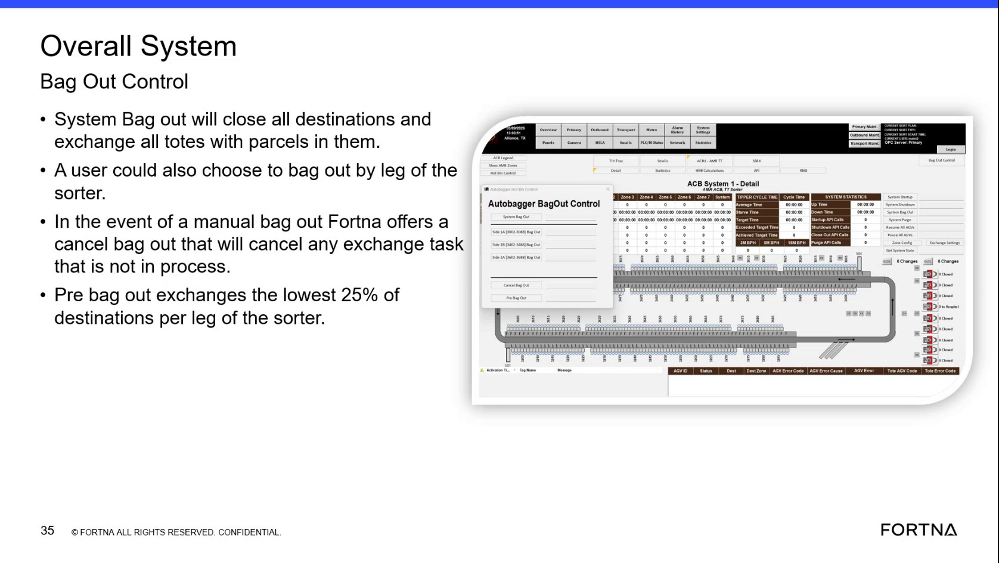

# Cancel Bag Out for Manual Bag Out to cancel exchange tasks that are not in process

## Runbook Header

| Field | Value |
| --- | --- |
| Procedure ID | `proc_cancel_bag_out_manual_bag_out_cancel_exchange_tasks_v1` |
| Title | Cancel Bag Out for Manual Bag Out to cancel exchange tasks that are not in process |
| Procedure Type | `recovery` |
| Primary Role | `operator` |
| Supporting Roles | None |
| Support Safe | Yes |
| Capability Tags | `bag_out_or_closeout_state` |
| Access Surface | `aveva_hmi` |
| Audience Roles | `operator` |
| Failure Pattern Tags | None |
| Validation Status | `needs_sme_review` |
| Merge Status | `source_finalized` |

## Summary

Use the manual bag out “cancel bag out” option to cancel exchange tasks that are not already in process.

## When To Use

When you are performing a manual bag out and need to cancel exchange tasks that are not in process (i.e., pending/queued for exchange but not currently in process).

## Do Not Use For

* Do not use “cancel bag out” to cancel exchange tasks that are already in process; those are expected to still finish.

## Access Or Tools Needed

* AVEVA HMI (manual bag out popup / cancel bag out option)

## Related Operational Context

* ctx_training_video_manual_bag_out_cancel_option_v1

## Visual References

*Training frame showing Overall System Bag Out Control and the manual bag out/cancel bag out concept (includes statement that cancel bag out cancels exchange tasks that are not in process).*

*Training frame explicitly stating: “In the event of a manual bag out Fortna offers a cancel bag out that will cancel any exchange task… So that is not in process.”*

## Procedure Steps

### Step 1 — Open the site AVEVA HMI manual bag out controls

**Responsible role:** operator

**Instruction:**
On the site AVEVA HMI, open the screen/popup that contains the manual bag out controls and the “cancel bag out” option.

**Expected result:**
The manual bag out popup/controls are visible and include a “cancel bag out” option.

---

### Step 2 — Confirm you are in the manual bag out context where “cancel bag out” is available

**Responsible role:** operator

**Instruction:**
Verify that the currently displayed popup/context is the manual bag out popup where the “cancel bag out” option can be selected.

**Expected result:**
The “cancel bag out” option is selectable in the manual bag out context.

---

### Step 3 — Select “cancel bag out” to cancel exchange tasks that are not in process

**Responsible role:** operator

**Instruction:**
In the manual bag out popup, select “cancel bag out”.

**Expected result:**
The system cancels exchange tasks that are not in process (pending/queued for exchange no longer remain active/pending for exchange).

**Stop or Escalate If:**

* Stop and escalate if the “cancel bag out” action does not cancel pending exchange tasks.
* Stop and escalate if tasks appear to be canceled while they are already in process.

---

### Step 4 — Verify cancellation effect on exchange tasks

**Responsible role:** operator

**Instruction:**
Check the live exchange-task state to confirm that exchange tasks that were not in process are no longer pending/queued for exchange.

**Expected result:**
Exchange tasks that were not in process are canceled (they no longer appear as pending/queued for exchange).

**Stop or Escalate If:**

* Stop and escalate if cancellation does not remove pending exchange tasks.
* Stop and escalate if tasks appear to be canceled while they are already in process.

---

## Success Criteria

* After selecting “cancel bag out” during manual bag out, exchange tasks that were not in process are no longer pending/queued for exchange.
* Exchange tasks that are already in process are not canceled and continue to finish.

## Failure Conditions

* Pending/queued exchange tasks that were not in process remain active/pending after “cancel bag out”.
* Tasks that are already in process appear to be canceled/removed.

## Escalation Guidance

* Escalate to FORTNA support if canceling does not remove pending exchange tasks or if behavior contradicts the “not in process” scope.

## Missing Details / Known Gaps

* The packet does not provide the exact live AVEVA HMI navigation path (menu/screen names) to reach the manual bag out popup.
* The packet does not provide the exact live UI fields/status labels to use for verifying “pending/queued for exchange” vs “in process”.
* The packet does not include a live screenshot showing the post-click cancellation feedback state; only training frames are provided.

## Source Lineage

- Candidate IDs: candidate_training_video_cancel_bag_out_manual_exchange_task_not_in_process
- Source ID: `training_video_day1`
- Source Type: `training_video`
