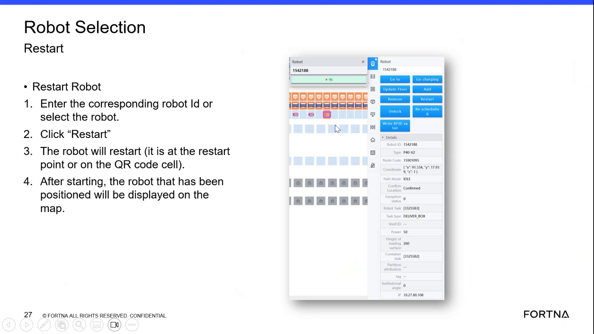

# Use Container Selection blue indicator and tote lookup to identify tote presence and tote number

## Runbook Header

| Field | Value |
| --- | --- |
| Procedure ID | `proc_use_container_selection_blue_indicator_tote_lookup_v1` |
| Title | Use Container Selection blue indicator and tote lookup to identify tote presence and tote number |
| Procedure Type | `operation` |
| Primary Role | `operator` |
| Supporting Roles | None |
| Support Safe | Yes |
| Capability Tags | `device_roster_state` |
| Access Surface | `tipper_hmi` |
| Audience Roles | `operator` |
| Failure Pattern Tags | None |
| Validation Status | `needs_sme_review` |
| Merge Status | `source_finalized` |

## Summary

On the live Container Selection screen, dark blue indicates tote presence and light blue indicates an empty rack. Selecting a location shows a box icon and the tote number. You can also find a tote by typing a location number and selecting the rack/AGV where it is located (if it is in the system).

## When To Use

Use when you need to confirm whether a station/rack location currently has a tote present and, if present, identify the tote number and its location using the Container Selection screen.

## Access Or Tools Needed

* Tipper HMI / WebVisu / VISU (Container Selection screen) or AVEVA HMI tote/container views (depending on site configuration)

## Related Operational Context

* ctx_training_video_container_selection_screen_v1
* ctx_training_video_container_blue_indicator_status_v1
* ctx_training_video_container_search_reference_v1

## Visual References

*Container Selection screen example showing: dark blue = tote presence, light blue = empty rack; selecting shows a box icon and tote number; includes location-number lookup guidance.*

## Procedure Steps

### Step 1 — Open the live Container Selection screen used for totes/containers

**Responsible role:** operator

**Instruction:**
Open the live Container Selection screen used for totes/containers.

**Expected result:**
The Container Selection screen is displayed with station/rack tiles and the blue indicator(s) on top of some stations.

---

### Step 2 — Scan station/rack tiles for the small blue indicator on top of stations

**Responsible role:** operator

**Instruction:**
Scan the station/rack tiles for the small blue indicator on top of stations.

**Expected result:**
You locate one or more tiles with a small blue indicator on top of the station/rack.

---

### Step 3 — Classify the indicator color (dark blue vs light blue)

**Responsible role:** operator

**Instruction:**
Classify the indicator color: confirm dark blue = tote presence and light blue = empty rack.

**Expected result:**
You can correctly distinguish dark blue (tote present) from light blue (empty rack) for the location(s) you plan to check.

---

### Step 4 — Select the station/rack tile with the blue indicator you want to check

**Responsible role:** operator

**Instruction:**
Click/select the station/rack tile with the blue indicator you want to check.

**Expected result:**
The selected location responds in the UI (selection state changes) and reveals tote details.

---

### Step 5 — Verify box icon and tote number after selecting the location

**Responsible role:** operator

**Instruction:**
Verify the expected UI response: confirm a box icon appears and the tote number is displayed for the selected location.

**Expected result:**
For a dark blue (tote present) location, a box icon appears and the tote number is displayed. For a light blue (empty rack) location, the location represents an empty rack (no tote presence indicated).

**Stop or Escalate If:**

* If the selected location does not show the box icon and tote number when the indicator is dark blue, stop and escalate to support for system-state verification.

---

### Step 6 — Find a tote by location number using the Container Selection lookup

**Responsible role:** operator

**Instruction:**
If you need to find a tote by location, type the location number into the Container Selection lookup field and select the rack or AGV where it is located (only if it is in the system).

**Expected result:**
Entering a location number and selecting the corresponding rack/AGV returns the tote’s presence and tote number when the tote is in the system.

**Stop or Escalate If:**

* If entering a location number does not return the expected rack/AGV location (when the tote is believed to be in the system), stop and escalate.

---

## Success Criteria

* Dark blue locations are confirmed as tote present (box icon + tote number after selection).
* Light blue locations are confirmed as empty racks.
* Location-number lookup returns tote presence and tote number for the correct rack/AGV when the tote is in the system.

## Failure Conditions

* Dark blue location does not display a box icon and tote number after selection.
* Location-number lookup does not return the expected rack/AGV location when the tote is believed to be in the system.

## Escalation Guidance

* Stop and escalate to support for system-state verification when the UI behavior does not match the indicator meaning (dark blue without box icon/tote number) or when location-number lookup does not return the expected rack/AGV.

## Missing Details / Known Gaps

* The packet does not specify the exact live UI control names/labels for the Container Selection lookup field and the rack/AGV selection control; steps rely on the described behavior only.

## Source Lineage

- Candidate IDs: candidate_training_video_container_selection_blue_indicator_tote_lookup
- Source ID: `training_video_day1`
- Source Type: `training_video`
