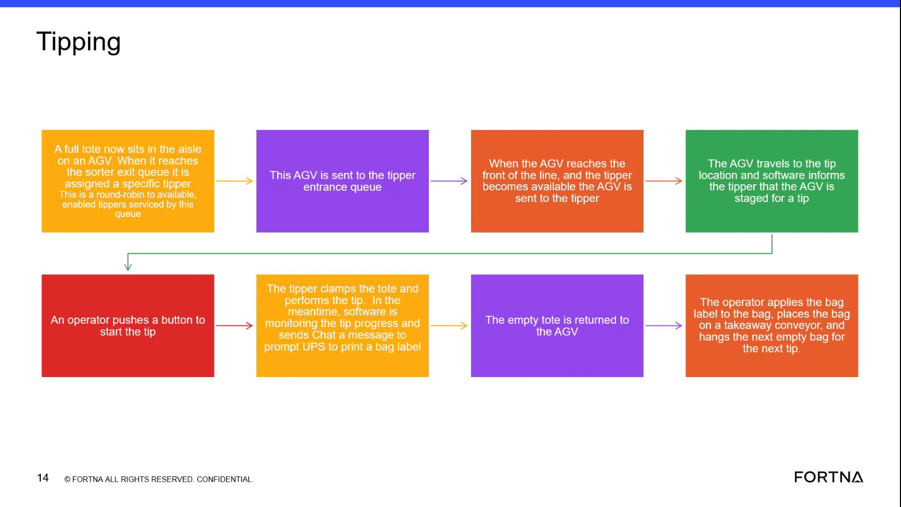
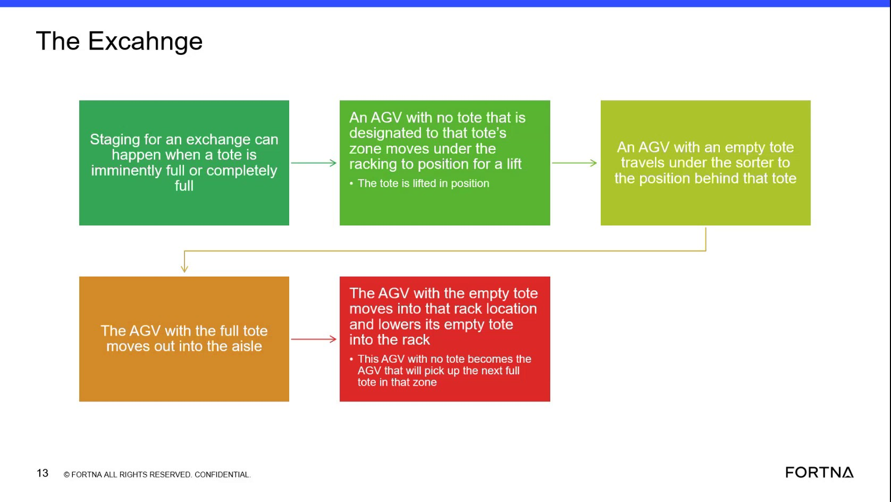
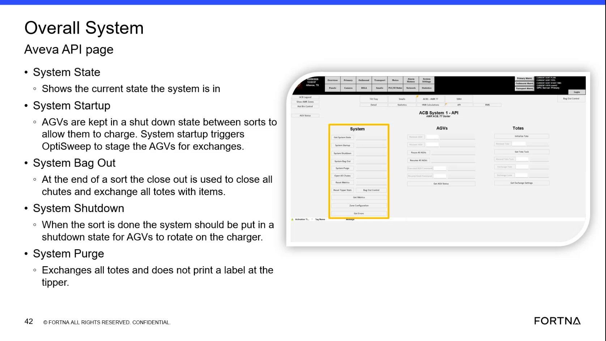

# Diagnose AGV exchange/backfill gap when an AGV moves out without a replacement

## Runbook Header

| Field | Value |
| --- | --- |
| Procedure ID | `proc_diagnose_agv_exchange_backfill_gap_v1` |
| Title | Diagnose AGV exchange/backfill gap when an AGV moves out without a replacement |
| Procedure Type | `diagnostic` |
| Primary Role | `L2_support` |
| Supporting Roles | None |
| Support Safe | Yes |
| Capability Tags | `agv_active_errors`, `fleet_system_status` |
| Access Surface | `rms_ui`, `wcs_sql` |
| Audience Roles | `L2_support` |
| Failure Pattern Tags | `agv_tracking_or_path_lost`, `zone_agv_mismatch` |
| Validation Status | `needs_sme_review` |
| Merge Status | `source_finalized` |

## Summary

Diagnose why a front AGV moved out without a replacement/backfill by checking (1) whether the trailing AGV had a fault (including the case where it was reported ready for a new task and faulted at the same time) and (2) whether chute closure/fullness and exchange timing targets indicate exchanges were not completed before chute closure.

## When To Use

Use when you observe or are told that an AGV moved out without another AGV backfilling/replacing it during an exchange, and you need live evidence to confirm whether the trailing AGV fault/ready+fault timing and/or chute fullness/closure and exchange timing targets contributed.

## Do Not Use For

* Do not use this procedure as a substitute for physical safety actions (e.g., E-stop/LOTO).

## Access Or Tools Needed

* RMS / fleet status UI (rms_ui)
* WCS / Helix DB (SSMS) (wcs_sql)

## Related Operational Context

* ctx_training_video_agv_exchange_pairing_v1
* ctx_training_video_chute_closure_and_exchange_timing_v1

## Visual References

*Training frame describing the mechanism: front AGV will not move until trailing AGV is present; software sends both commands together; gap can occur if trailing AGV faults (possibly while also being ready); chute gets closed when full; exchange timing targets (median ~8s, floor ~6.7s).*

*Training frame describing exchange thresholds and that exchanges are staged with strict quick KPI targets (context for exchange timing/threshold behavior).*

*Training frame describing system-level API page concepts (context only; not specific to this diagnostic’s live checks).*

## Procedure Steps

### Step 1 — Open RMS / fleet status UI and identify the AGV pair for the exchange event

**Responsible role:** L2_support

**Instruction:**
Using the RMS / fleet status UI (rms_ui), locate the AGV pair involved in the exchange event: the AGV that moved out (front) and the AGV that should have backfilled (trailing).

**Expected result:**
You have identified the specific trailing AGV associated with the exchange event time window (so you can check whether it faulted when the front AGV moved out).

**Stop or Escalate If:**

* If you cannot identify the correct AGV pair/time window in RMS, proceed to WCS/Helix DB (SSMS) (wcs_sql) to find the relevant AGV records for the time window.

---

### Step 2 — Check trailing AGV status for fault at the time the front AGV moved out

**Responsible role:** L2_support

**Instruction:**
In RMS / fleet status UI (rms_ui), check the trailing (behind) AGV’s status/error indicators around the time the front AGV moved out. Confirm whether the trailing AGV is faulted, or shows a fault coincident with being reported ready for a new task.

**Expected result:**
You find live evidence that the trailing AGV had an active fault at (or coincident with) the time the front AGV moved out, consistent with the described pairing/backfill failure mechanism.

**Stop or Escalate If:**

* If you confirm trailing AGV fault/ready+fault timing that would prevent proper backfill, stop further fault/backfill investigation and proceed to escalation guidance.

---

### Step 3 — If RMS is inconclusive, query WCS / Helix DB (SSMS) for trailing AGV fault/backfill failure evidence

**Responsible role:** L2_support

**Instruction:**
Using WCS / Helix DB (SSMS) (wcs_sql), query the OptiSweep DB for the same time window to find evidence of a fault/backfill failure for the trailing AGV (e.g., AGV state/error records).

**Expected result:**
You identify live database evidence that the trailing AGV faulted (or otherwise failed to support backfill) during the exchange window corresponding to the front AGV move-out.

**Stop or Escalate If:**

* If you confirm trailing AGV fault/backfill failure evidence in the database, stop further chute/timing checks and proceed to escalation guidance.
* If you do not find trailing AGV fault/backfill failure evidence, proceed to chute fullness/exchange timing checks.

---

### Step 4 — Check chute fullness/closure and exchange timing targets around the event

**Responsible role:** L2_support

**Instruction:**
Using WCS / Helix DB (SSMS) (wcs_sql), review live system data available for chute fullness and exchange timing metrics around the event time window. Look for conditions consistent with chute closure when the chute is full and exchange not completing before the 80% threshold (with exchange timing deviating from the median ~8 seconds and floor ~6.7 seconds).

**Expected result:**
You find live evidence that chute fullness/closure occurred (or was imminent) such that exchanges were not completed before the 80% threshold, and/or exchange timing deviated from the described targets (median ~8s, floor ~6.7s).

**Stop or Escalate If:**

* If you confirm chute fullness/insufficient exchange rate consistent with chute closure before exchange completion, stop and escalate.
* If chute fullness/exchange timing metrics do not align with the described mechanisms, escalate because the cause is not confirmed by the available evidence.

---

### Step 5 — Stop and escalate based on confirmed evidence (or lack of evidence)

**Responsible role:** L2_support

**Instruction:**
Based on your findings from RMS and WCS/Helix DB, decide whether to escalate. Escalate when you confirm the trailing AGV fault/ready+fault timing mechanism or confirm chute fullness/insufficient exchange timing mechanism, or when you cannot confirm either mechanism with live evidence.

**Expected result:**
A clear diagnostic conclusion is produced: (1) trailing AGV fault/ready+fault timing explains the missing backfill, and/or (2) chute fullness/closure and exchange timing targets indicate exchanges were not completed before 80%. If neither is supported by live evidence, escalation occurs due to unconfirmed cause.

**Stop or Escalate If:**

* Escalate if RMS and WCS/Helix DB do not show a trailing AGV fault/backfill failure and chute fullness/exchange timing metrics do not align with the described mechanisms.
* Do not assume the cause solely from the event description; require live fault/state evidence for the trailing AGV and/or live chute fullness/exchange timing evidence.

---

## Success Criteria

* You confirm (with live RMS and/or WCS/Helix DB evidence) that the trailing AGV fault/ready+fault timing explains why the front AGV moved out without replacement/backfill.
* OR you confirm (with live WCS/Helix DB evidence) that chute fullness/closure occurred such that exchanges were not completed before the 80% threshold, with exchange timing deviating from the described targets (median ~8s, floor ~6.7s).
* If neither mechanism is supported by live evidence, you escalate rather than assuming the cause.

## Failure Conditions

* Trailing AGV fault/ready+fault timing is present at the time the front AGV moved out, consistent with missing backfill.
* Chute fullness/closure occurs (or is imminent) such that exchanges were not completed before reaching 80%, with exchange timing deviating from median ~8s and floor ~6.7s.
* RMS and WCS/Helix DB show no trailing AGV fault/backfill failure evidence and no chute fullness/exchange timing evidence consistent with the described mechanisms.

## Escalation Guidance

* Escalate if you confirm the trailing AGV fault/ready+fault timing mechanism or confirm chute fullness/insufficient exchange timing consistent with chute closure before exchange completion.
* Escalate if RMS and WCS/Helix DB do not show trailing AGV fault/backfill failure and chute fullness/exchange timing metrics do not align with the described mechanisms (do not assume the cause from the event description alone).

## Missing Details / Known Gaps

* The packet does not provide specific RMS page names/field labels or specific SSMS table/column names to query for AGV fault/backfill failure and chute fullness/exchange timing metrics. Steps therefore describe the required checks at a high level without exact UI navigation or SQL targets.

## Source Lineage

- Candidate IDs: candidate_training_video_d1_agv_exchange_backfill_fault_check
- Source ID: `training_video_day1`
- Source Type: `training_video`
