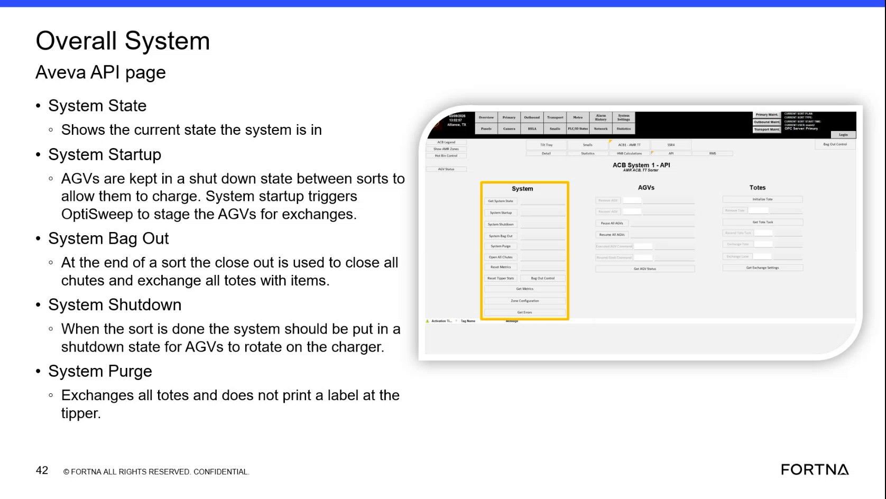

# Check Overall System state on the AVEVA API page (System State / System Startup / Bag Out / Shutdown / Purge)

## Runbook Header

| Field | Value |
| --- | --- |
| Procedure ID | `proc_check_overall_system_state_on_aveva_api_page_v1` |
| Title | Check Overall System state on the AVEVA API page (System State / System Startup / Bag Out / Shutdown / Purge) |
| Procedure Type | `diagnostic` |
| Primary Role | `L1_support` |
| Supporting Roles | None |
| Support Safe | Yes |
| Capability Tags | `fleet_system_status` |
| Access Surface | `aveva_hmi` |
| Audience Roles | `L1_support` |
| Failure Pattern Tags | None |
| Validation Status | `needs_sme_review` |
| Merge Status | `source_finalized` |

## Summary

Use the AVEVA HMI “Overall System” / “API page” to verify the current OptiSweep system lifecycle state shown in the “System State” field, and confirm the presence/meaning of the system-level lifecycle actions: System Startup, System Bag Out, System Shutdown, and System Purge.

## When To Use

When you need to confirm the current OptiSweep system lifecycle phase and verify that the AVEVA “API page” is showing the expected system-level lifecycle controls (System Startup / Bag Out / Shutdown / Purge) and the “System State” value.

## Access Or Tools Needed

* AVEVA HMI (Overall System / API page view)

## Related Operational Context

* ctx_training_video_api_page_overview_v1
* ctx_training_video_system_state_reference_v1
* ctx_training_video_system_startup_agv_staging_v1
* ctx_training_video_bag_out_close_out_reference_v1
* ctx_training_video_system_shutdown_agv_charging_v1
* ctx_training_video_system_purge_reference_v1

## Visual References

*Overall System Aveva API page showing the left-side items: System State, System Startup, System Bag Out, System Shutdown, and System Purge, plus the lifecycle meanings (e.g., System State shows current state; System Startup stages AGVs for exchanges; System Shutdown puts AGVs into shutdown state for charger rotation; Purge exchanges all totes and does not print a label at the tipper).*

## Procedure Steps

### Step 1 — Open the AVEVA HMI Overall System / API page view

**Responsible role:** L1_support

**Instruction:**
Open the AVEVA HMI “Overall System” / “API page” view that shows the left-side items labeled: System State, System Startup, System Bag Out, System Shutdown, and System Purge.

**Expected result:**
The AVEVA “API page” is visible with the left-side panel containing the labeled sections for System State, System Startup, System Bag Out, System Shutdown, and System Purge.

**Stop or Escalate If:**

* Stop and escalate if the AVEVA “API page” does not display the “System State” field or the left-side labels (System Startup / Bag Out / Shutdown / Purge).

---

### Step 2 — Read the System State value

**Responsible role:** L1_support

**Instruction:**
On the AVEVA “API page”, locate the “System State” field and read the value shown there.

**Expected result:**
The “System State” field shows the current system lifecycle state.

**Stop or Escalate If:**

* Stop and escalate if the AVEVA “API page” does not display the “System State” field.

---

### Step 3 — Confirm lifecycle action sections are present (Startup / Bag Out / Shutdown / Purge)

**Responsible role:** L1_support

**Instruction:**
Confirm the AVEVA “API page” left-side panel displays the labeled sections for: System Startup, System Bag Out, System Shutdown, and System Purge.

**Expected result:**
The left-side panel contains the labeled sections for System Startup, System Bag Out, System Shutdown, and System Purge.

**Stop or Escalate If:**

* Stop and escalate if the AVEVA “API page” does not display the left-side labels for System Startup / Bag Out / Shutdown / Purge.

---

### Step 4 — Sanity-check lifecycle context using the displayed lifecycle meanings

**Responsible role:** L1_support

**Instruction:**
Using the lifecycle meanings shown for each section on the AVEVA “API page”, sanity-check the lifecycle context implied by the current “System State” value:

**Expected result:**
You can map the current “System State” to the lifecycle context described for System Startup / Bag Out / Shutdown / Purge.

**Stop or Escalate If:**

* Stop and escalate if the System State value indicates an unexpected lifecycle state for the current operational moment.

---

### Step 5 — Stop and escalate on missing fields/labels or unexpected lifecycle state

**Responsible role:** L1_support

**Instruction:**
If any of the following conditions occur, stop the check and escalate.

**Expected result:**
Escalation is triggered when the AVEVA “API page” is missing expected UI elements or when “System State” appears inconsistent with the operational lifecycle phase.

**Stop or Escalate If:**

* Stop and escalate if the AVEVA API page does not display the “System State” field or the left-side labels (System Startup / Bag Out / Shutdown / Purge).
* Stop and escalate if the System State value appears inconsistent with the expected lifecycle phase.

---

## Success Criteria

* On the AVEVA “API page”, the “System State” field is present and shows a current system lifecycle state value.
* The left-side panel contains the labeled sections for System Startup, System Bag Out, System Shutdown, and System Purge.
* The current “System State” value can be sanity-checked against the lifecycle meanings without indicating an unexpected lifecycle phase for the operational moment.

## Failure Conditions

* AVEVA “API page” missing the “System State” field.
* AVEVA “API page” missing one or more left-side lifecycle labels/sections (System Startup / Bag Out / Shutdown / Purge).
* System State value appears inconsistent with the expected lifecycle phase for the current operational moment.

## Escalation Guidance

* Escalate if the AVEVA “API page” does not display the expected “System State” field and/or the left-side lifecycle labels (System Startup / Bag Out / Shutdown / Purge), or if the “System State” value appears inconsistent with the expected lifecycle phase.

## Missing Details / Known Gaps

* No explicit click-path/navigation steps are provided in the packet transcript/OCR for how to reach the AVEVA “Overall System” / “API page” from a starting screen; the procedure assumes the operator can open the correct AVEVA view.

## Source Lineage

- Candidate IDs: candidate_training_video_d1_api_page_system_state_check
- Source ID: `training_video_day1`
- Source Type: `training_video`
