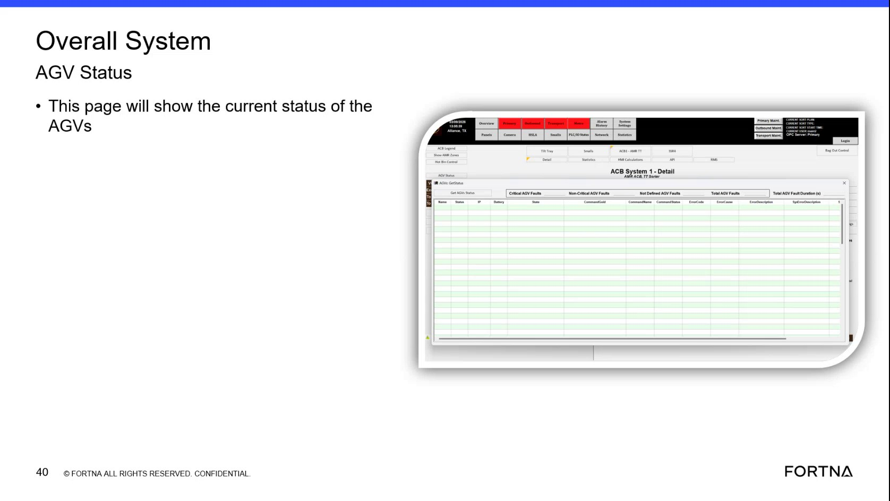

# Check AUV/AGV overall fleet status using the “Overall System AGV Status” pop-up

## Runbook Header

| Field | Value |
| --- | --- |
| Procedure ID | `proc_check_auv_agv_overall_fleet_status_overall_system_agv_status_popup_v1` |
| Title | Check AUV/AGV overall fleet status using the “Overall System AGV Status” pop-up |
| Procedure Type | `diagnostic` |
| Primary Role | `L1_support` |
| Supporting Roles | None |
| Support Safe | Yes |
| Capability Tags | `fleet_system_status` |
| Access Surface | `rms_ui` |
| Audience Roles | `L1_support` |
| Failure Pattern Tags | `site_stoppage` |
| Validation Status | `needs_sme_review` |
| Merge Status | `source_finalized` |

## Summary

Use the RMS / fleet status UI pop-up titled “Overall System AGV Status” to confirm the current overall AGV/AUV system status is populated and capture the displayed overall status wording/values for troubleshooting context.

## When To Use

When you need a first confirmation of whether the overall AGV/AUV system status page is populated and what overall status it reports (e.g., to establish whether the system appears reachable vs overall-down/unreachable).

## Do Not Use For

* Do not use this procedure to deep-dive a single AGV’s active error/fault details; this procedure is only for the overall fleet/system status pop-up.
* Do not use this procedure as a substitute for deeper diagnostics if the pop-up is blank/unreachable.

## Access Or Tools Needed

* RMS / fleet status UI (rms_ui)

## Related Operational Context

* ctx_training_video_auv_status_popup_v1
* ctx_training_video_overall_system_agv_status_v1

## Visual References

*Frame showing the pop-up title “Overall System AGV Status” and the statement that the page shows the current status.*

## Procedure Steps

### Step 1 — Open the RMS / fleet status UI and navigate to the “Overall System AGV Status” pop-up

**Responsible role:** L1_support

**Instruction:**
In the RMS / fleet status UI (rms_ui), open the pop-up/page titled “Overall System AGV Status”.

**Expected result:**
The “Overall System AGV Status” pop-up/page is opened and visible.

---

### Step 2 — Verify the “Overall System AGV Status” page is populated (not blank/unavailable)

**Responsible role:** L1_support

**Instruction:**
On the “Overall System AGV Status” page, confirm the page shows current status details (i.e., the status content is present rather than blank/unreachable).

**Expected result:**
The “Overall System AGV Status” page shows current overall AGV/AUV status details (not blank/unavailable).

**Stop or Escalate If:**

* If the pop-up cannot be opened or the page content is blank/unavailable, treat this as an overall system-down/unreachable symptom and stop further deep-dive checks in this procedure.

---

### Step 3 — Record the displayed overall status value(s) from the pop-up

**Responsible role:** L1_support

**Instruction:**
Record the displayed overall status value(s) shown on the “Overall System AGV Status” page using the exact on-screen wording/fields present.

**Expected result:**
You have captured the displayed overall status value(s)/wording from the “Overall System AGV Status” pop-up.

---

## Success Criteria

* The “Overall System AGV Status” pop-up/page is reachable and populated with current status details.
* The displayed overall status value(s)/wording are recorded from the pop-up.

## Failure Conditions

* “Overall System AGV Status” pop-up/page is blank or unavailable (overall system-down/unreachable symptom).

## Escalation Guidance

* If the pop-up cannot be opened or the page content is blank/unavailable, stop further deep-dive checks in this procedure and escalate to deeper fleet/system diagnostics.

## Missing Details / Known Gaps

* The packet does not provide the exact RMS navigation path/click sequence to reach the “Overall System AGV Status” pop-up within the RMS / fleet status UI.
* The packet does not provide the specific on-screen status field names/labels beyond the pop-up title, so the exact values/fields to record cannot be enumerated.

## Source Lineage

- Candidate IDs: candidate_training_video_d1_auv_status_overall_system_agv_status_popup
- Source ID: `training_video_day1`
- Source Type: `training_video`
