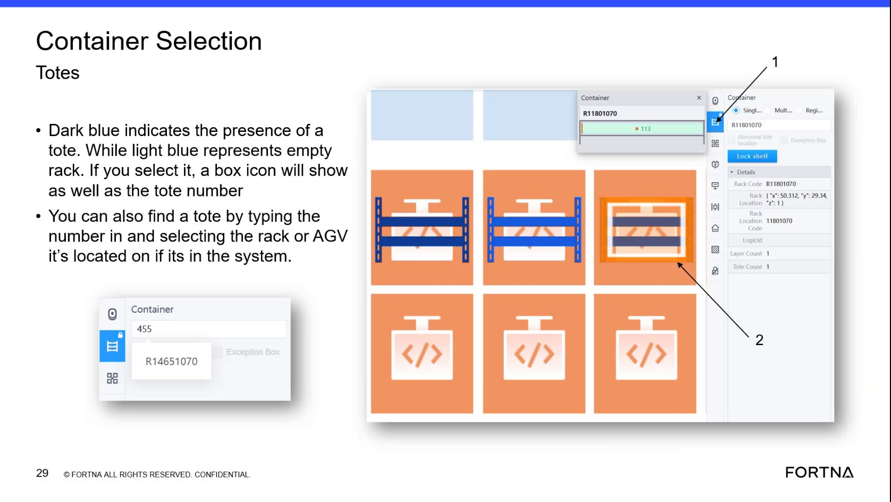

# Send an AGV to a selected square using Robot Selection → Go-to (Confirm) and verify AGV info updates

## Runbook Header

| Field | Value |
| --- | --- |
| Procedure ID | `proc_send_agv_to_selected_square_robot_selection_goto_confirm_v1` |
| Title | Send an AGV to a selected square using Robot Selection → Go-to (Confirm) and verify AGV info updates |
| Procedure Type | `operation` |
| Primary Role | `operator` |
| Supporting Roles | None |
| Support Safe | Yes |
| Capability Tags | `robot_command_or_task_state` |
| Access Surface | `rms_ui` |
| Audience Roles | `operator` |
| Failure Pattern Tags | None |
| Validation Status | `needs_sme_review` |
| Merge Status | `source_finalized` |

## Summary

Use the live OptiSweep interface object selection to select an AGV (cell phone/object icon) so the AGV information panel updates, then use Go-to → select a destination square → Confirm to send an AGV that is not in a task to the selected square (example recovery: drop it off at the hospital).

## When To Use

When you need to recover an AGV quickly by sending it to a chosen square using Go-to, specifically described for an AGV that is “not in a task.”

## Do Not Use For

* Do not use this procedure as a substitute for physical safety actions if an AGV requires on-floor intervention (the provided segment does not include physical recovery steps or safety interlocks).

## Access Or Tools Needed

* Live OptiSweep interface that includes “Robot Selection” and “Go to” controls (the segment references these UI labels).

## Related Operational Context

* ctx_training_video_agv_object_selection_v1
* ctx_training_video_agv_recovery_hospital_dropoff_v1

## Visual References

*Frame showing the Robot Selection → Go-to flow and the Confirm step; includes text: selecting the cell phone shows AGV information; Go-to can send an AGV not in a task to any square; example recovery drop-off at the hospital.*

## Procedure Steps

### Step 1 — Open the live interface and use Robot Selection to select an AGV object

**Responsible role:** operator

**Instruction:**
Open the live OptiSweep interface that supports “Robot Selection.” Under the AGV view, select the AGV object (the segment references selecting a “cell phone” icon).

**Expected result:**
After selecting the AGV object (cell phone), the interface shows the AGV information.

**Stop or Escalate If:**

* If selecting the AGV does not display AGV information, stop and escalate for assistance.

---

### Step 2 — Select Go-to for the selected AGV

**Responsible role:** operator

**Instruction:**
With the AGV selected, select the “Go to” function for that AGV.

**Expected result:**
The Go-to function is selected/active for the selected AGV (ready for destination square selection).

---

### Step 3 — Select the destination square on the map/grid

**Responsible role:** operator

**Instruction:**
Select the destination square on the map/grid for where you want the AGV to go.

**Expected result:**
The destination square selection is made (the chosen square is the target for the Go-to request).

---

### Step 4 — Confirm the Go-to request

**Responsible role:** operator

**Instruction:**
Select “Confirm” to submit the Go-to request.

**Expected result:**
The Go-to request is submitted via Confirm.

**Stop or Escalate If:**

* If the Go-to action cannot be confirmed, stop and escalate for assistance.
* If the AGV does not reflect movement/routing toward the selected square, stop and escalate for assistance.

---

### Step 5 — Verify the AGV is routed to the selected square (recovery example: hospital drop-off)

**Responsible role:** operator

**Instruction:**
Observe that the AGV is now being routed to the selected square (example recovery use: drop it off at the hospital).

**Expected result:**
The interface/system reflects that the AGV is being routed to the selected square; example: hospital drop-off use case.

**Stop or Escalate If:**

* If the AGV does not reflect movement toward the selected square, stop and escalate for assistance.

---

## Success Criteria

* After selecting the AGV object (cell phone), the AGV information panel updates/shows AGV information.
* After Go-to → destination square → Confirm, the system reflects that the AGV is being routed to the selected square.

## Failure Conditions

* Selecting the AGV object does not display AGV information.
* Go-to cannot be confirmed.
* After Confirm, the AGV does not reflect movement/routing toward the selected square.

## Escalation Guidance

* If AGV information does not display after selecting the AGV object, stop and escalate for assistance.
* If Go-to cannot be confirmed or the AGV does not reflect movement/routing toward the selected square, stop and escalate for assistance.

## Missing Details / Known Gaps

* The packet does not explicitly name the exact live UI surface (e.g., RMS vs another HMI) that contains “Robot Selection” and “Go to”; it only references the UI labels in the training segment.
* The packet does not specify the exact observable routing indicator (e.g., map highlight, status text, or AGV icon behavior) beyond the general expectation that the AGV is routed toward the selected square.

## Source Lineage

- Candidate IDs: candidate_training_video_day1_agv_object_selection_go_to
- Source ID: `training_video_day1`
- Source Type: `training_video`
