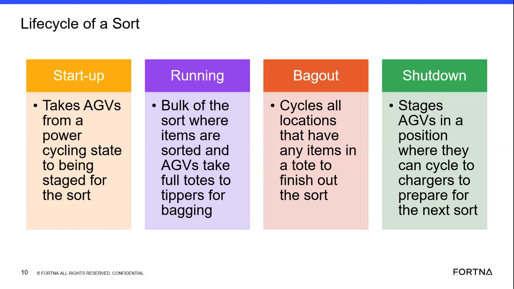

# Check RMS / fleet status UI for AGVs waiting to exchange during shutdown or startup delay waiting on charger

## Runbook Header

| Field | Value |
| --- | --- |
| Procedure ID | `proc_check_rms_fleet_status_agvs_exchange_waiting_startup_delay_v1` |
| Title | Check RMS / fleet status UI for AGVs waiting to exchange during shutdown or startup delay waiting on charger |
| Procedure Type | `diagnostic` |
| Primary Role | `L1_support` |
| Supporting Roles | `L2_support` |
| Support Safe | Yes |
| Capability Tags | `agv_active_errors`, `fleet_system_status` |
| Access Surface | `rms_ui` |
| Audience Roles | `L1_support` |
| Failure Pattern Tags | None |
| Validation Status | `needs_sme_review` |
| Merge Status | `source_finalized` |

## Summary

Use the RMS / fleet status UI to determine whether AGVs are not progressing due to state-transition failure visibility patterns: (1) AGVs waiting to do an exchange during shutdown, and/or (2) startup delay while waiting for an AGV on the charger. The system is described as exposing this via system faults and visible waiting conditions.

## When To Use

Use when lifecycle progression appears delayed during shutdown/startup and you need to check whether RMS is showing AGVs in the documented waiting/fault visibility patterns (exchange-waiting during shutdown; charger-waiting startup delay).

## Access Or Tools Needed

* RMS / fleet status UI (rms_ui)

## Related Operational Context

* ctx_training_video_state_transition_fault_visibility_v1

## Visual References

*Training segment frame used as evidence that the system will show faults/visible waiting conditions for (a) AGV waiting to do an exchange during shutdown and (b) startup delay waiting for an AGV on the charger.*

## Procedure Steps

### Step 1 — Open RMS / fleet status UI and navigate to AGV status/errors overview

**Responsible role:** L1_support

**Instruction:**
Open the RMS / fleet status UI (rms_ui) and navigate to the AGV status/errors overview area.

**Expected result:**
You are viewing the RMS AGV status/errors overview area where AGV waiting conditions and system fault/alert visibility can be checked.

**Stop or Escalate If:**

* RMS / fleet status UI cannot be accessed or the AGV status/errors overview area is not viewable.

---

### Step 2 — Check for AGVs waiting to do an exchange during shutdown

**Responsible role:** L1_support

**Instruction:**
In the RMS AGV status/errors overview, look for AGVs showing a waiting condition consistent with “waiting to do an exchange” during shutdown.

**Expected result:**
At least one AGV is indicated in RMS as waiting to do an exchange during shutdown (or you determine none are indicated).

**Stop or Escalate If:**

* You observe repeated or widespread exchange-waiting indications that prevent lifecycle progression.

---

### Step 3 — Check for startup delay waiting for an AGV on the charger

**Responsible role:** L1_support

**Instruction:**
In the RMS AGV status/errors overview, look for startup delay evidence consistent with “waiting … for an AGV on the charger.”

**Expected result:**
At least one AGV is indicated in RMS as contributing to startup delay by waiting for an AGV on the charger (or you determine none are indicated).

**Stop or Escalate If:**

* You observe repeated or widespread charger-waiting indications that prevent lifecycle progression.

---

### Step 4 — Confirm system faults/alerts align with the waiting conditions

**Responsible role:** L1_support

**Instruction:**
In the RMS AGV status/errors overview, confirm whether system faults/alerts are visible and align with the exchange-waiting and/or charger-waiting conditions you observed.

**Expected result:**
RMS shows visible system fault/alert entries that align with the waiting conditions (or you determine there are no aligning fault/alert entries).

**Stop or Escalate If:**

* You see repeated or widespread waiting/fault indications that prevent lifecycle progression.

---

### Step 5 — Stop and escalate on repeated or widespread waiting/fault indications

**Responsible role:** L1_support

**Instruction:**
If you see repeated or widespread waiting/fault indications that prevent lifecycle progression (e.g., multiple AGVs stuck in exchange-waiting or charger-waiting states), stop and escalate for deeper investigation.

**Expected result:**
Escalation is initiated when the RMS evidence shows repeated/widespread waiting/fault indications consistent with the described patterns.

**Stop or Escalate If:**

* Multiple AGVs stuck in exchange-waiting during shutdown.
* Multiple AGVs stuck in charger-waiting during startup delay.
* System faults/alerts visible in RMS align with these waiting conditions and are repeated/widespread.

---

## Success Criteria

* RMS / fleet status UI shows either (a) AGVs indicated as waiting to do an exchange during shutdown and/or (b) startup delay evidence consistent with waiting for an AGV on the charger.
* RMS also shows visible system faults/alerts that align with the observed waiting conditions (when present).

## Failure Conditions

* RMS shows repeated/widespread AGVs waiting to do an exchange during shutdown.
* RMS shows repeated/widespread startup delay evidence consistent with waiting for an AGV on the charger.
* RMS shows system faults/alerts that align with the above waiting conditions.

## Escalation Guidance

* If RMS does not show any fault/waiting evidence while lifecycle progression is failing, escalate for deeper investigation (the segment only states the system will tell you via faults/waiting conditions, but does not provide additional surfaces here).

## Missing Details / Known Gaps

* The packet does not provide the exact RMS UI field/label text for the exchange-waiting and charger-waiting conditions; steps therefore describe what to look for conceptually rather than naming specific RMS columns/status strings.
* The packet does not provide the exact RMS navigation path (menu names) to the AGV status/errors overview area.

## Source Lineage

- Candidate IDs: candidate_training_video_day1_check_rms_for_agv_waiting_exchange_or_startup_delay
- Source ID: `training_video_day1`
- Source Type: `training_video`
