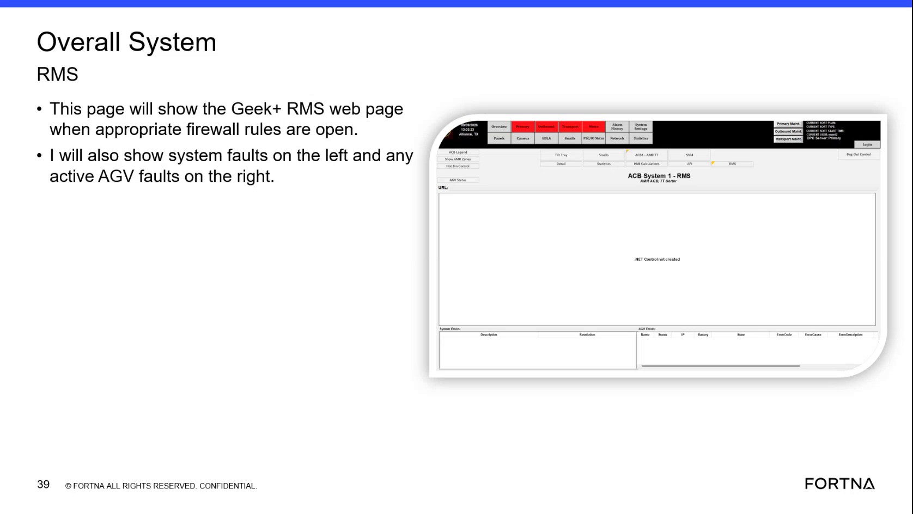

# Check Geek+ RMS overall page for system faults vs AGV system faults (and handle blank RMS due to firewall)

## Runbook Header

| Field | Value |
| --- | --- |
| Procedure ID | `proc_check_geek_rms_overall_system_faults_vs_agv_faults_v1` |
| Title | Check Geek+ RMS overall page for system faults vs AGV system faults (and handle blank RMS due to firewall) |
| Procedure Type | `diagnostic` |
| Primary Role | `L1_support` |
| Supporting Roles | `operator` |
| Support Safe | Yes |
| Capability Tags | `fleet_system_status` |
| Access Surface | `rms_ui` |
| Audience Roles | `L1_support`, `operator` |
| Failure Pattern Tags | None |
| Validation Status | `needs_sme_review` |
| Merge Status | `source_finalized` |

## Summary

Use the Geek+ RMS / fleet status web UI to confirm the overall page is reachable and that it correctly separates fault categories: “system faults” on the left and “AGV system faults” on the right. If the RMS page is blank, treat it as a reachability/firewall symptom. Use the left/right placement to interpret whether the issue is communication loss vs an AGV that was commanded to move but is not in progress.

## When To Use

When you need to verify that the Geek+ RMS overall/fleet status page is reachable and that it is showing the expected fault panels (left system faults vs right AGV system faults), including the specific symptom where the page appears blank due to firewall not being open.

## Access Or Tools Needed

* RMS / fleet status UI (rms_ui)

## Related Operational Context

* ctx_training_video_system_faults_vs_agv_faults_v1
* ctx_training_video_rms_visibility_on_thin_clients_v1

## Visual References

*Overall System RMS page frame showing the expected layout: system faults on the left and active AGV system faults on the right; also includes the blank-page symptom when firewall is not open.*

## Procedure Steps

### Step 1 — Open the Geek+ RMS / fleet status web UI (RMS overall page)

**Responsible role:** L1_support

**Instruction:**
Open the Geek+ RMS / fleet status web UI (RMS / fleet status UI).

**Expected result:**
The RMS overall page loads (or you observe that it is blank).

---

### Step 2 — Confirm the RMS page is not blank; if blank, treat as firewall/reachability symptom

**Responsible role:** L1_support

**Instruction:**
Check whether the RMS overall page shows content/fault panels. If it is blank, treat it as the firewall-not-open symptom described by the source.

**Expected result:**
Either (a) fault panels are visible, or (b) the page is blank consistent with firewall not being open.

**Stop or Escalate If:**

* RMS remains blank (no visible system/AGV fault panels).

---

### Step 3 — Check left-side “system faults” panel

**Responsible role:** L1_support

**Instruction:**
On the RMS overall page, check the left side labeled area for “system faults”.

**Expected result:**
The left-side “system faults” area is visible and can be reviewed for any listed faults.

**Stop or Escalate If:**

* Fault placement/layout is not observable or does not match the expected left/right meaning described by the source.

---

### Step 4 — Check right-side “AGV system faults” panel

**Responsible role:** L1_support

**Instruction:**
On the RMS overall page, check the right side labeled area for “AGV system faults” (active AGV faults).

**Expected result:**
The right-side “AGV system faults” area is visible and can be reviewed for any listed faults.

**Stop or Escalate If:**

* Fault placement/layout is not observable or does not match the expected left/right meaning described by the source.

---

### Step 5 — Interpret left/right fault placement for communication loss vs commanded-but-not-in-progress movement

**Responsible role:** L1_support

**Instruction:**
Use the source mapping: if you lose communication with a chat, expect it on the left “system faults”; if you told an AGV to move but it hasn’t moved, expect it on the right “AGV system faults”.

**Expected result:**
You can map the observed fault placement to either communication-loss (left) or commanded-but-not-in-progress movement (right).

**Stop or Escalate If:**

* Fault placement does not match the expected left/right meaning described by the source.

---

## Success Criteria

* RMS overall page is reachable and not blank (fault panels visible).
* Left “system faults” and right “AGV system faults” areas are observable on the RMS overall page.
* Observed fault placement can be interpreted as communication loss (left) vs commanded-but-not-in-progress movement (right) using the source mapping.

## Failure Conditions

* RMS remains blank (no visible system/AGV fault panels).
* Left/right fault separation is not observable or does not align with the expected meaning (left = communication loss; right = commanded move not in progress).

## Escalation Guidance

* If RMS remains blank (no visible system/AGV fault panels), escalate as a firewall/reachability issue consistent with the source symptom.
* If the left/right fault placement does not match the expected meaning described by the source, escalate for further investigation of RMS fault categorization/communication behavior.

## Missing Details / Known Gaps

* No specific RMS URL/IP address or exact UI navigation steps/controls are provided in the packet; the procedure only specifies opening the RMS / fleet status web UI and checking the left/right fault panels.

## Source Lineage

- Candidate IDs: candidate_training_video_day1_check_rms_system_faults_blank_or_split_view
- Source ID: `training_video_day1`
- Source Type: `training_video`
