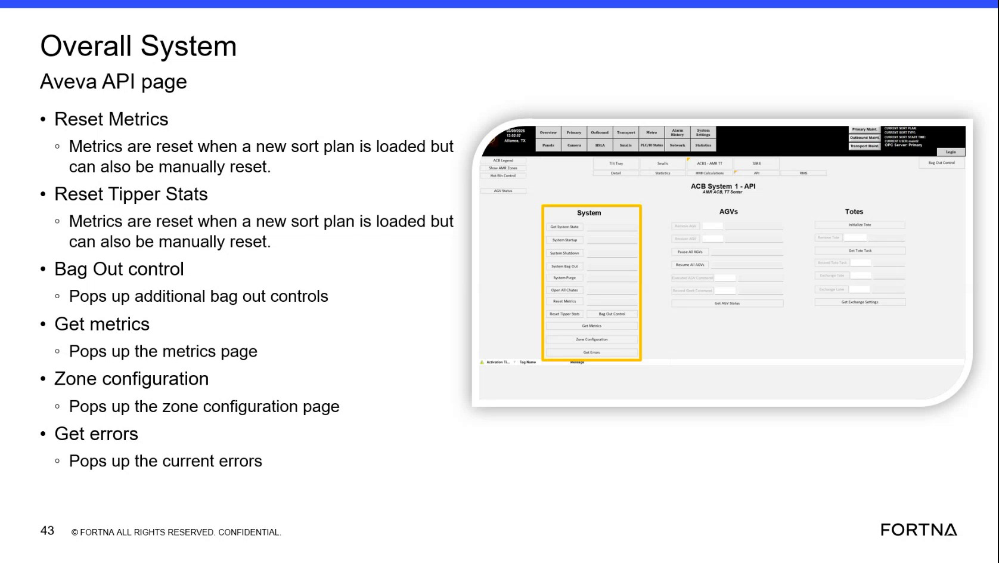

# Open the current errors pop-up from the Overall System Aveva API page

## Runbook Header

| Field | Value |
| --- | --- |
| Procedure ID | `proc_open_current_errors_popup_from_overall_system_aveva_api_v1` |
| Title | Open the current errors pop-up from the Overall System Aveva API page |
| Procedure Type | `diagnostic` |
| Primary Role | `operator` |
| Supporting Roles | None |
| Support Safe | Yes |
| Capability Tags | `fleet_system_status` |
| Access Surface | `aveva_hmi` |
| Audience Roles | `operator` |
| Failure Pattern Tags | None |
| Validation Status | `needs_sme_review` |
| Merge Status | `source_finalized` |

## Summary

Use the “Get errors” control on the Overall System Aveva API page to open the pop-up that displays the current errors list.

## When To Use

When you need to view the current errors list from the Overall System Aveva API page.

## Access Or Tools Needed

* AVEVA HMI (Overall System Aveva API page)

## Related Operational Context

* ctx_training_video_overall_system_aveva_api_page_v1
* ctx_training_video_metrics_and_errors_popups_v1

## Visual References

*Frame showing the Overall System Aveva API page controls including “Get errors” (pop-up for current errors).*

## Procedure Steps

### Step 1 — Open the AVEVA HMI page labeled “Overall System Aveva API”

**Responsible role:** operator

**Instruction:**
Open the AVEVA HMI page labeled “Overall System Aveva API”.

**Expected result:**
The “Overall System Aveva API” page is displayed and contains the “Get errors” control.

---

### Step 2 — Click “Get errors” to open the current errors pop-up

**Responsible role:** operator

**Instruction:**
Click the control labeled “Get errors”.

**Expected result:**
A pop-up opens that displays the current errors.

**Stop or Escalate If:**

* If the pop-up does not appear or shows no current errors when errors are expected, stop and escalate to support.

---

### Step 3 — Confirm the current errors pop-up is visible

**Responsible role:** operator

**Instruction:**
Verify the pop-up appears showing the “current errors”. Stop once the current errors pop-up is visible.

**Expected result:**
The current errors pop-up/list area is visible on screen.

**Stop or Escalate If:**

* If the pop-up is not visible or does not show the current errors list, stop and escalate to support.

---

## Success Criteria

* The “Get errors” pop-up opens from the Overall System Aveva API page.
* The pop-up displays the current errors list.

## Failure Conditions

* No pop-up appears after clicking “Get errors”.
* Pop-up appears but does not show current errors when errors are expected.

## Escalation Guidance

* If the pop-up does not appear or shows no current errors when errors are expected, stop and escalate to support.

## Missing Details / Known Gaps

* The packet does not specify the exact navigation path/menu steps to reach the “Overall System Aveva API” page beyond the page label itself.
* The packet does not specify what specific fields/columns appear inside the “current errors” pop-up beyond it being a pop-up that shows current errors.

## Source Lineage

- Candidate IDs: candidate_training_video_day1_get_errors_popup_aveva_api_page
- Source ID: `training_video_day1`
- Source Type: `training_video`
