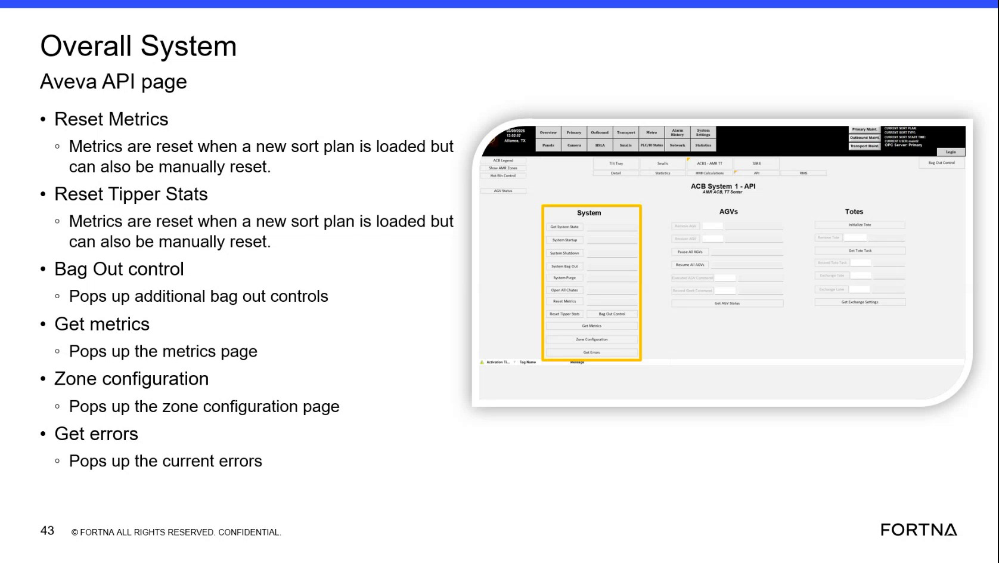

# Open the system metrics pop-up from the Overall System Aveva API page

## Runbook Header

| Field | Value |
| --- | --- |
| Procedure ID | `proc_open_system_metrics_popup_from_overall_system_aveva_api_page_v1` |
| Title | Open the system metrics pop-up from the Overall System Aveva API page |
| Procedure Type | `diagnostic` |
| Primary Role | `operator` |
| Supporting Roles | None |
| Support Safe | Yes |
| Capability Tags | `fleet_system_status` |
| Access Surface | `aveva_hmi` |
| Audience Roles | `operator` |
| Failure Pattern Tags | None |
| Validation Status | `needs_sme_review` |
| Merge Status | `source_finalized` |

## Summary

Use the “Get metrics” control on the Overall System Aveva API page to open a pop-up/metrics page that displays the current system metrics.

## When To Use

When you need to view the current system metrics from the Overall System Aveva API page using the “Get metrics” pop-up.

## Access Or Tools Needed

* AVEVA HMI (Overall System Aveva API page)

## Related Operational Context

* ctx_training_video_overall_system_aveva_api_page_v1
* ctx_training_video_metrics_and_errors_popups_v1

## Visual References

*Frame showing the Overall System Aveva API page controls including “Get metrics” (and other controls like Reset Metrics / Get errors).*

## Procedure Steps

### Step 1 — Open the AVEVA HMI page labeled “Overall System Aveva API”

**Responsible role:** operator

**Instruction:**
On the AVEVA HMI, open the page labeled “Overall System Aveva API”.

**Expected result:**
The “Overall System Aveva API” page is displayed with the “Get metrics” control available.

---

### Step 2 — Click “Get metrics” to open the system metrics pop-up

**Responsible role:** operator

**Instruction:**
On the “Overall System Aveva API” page, click the control labeled “Get metrics”.

**Expected result:**
A “Get metrics” pop-up/metrics page opens and displays the system metrics.

**Stop or Escalate If:**

* If clicking “Get metrics” does not open the pop-up or the metrics do not populate, stop and escalate to support.

---

### Step 3 — Confirm the metrics pop-up is visible and populated

**Responsible role:** operator

**Instruction:**
Wait for the “Get metrics” pop-up/metrics page to appear and confirm it contains the system metrics.

**Expected result:**
The metrics pop-up/page is visible and populated.

**Stop or Escalate If:**

* If the metrics pop-up is not populated, stop and escalate to support.

---

## Success Criteria

* A “Get metrics” pop-up/metrics page opens from the “Overall System Aveva API” page.
* The metrics pop-up/page is visible and populated with system metrics.

## Failure Conditions

* Clicking “Get metrics” does not open the pop-up.
* The metrics pop-up opens but does not populate with system metrics.

## Escalation Guidance

* If clicking “Get metrics” does not open the pop-up or the metrics do not populate, stop and escalate to support.

## Missing Details / Known Gaps

* The packet does not provide the exact visual layout/field names inside the metrics pop-up—only that it contains “all the system metrics.”

## Source Lineage

- Candidate IDs: candidate_training_video_day1_get_metrics_popup_aveva_api_page
- Source ID: `training_video_day1`
- Source Type: `training_video`
