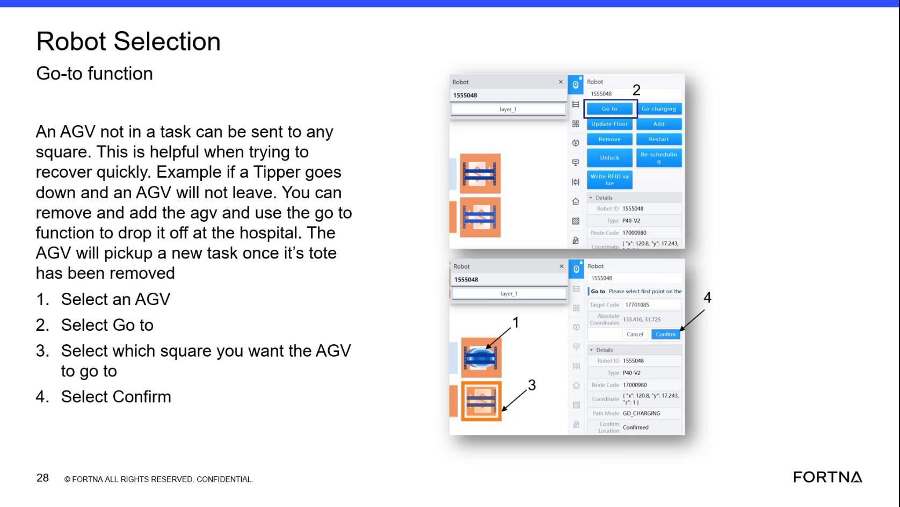

# Use OptiSweep Go-to Function to Send an AGV (Not in a Task) to a Selected Square

## Runbook Header

| Field | Value |
| --- | --- |
| Procedure ID | `proc_use_optsweep_go_to_function_send_agv_to_selected_square_v1` |
| Title | Use OptiSweep Go-to Function to Send an AGV (Not in a Task) to a Selected Square |
| Procedure Type | `operation` |
| Primary Role | `L1_support` |
| Supporting Roles | `L2_support` |
| Support Safe | Yes |
| Capability Tags | `device_roster_state` |
| Access Surface | `rms_ui`, `aveva_hmi` |
| Audience Roles | `L1_support` |
| Failure Pattern Tags | None |
| Validation Status | `needs_sme_review` |
| Merge Status | `source_finalized` |

## Summary

Send an AGV that is not currently in a task to a selected destination square using the OptiSweep Go-to function. This is intended for quick recovery scenarios (e.g., when a tipper is down and an AGV will not leave), including dropping the AGV off at the hospital so it can pick up a new task after the tote is removed.

## When To Use

Use when you need quick recovery by sending an AGV that is not in a task to a chosen square (for example, to drop it off at the hospital when a tipper is down and the AGV will not leave).

## Do Not Use For

* Do not use this procedure as a substitute for deeper diagnostics if the AGV does not move after Confirm; the segment does not provide troubleshooting steps for that condition.

## Access Or Tools Needed

* OptiSweep operator UI that provides Robot Selection and Go-to controls (surface not explicitly named in the segment).
* RMS / fleet status UI (for fleet/AGV status visibility, if needed during verification).

## Related Operational Context

* ctx_training_video_agv_go_to_recovery_use_case_v1

## Visual References

*Frame showing the Robot Selection area and the Go-to workflow: select an AGV, select Go to, select destination square, and select Confirm; includes the recovery use case (tipper down, AGV not leaving, drop off at hospital, pick up new task after tote removed).*

## Procedure Steps

### Step 1 — Open the OptiSweep interface with Robot Selection and Go-to controls

**Responsible role:** L1_support

**Instruction:**
Open the OptiSweep interface that contains the Robot Selection and Go-to controls shown in the segment.

**Expected result:**
You can see the Robot Selection area and the Go-to option/button, along with a destination square selection area and a Confirm control.

---

### Step 2 — Select the AGV that is not in a task

**Responsible role:** L1_support

**Instruction:**
In Robot Selection, select the AGV that is “not in a task.”

**Expected result:**
The intended AGV is selected in the Robot Selection area (i.e., the UI reflects that AGV as the active selection).

---

### Step 3 — Select the Go-to function

**Responsible role:** L1_support

**Instruction:**
Select the “Go to” function for the selected AGV.

**Expected result:**
The Go-to option/workflow becomes active in the UI for the selected AGV.

---

### Step 4 — Select the destination square

**Responsible role:** L1_support

**Instruction:**
Select which square you want the AGV to go to (destination square).

**Expected result:**
The destination square is selected/highlighted in the UI.

---

### Step 5 — Select Confirm to send the AGV

**Responsible role:** L1_support

**Instruction:**
Select “Confirm.”

**Expected result:**
After Confirm, the selected AGV is commanded to move to the chosen destination square (e.g., drop it off at the hospital per the segment’s example).

**Stop or Escalate If:**

* If the AGV does not move to the selected square after Confirm, stop and escalate to support for deeper diagnostics (the segment does not provide troubleshooting steps).
* If the AGV still cannot pick up a new task after the tote is removed, stop and escalate.

---

## Success Criteria

* After selecting Confirm, the selected AGV moves to the chosen destination square.
* After the tote is removed, the AGV can pick up a new task.

## Failure Conditions

* AGV does not move to the selected square after Confirm.
* AGV still cannot pick up a new task after the tote is removed.

## Escalation Guidance

* If the AGV does not move after Confirm, stop and escalate to support for deeper diagnostics (no troubleshooting steps are provided in the segment).
* If the AGV still cannot pick up a new task after the tote is removed, stop and escalate.

## Missing Details / Known Gaps

* The packet does not explicitly name the live OptiSweep UI surface for the Robot Selection / Go-to controls (only that it is an OptiSweep interface).
* The packet does not provide explicit verification signals/fields (e.g., exact status text, map indicator, or RMS/AVEVA field names) to confirm movement after Confirm.

## Source Lineage

- Candidate IDs: candidate_training_video_day1_go_to_function_send_agv_to_square
- Source ID: `training_video_day1`
- Source Type: `training_video`
