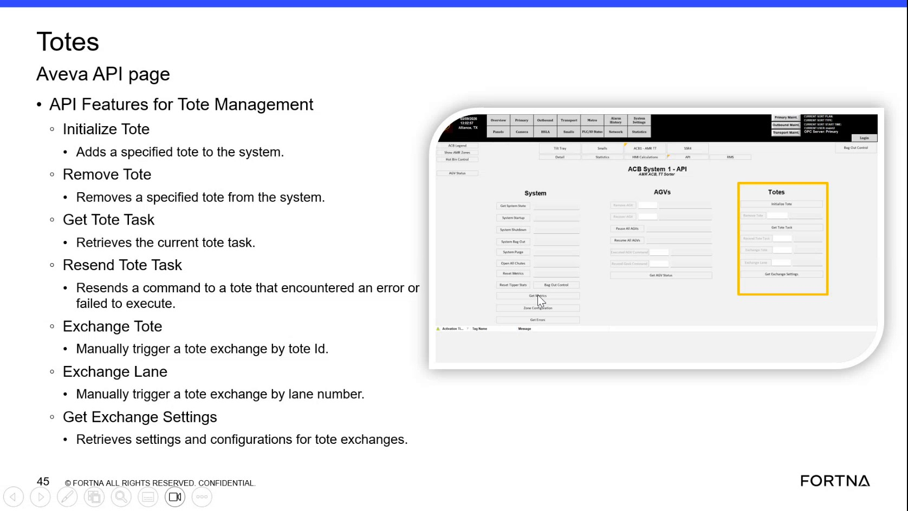

# Check current tote task and resend tote task command using the Tote Management API page (Obeyba/Aveva API features)

## Runbook Header

| Field | Value |
| --- | --- |
| Procedure ID | `proc_check_current_tote_task_and_resend_tote_task_v1` |
| Title | Check current tote task and resend tote task command using the Tote Management API page (Obeyba/Aveva API features) |
| Procedure Type | `diagnostic` |
| Primary Role | `L2_support` |
| Supporting Roles | None |
| Support Safe | Yes |
| Capability Tags | `wcs_api_responsiveness` |
| Access Surface | `aveva_hmi` |
| Audience Roles | `L2_support` |
| Failure Pattern Tags | `api_unresponsive` |
| Validation Status | `needs_sme_review` |
| Merge Status | `source_finalized` |

## Summary

Use the AVEVA/Obeyba “API Features for Tote Management” page to retrieve the current tote task (“Get Tote Task”) and, when a tote command previously errored or failed to execute, resend it (“Resend Tote Task”). Confirm the “Get Tote Task” output updates after resending.

## When To Use

When a tote task command encountered an error or failed to execute and you need to verify the current tote task and resend the tote task command using the Tote Management API features page.

## Access Or Tools Needed

* AVEVA/Obeyba Tote Management API features page controls: “Get Tote Task” and “Resend Tote Task”.

## Related Operational Context

* ctx_training_video_tote_api_task_functions_v1

## Visual References

*Totes Aveva API page showing “API Features for Tote Management” with “Get Tote Task” and “Resend Tote Task”, including the login prompt context (“Are you logged in to Obeyba?”).*

## Procedure Steps

### Step 1 — Open the Tote Management API features page (Obeyba/Aveva)

**Responsible role:** L2_support

**Instruction:**
Open the AVEVA/Obeyba page titled like “API Features for Tote Management” that contains the controls “Get Tote Task” and “Resend Tote Task”.

**Expected result:**
The page shows the “Get Tote Task” and “Resend Tote Task” controls.

**Stop or Escalate If:**

* If the page indicates you are not logged in to Obeyba, do not proceed with resend actions; resolve login first.

---

### Step 2 — Confirm you are logged in to Obeyba

**Responsible role:** L2_support

**Instruction:**
On the Tote Management API features page, confirm the login state indicates you are logged in to Obeyba before using “Get Tote Task” or “Resend Tote Task”.

**Expected result:**
You are logged in to Obeyba (login indicator/prompt is not blocking API actions).

**Stop or Escalate If:**

* If the page indicates you are not logged in to Obeyba, do not proceed with resend actions; resolve login first.

---

### Step 3 — Retrieve the current tote task using “Get Tote Task”

**Responsible role:** L2_support

**Instruction:**
Use the “Get Tote Task” function on the Tote Management API features page to retrieve the current tote task.

**Expected result:**
The “Get Tote Task” output populates with the current tote task information.

**Stop or Escalate If:**

* Stop and escalate if “Get Tote Task” does not return a current task (blank/no data).

---

### Step 4 — Resend the tote task command using “Resend Tote Task” (only when needed)

**Responsible role:** L2_support

**Instruction:**
If the tote task previously encountered an error or failed to execute, use “Resend Tote Task” on the same Tote Management API features page to resend the command.

**Expected result:**
The “Resend Tote Task” action is executed (command resent) for the tote that previously errored/failed.

**Stop or Escalate If:**

* Stop and escalate if “Resend Tote Task” does not produce any observable change in the subsequent “Get Tote Task” output.

---

### Step 5 — Verify “Get Tote Task” output updates after resending

**Responsible role:** L2_support

**Instruction:**
Run “Get Tote Task” again and compare the output to the prior “Get Tote Task” results to confirm the tote task information updates after resending.

**Expected result:**
After “Resend Tote Task”, the “Get Tote Task” output reflects the current tote task (task state/values update rather than remaining unchanged in the prior failed/error state).

**Stop or Escalate If:**

* Stop and escalate if “Resend Tote Task” does not produce any observable change in the subsequent “Get Tote Task” output.

---

## Success Criteria

* “Get Tote Task” returns current tote task data (not blank/no data).
* After “Resend Tote Task”, a subsequent “Get Tote Task” shows observable updates (task state/values change rather than remaining in the prior failed/error state).

## Failure Conditions

* “Get Tote Task” returns blank/no data or does not return a current task.
* “Resend Tote Task” produces no observable change in the subsequent “Get Tote Task” output.
* The page indicates you are not logged in to Obeyba.

## Escalation Guidance

* If “Get Tote Task” does not return a current task (blank/no data), stop and escalate.
* If “Resend Tote Task” does not produce any observable change in the subsequent “Get Tote Task” output, stop and escalate.
* If the page indicates you are not logged in to Obeyba, resolve login first and do not proceed with resend actions.

## Missing Details / Known Gaps

* The packet does not provide the exact Obeyba navigation path to reach the “API Features for Tote Management” page beyond the page being shown in the training segment.
* The packet does not specify the exact input fields (if any) required by “Resend Tote Task” (e.g., tote/task identifiers) beyond the button/control label.

## Source Lineage

- Candidate IDs: candidate_training_video_day1_obeyba_aveva_api_get_resend_tote_task
- Source ID: `training_video_day1`
- Source Type: `training_video`
