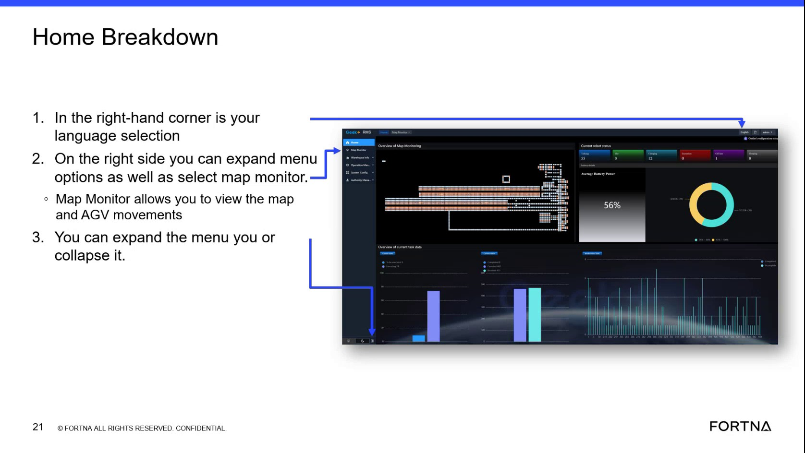

# Switch RMS UI language to English using the top-right language selection icon

## Runbook Header

| Field | Value |
| --- | --- |
| Procedure ID | `proc_switch_rms_ui_language_to_english_v1` |
| Title | Switch RMS UI language to English using the top-right language selection icon |
| Procedure Type | `operation` |
| Primary Role | `operator` |
| Supporting Roles | None |
| Support Safe | Yes |
| Capability Tags | `fleet_system_status` |
| Access Surface | `rms_ui` |
| Audience Roles | `operator` |
| Failure Pattern Tags | None |
| Validation Status | `needs_sme_review` |
| Merge Status | `source_finalized` |

## Summary

Use the RMS top-right language selection control (third icon from the right) to switch the RMS interface from Chinese to English when the default login language appears in Chinese.

## When To Use

Use when the RMS / fleet status UI loads in Chinese and you need the interface labels in English to operate the RMS.

## Access Or Tools Needed

* RMS / fleet status UI (rms_ui) in a web browser

## Related Operational Context

* ctx_training_video_rms_language_selection_reference_v1

## Visual References

*RMS language selection location: top-right corner language selection; third icon from the right.*

## Procedure Steps

### Step 1 — Open RMS / fleet status UI and locate the top-right language selection icon

**Responsible role:** operator

**Instruction:**
In the RMS / fleet status UI (rms_ui) in your browser, look at the top-right corner and locate the language selection control (the third icon from the right).

**Expected result:**
You can visually identify the top-right language selection control (third icon from the right) on the RMS UI.

---

### Step 2 — Switch the RMS UI language from Chinese to English

**Responsible role:** operator

**Instruction:**
If the RMS UI is currently in Chinese, click the third icon from the right (language section) and switch the language to English.

**Expected result:**
RMS UI text and labels display in English (not Chinese) after selecting the English language option.

**Stop or Escalate If:**

* If clicking the third icon does not change the language, stop and escalate to support (no additional troubleshooting steps are provided by the source).

---

## Success Criteria

* RMS UI labels and text display in English rather than Chinese after using the top-right language selection control.

## Failure Conditions

* Language does not change after clicking the third icon from the right.

## Escalation Guidance

* If the language does not change after clicking the third icon from the right, stop and escalate to support. The source does not provide further troubleshooting steps.

## Missing Details / Known Gaps

* The source does not provide the exact visible label text for the English option in the language menu; success is validated by observable UI language change to English.

## Source Lineage

- Candidate IDs: candidate_training_video_day1_rms_switch_language_english
- Source ID: `training_video_day1`
- Source Type: `training_video`
