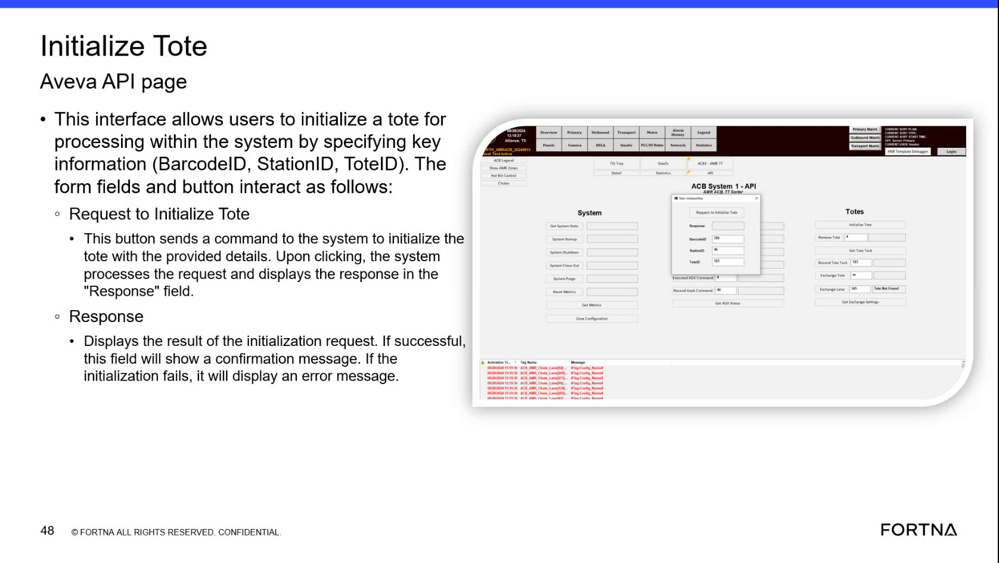

# Initialize a Tote Using the Aveva API “Initialize Tote” Page (Request + Response Check)

## Runbook Header

| Field | Value |
| --- | --- |
| Procedure ID | `proc_initialize_tote_aveva_api_request_response_v1` |
| Title | Initialize a Tote Using the Aveva API “Initialize Tote” Page (Request + Response Check) |
| Procedure Type | `operation` |
| Primary Role | `operator` |
| Supporting Roles | None |
| Support Safe | Yes |
| Capability Tags | `tote_lifecycle_state` |
| Access Surface | `aveva_hmi` |
| Audience Roles | `operator` |
| Failure Pattern Tags | None |
| Validation Status | `needs_sme_review` |
| Merge Status | `source_finalized` |

## Summary

Use the AVEVA HMI “Initialize Tote” API page to submit a tote initialization request by entering BarcodeID/Code ID, StationID, and ToteID, then confirm the outcome via the on-screen Response field (confirmation on success; error/tote status on failure).

## When To Use

When you need to initialize a tote for processing in the system using the AVEVA HMI “Initialize Tote” API page, and you want to verify success or capture the failure reason shown in the Response field.

## Access Or Tools Needed

* AVEVA HMI (Initialize Tote page / Aveva API page)

## Related Operational Context

* ctx_training_video_initialize_tote_api_page_v1
* ctx_training_video_initialize_tote_fields_v1
* ctx_training_video_initialize_tote_response_v1
* ctx_training_video_initialize_tote_agv_limitation_v1

## Visual References

*Initialize Tote Aveva API page showing the input fields (BarcodeID/Code ID, StationID, ToteID), the “Request to Initialize Tote” button, and the “Response” field behavior (confirmation on success; error/tote status on failure).*

## Procedure Steps

### Step 1 — Open the AVEVA HMI “Initialize Tote” API page

**Responsible role:** operator

**Instruction:**
On the AVEVA HMI, open the page labeled “Initialize Tote” (Aveva API page).

**Expected result:**
The “Initialize Tote” page is displayed with fields for BarcodeID/Code ID, StationID, ToteID, a button labeled “Request to Initialize Tote”, and a “Response” field.

---

### Step 2 — Enter BarcodeID/Code ID

**Responsible role:** operator

**Instruction:**
In the BarcodeID field, enter the tote barcode value. The source states BarcodeID and Code ID use the same number.

**Expected result:**
BarcodeID field contains the intended tote barcode value (same number as Code ID).

---

### Step 3 — Enter StationID for the rack station

**Responsible role:** operator

**Instruction:**
In the StationID field, enter the station ID for the rack station (the source notes StationID corresponds to station IDs shown in RMS).

**Expected result:**
StationID field contains the intended rack station ID.

---

### Step 4 — Enter ToteID

**Responsible role:** operator

**Instruction:**
In the ToteID field, enter the tote ID.

**Expected result:**
ToteID field contains the intended tote ID.

---

### Step 5 — Request tote initialization

**Responsible role:** operator

**Instruction:**
Click the button labeled “Request to Initialize Tote”.

**Expected result:**
The system processes the request and updates the “Response” field with the result.

---

### Step 6 — Check the “Response” field for success vs failure

**Responsible role:** operator

**Instruction:**
After the request completes, observe the “Response” field and confirm whether it shows a confirmation message (success) or an error message / tote status (failure).

**Expected result:**
The “Response” field displays either: (1) a confirmation message indicating the tote was initialized successfully, or (2) an error message / tote status explaining why initialization failed.

**Stop or Escalate If:**

* Stop and escalate if the Response field shows an initialization failure and you cannot determine the tote status reason from the displayed error/tote status text.
* If the response indicates AGV-related rejection (totes on an AGV), do not proceed with repeated initialization attempts without addressing the AGV condition implied by the response.

---

### Step 7 — If initialization fails, interpret the failure context shown in Response

**Responsible role:** operator

**Instruction:**
If Response indicates the tote cannot be initialized, check whether the displayed text matches the known contexts: totes on an AGV may be rejected; failures may indicate AGVs not in the system or AGVs that have been removed, and the response may include a tote status explaining why initialization failed.

**Expected result:**
You can identify the reason from the displayed error/tote status text (e.g., AGV-related rejection, AGV not in system, or AGV removed).

**Stop or Escalate If:**

* Stop and escalate if the Response field shows an initialization failure and you cannot determine the tote status reason from the displayed error/tote status text.
* If the response indicates AGV-related rejection (totes on an AGV), do not proceed with repeated initialization attempts without addressing the AGV condition implied by the response.

---

## Success Criteria

* After clicking “Request to Initialize Tote,” the “Response” field shows a confirmation message indicating the tote was initialized successfully.

## Failure Conditions

* “Response” field displays an error message or tote status indicating initialization failed.
* Response indicates the tote cannot be initialized due to AGV-related conditions (totes on an AGV).
* Response indicates AGV-related conditions such as AGVs not in the system or AGVs that have been removed.

## Escalation Guidance

* If the Response field shows an initialization failure and you cannot determine the tote status reason from the displayed error/tote status text, stop and escalate.

## Missing Details / Known Gaps

* The packet does not provide the exact navigation path/menu clicks to reach the AVEVA HMI “Initialize Tote” page (only that the page exists and is labeled “Initialize Tote”).

## Source Lineage

- Candidate IDs: candidate_training_video_initialize_tote_aveva_api_request_response
- Source ID: `training_video_day1`
- Source Type: `training_video`
