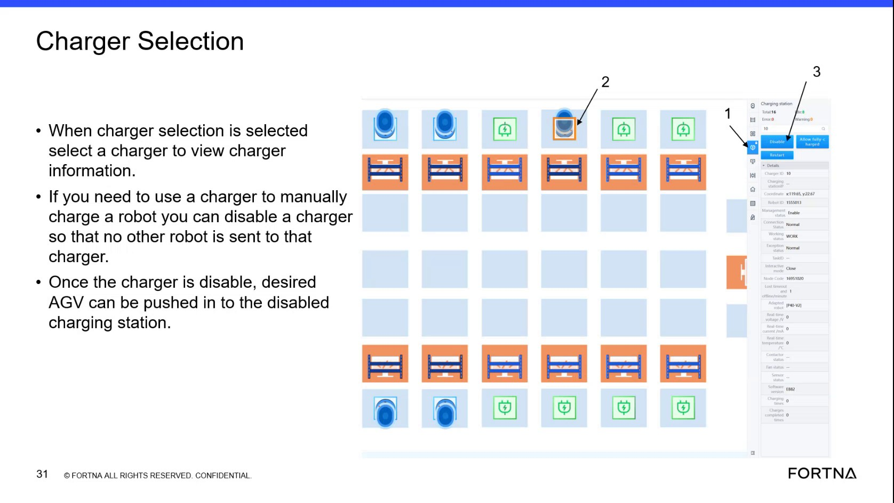

# Disable/Enable a Charging Location From RMS Charger Selection to Manually Charge a Low-Power AGV

## Runbook Header

| Field | Value |
| --- | --- |
| Procedure ID | `proc_disable_enable_charger_location_rms_charger_selection_manual_charge_v1` |
| Title | Disable/Enable a Charging Location From RMS Charger Selection to Manually Charge a Low-Power AGV |
| Procedure Type | `recovery` |
| Primary Role | `L2_support` |
| Supporting Roles | None |
| Support Safe | Yes |
| Capability Tags | `agv_charging_state` |
| Access Surface | `rms_ui` |
| Audience Roles | `L2_support` |
| Failure Pattern Tags | None |
| Validation Status | `needs_sme_review` |
| Merge Status | `source_finalized` |

## Summary

Use RMS Charger Selection to logically disable a specific charging location (by charger ID) so RMS will not route AGVs to it. Physically place a low-power AGV onto that disabled charger for a charging boost, then re-enable the charger so RMS/WCS can resume charging allocation from the charging queue.

## When To Use

When an AGV’s power is extremely low (e.g., stuck in an error state too long) and you need to manually place it onto a charger for a charging boost by preventing RMS from routing other AGVs to that charger.

## Safety And Operational Notes

* Disabling a charger is a logical allocation control (it does not “kill” the charger hardware).

## Access Or Tools Needed

* RMS / fleet status UI (rms_ui) with Charger Selection view

## Related Operational Context

* ctx_training_video_charger_selection_screen_v1
* ctx_training_video_disabled_charger_status_v1
* ctx_training_video_manual_charging_use_case_v1

## Visual References

*RMS Charger Selection frame showing charger selection by charger ID and the concept of enabled/disabled charger status for logical allocation control.*

## Procedure Steps

### Step 1 — Open RMS Charger Selection view

**Responsible role:** L2_support

**Instruction:**
In the RMS / fleet status UI (rms_ui), navigate to the Charger Selection view.

**Expected result:**
The Charger Selection view is open and shows charging stations with unique charger IDs available for selection.

---

### Step 2 — Select the target charger by charger ID

**Responsible role:** L2_support

**Instruction:**
In Charger Selection, click/select the target charging station using its unique charger ID.

**Expected result:**
The selected charger’s details are displayed for the chosen charger ID.

---

### Step 3 — Verify charger status is enabled or disabled

**Responsible role:** L2_support

**Instruction:**
Check the selected charger’s status field/label to determine whether it is currently enabled or disabled.

**Expected result:**
The selected charger shows a status indicating enabled vs disabled.

---

### Step 4 — Disable the charger allocation (logical disable) for manual charging

**Responsible role:** L2_support

**Instruction:**
If the charger is currently enabled and you need to manually charge the low-power AGV, click Disable for that charging location in the Charger Selection details panel.

**Expected result:**
The charger allocation is logically disabled (status changes to disabled).

**Stop or Escalate If:**

* Stop and escalate if the charger status does not change to disabled after clicking Disable.

---

### Step 5 — Confirm charger status shows disabled

**Responsible role:** L2_support

**Instruction:**
In Charger Selection details for the selected charger, confirm the status now indicates disabled.

**Expected result:**
The selected charger status shows disabled.

**Stop or Escalate If:**

* Stop and escalate if the charger status does not change to disabled after clicking Disable.

---

### Step 6 — Physically push/position the low-power AGV into the disabled charging station

**Responsible role:** L2_support

**Instruction:**
Physically push/position the low-power AGV into the disabled charging station (the charger remains physically present; it is logically unavailable for routing).

**Expected result:**
The low-power AGV is physically placed into the disabled charging station.

---

### Step 7 — Wait for the AGV to pick up a task and proceed via the described flow

**Responsible role:** L2_support

**Instruction:**
After the AGV is placed on the disabled charger, remove the AGV from the disabled charger once it has picked up a task and is going to the hospital in that tote (as described in the use case flow).

**Expected result:**
The AGV picks up a task and proceeds to the hospital in that tote; then the AGV is removed from the disabled charger.

**Stop or Escalate If:**

* Stop and escalate if the AGV does not pick up a task after being placed on the disabled charging station (the source describes that it should pick up a task and go to the hospital in that tote).

---

### Step 8 — Re-enable the charging location (logical enable)

**Responsible role:** L2_support

**Instruction:**
In Charger Selection, click Enable for that charger in the Charger Selection details panel.

**Expected result:**
The charger allocation is logically re-enabled (status changes back to enabled).

**Stop or Escalate If:**

* Stop and escalate if the charger status does not change back to enabled after clicking Enable.

---

### Step 9 — Confirm charger status returns to enabled

**Responsible role:** L2_support

**Instruction:**
Confirm the selected charger’s status in Charger Selection now indicates enabled.

**Expected result:**
The selected charger status shows enabled.

**Stop or Escalate If:**

* Stop and escalate if the charger status does not change back to enabled after clicking Enable.

---

## Success Criteria

* The selected charger status transitions to disabled after Disable is clicked.
* The selected charger status transitions back to enabled after Enable is clicked.
* After placing the low-power AGV on the disabled charger, the AGV picks up a task and proceeds via the described flow (to the hospital in that tote).

## Failure Conditions

* Charger status does not change to disabled after clicking Disable.
* Charger status does not change back to enabled after clicking Enable.
* AGV does not pick up a task after being placed on the disabled charging station.

## Escalation Guidance

* If charger status does not change as expected after Disable/Enable, stop and escalate.
* If the AGV does not pick up a task after being placed on the disabled charger, stop and escalate.

## Missing Details / Known Gaps

* The packet does not specify the exact UI label text for the Enable/Disable controls beyond the concepts “Disable” and “Enable” in Charger Selection details.
* The packet does not provide a specific observable UI indicator for “AGV picked up a task” (e.g., which RMS field/status to watch).

## Source Lineage

- Candidate IDs: candidate_training_video_rms_charger_selection_disable_enable_for_manual_charging
- Source ID: `training_video_day1`
- Source Type: `training_video`
