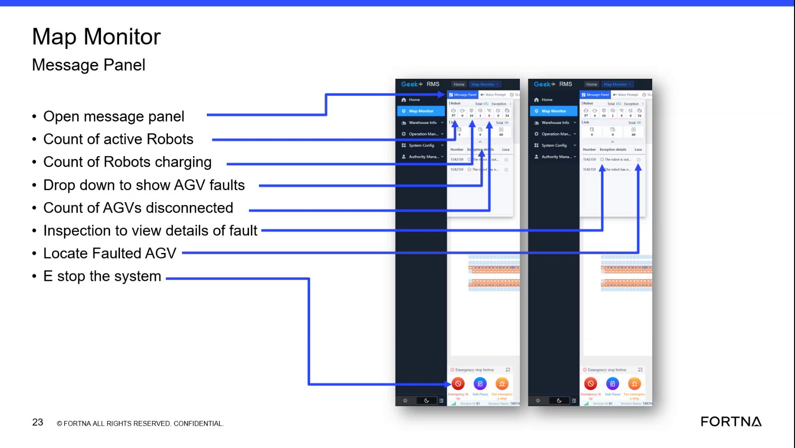

# Check RMS active robot count and charging robots count on the map monitor summary

## Runbook Header

| Field | Value |
| --- | --- |
| Procedure ID | `proc_check_rms_active_robot_and_charging_counts_v1` |
| Title | Check RMS active robot count and charging robots count on the map monitor summary |
| Procedure Type | `diagnostic` |
| Primary Role | `L1_support` |
| Supporting Roles | None |
| Support Safe | Yes |
| Capability Tags | `fleet_system_status` |
| Access Surface | `rms_ui` |
| Audience Roles | `L1_support` |
| Failure Pattern Tags | None |
| Validation Status | `needs_sme_review` |
| Merge Status | `source_finalized` |

## Summary

Use the RMS / fleet status UI map monitor summary metrics to read (1) the active robot count (robots actively running) and (2) the charging robots count (robots actively charging) at the current moment.

## When To Use

When you need a quick, high-level check of how many robots are actively running and how many are actively charging right now using the RMS map monitor summary metrics.

## Access Or Tools Needed

* RMS / fleet status UI (rms_ui)

## Related Operational Context

* ctx_training_video_robot_count_summary_metrics_v1

## Visual References

*Map Monitor Message Panel area showing the summary metrics including 'Count of active Robots' and 'Count of Robots charging' (example transcript mentions charging count '10').*

## Procedure Steps

### Step 1 — Open the RMS / fleet status UI map monitor summary area

**Responsible role:** L1_support

**Instruction:**
Open the RMS / fleet status UI and navigate to the map monitor summary area that contains the Map Monitor Message Panel summary metrics.

**Expected result:**
The RMS map monitor summary metrics panel is visible, including the metric labeled 'active robot count' (robots actively running) and the metric labeled for robots charging (charging robots count).

---

### Step 2 — Read the active robot count (robots actively running)

**Responsible role:** L1_support

**Instruction:**
In the RMS map monitor summary metrics, locate the 'active robot count' metric and read its value.

**Expected result:**
You obtain the numeric value for 'active robot count' that represents how many robots are actively running in the system.

**Stop or Escalate If:**

* Active robot count is unexpectedly low/high relative to operator expectation for the shift.

---

### Step 3 — Read the charging robots count (robots actively charging)

**Responsible role:** L1_support

**Instruction:**
In the RMS map monitor summary metrics, locate the metric for robots that are on the charter / charging robots (charging robots count) and read its value.

**Expected result:**
You obtain the numeric value for the charging robots count that represents how many robots are actively charging at the moment (example described as '10').

**Stop or Escalate If:**

* Charging robots count is unexpectedly low/high relative to operator expectation for the shift.
* Charging robots count does not align with observed system behavior (e.g., robots visibly charging but charging count is 0, or vice versa).

---

### Step 4 — Stop and escalate on unexpected count mismatch

**Responsible role:** L1_support

**Instruction:**
If either the active robot count or the charging robots count is unexpectedly low/high relative to operator expectation for the shift, stop and escalate.

**Expected result:**
A mismatch condition is identified and escalation is initiated when counts are unexpectedly low/high or do not align with observed system behavior.

**Stop or Escalate If:**

* Active robot count unexpectedly low/high relative to operator expectation for the shift.
* Charging robots count unexpectedly low/high relative to operator expectation for the shift.
* Charging count mismatch with observed system behavior (e.g., robots visibly charging but charging count is 0, or vice versa).

---

## Success Criteria

* Active robot count value is read from the RMS map monitor summary and interpreted as robots actively running.
* Charging robots count value is read from the RMS map monitor summary and interpreted as robots actively charging.
* Escalation occurs when either count is unexpectedly low/high relative to operator expectation or mismatches observed behavior.

## Failure Conditions

* Active robot count is unexpectedly low/high relative to operator expectation for the shift.
* Charging robots count is unexpectedly low/high relative to operator expectation for the shift.
* Charging robots count does not align with observed system behavior (e.g., robots visibly charging but charging count is 0, or vice versa).

## Escalation Guidance

* Escalate when either metric is unexpectedly low/high relative to operator expectation for the shift or when the charging count mismatches observed system behavior.

## Missing Details / Known Gaps

* No explicit numeric thresholds for 'unexpectedly low/high' are provided; escalation judgment must use operator expectation supplied externally.

## Source Lineage

- Candidate IDs: candidate_training_video_rms_check_active_robot_count_and_charging_robots
- Source ID: `training_video_day1`
- Source Type: `training_video`
