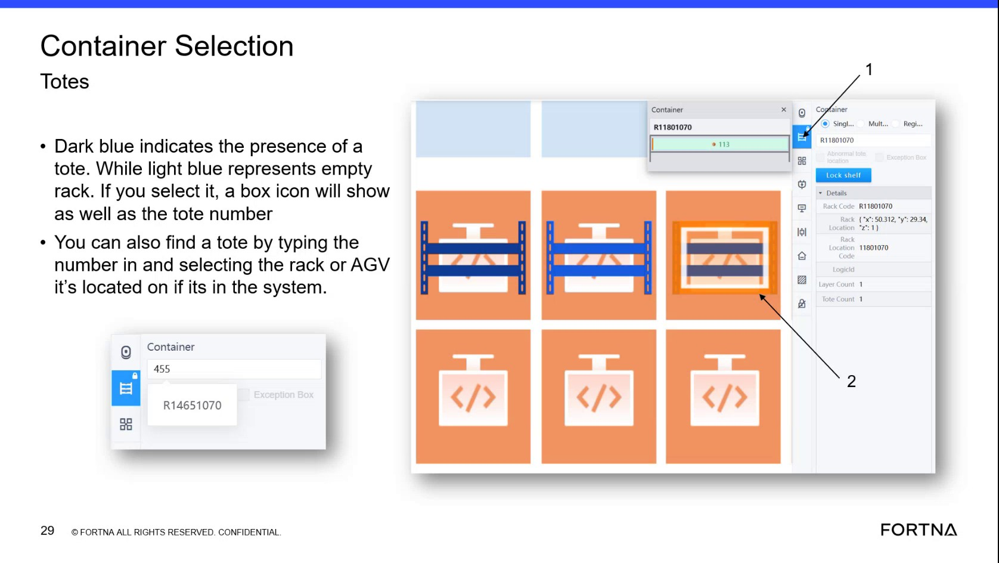

# Click a dark blue rack in RMS to view which tote is associated to that rack

## Runbook Header

| Field | Value |
| --- | --- |
| Procedure ID | `proc_click_dark_blue_rack_in_rms_view_associated_tote_v1` |
| Title | Click a dark blue rack in RMS to view which tote is associated to that rack |
| Procedure Type | `diagnostic` |
| Primary Role | `L1_support` |
| Supporting Roles | `L1_support` |
| Support Safe | Yes |
| Capability Tags | `device_roster_state` |
| Access Surface | `rms_ui` |
| Audience Roles | `L1_support` |
| Failure Pattern Tags | `mapping_abnormal` |
| Validation Status | `needs_sme_review` |
| Merge Status | `source_finalized` |

## Summary

Use the RMS / fleet status UI map to verify which tote number is currently associated with a specific rack location. Dark blue/violet rack locations indicate a tote is present; clicking the rack reveals the tote number so you can compare it to the expected tote for that rack position and detect mismatches.

## When To Use

When you need to confirm the tote number RMS shows for a particular rack position (e.g., to validate whether the correct tote is on the expected sorter destination rack).

## Access Or Tools Needed

* RMS / fleet status UI (rms_ui)

## Related Operational Context

* ctx_training_video_rack_click_tote_identity_v1

## Visual References

*Training frame showing rack locations and the rule: dark blue/violet rack indicates a tote is on the rack; clicking the rack reveals the tote number associated with that rack.*

## Procedure Steps

### Step 1 — Open RMS / fleet status UI and locate the rack position to verify

**Responsible role:** L1_support

**Instruction:**
Open the RMS / fleet status UI (map view) and find the rack location you want to verify.

**Expected result:**
You can visually identify the target rack location on the RMS map.

---

### Step 2 — Confirm the rack is dark blue/violet (tote present)

**Responsible role:** L1_support

**Instruction:**
Confirm the rack location color is dark blue (almost like a violet).

**Expected result:**
The rack location you plan to click is dark blue/violet, indicating a tote is on that rack.

---

### Step 3 — Click the dark blue rack location on the RMS map

**Responsible role:** L1_support

**Instruction:**
Click the dark blue rack location on the RMS map.

**Expected result:**
RMS updates to show the tote identifier/number associated with the clicked rack.

---

### Step 4 — Read the tote number shown for the clicked rack

**Responsible role:** L1_support

**Instruction:**
Observe the tote identifier/number displayed for that rack after clicking.

**Expected result:**
A tote number/identifier is visible in RMS for the clicked rack.

---

### Step 5 — Compare displayed tote number to expected tote number for that rack position

**Responsible role:** L1_support

**Instruction:**
Compare the tote number displayed in RMS to the expected tote number for that rack position (for example, if someone reports tote HV 110 but RMS shows 113).

**Expected result:**
You determine whether the displayed tote number matches or mismatches the expected tote number for the rack position.

**Stop or Escalate If:**

* Stop and escalate if the displayed tote number does not match the expected tote number for the rack position.

---

## Success Criteria

* RMS shows a tote number after clicking the dark blue/violet rack location.
* The displayed tote number matches the expected tote number for the rack position (or you escalate when it does not).

## Failure Conditions

* Rack is not dark blue/violet (appears light blue indicating empty) when you expect a tote.
* After clicking, RMS does not display a tote number/identifier for the rack.
* Displayed tote number does not match the expected tote number for the rack position.

## Escalation Guidance

* Escalate when the displayed tote number after clicking the rack does not match the expected tote number for that rack position.

## Missing Details / Known Gaps

* The packet does not specify the exact RMS UI field label/name where the tote number appears after clicking the rack (only that RMS displays the tote number/identifier).

## Source Lineage

- Candidate IDs: candidate_training_video_rms_click_rack_to_view_associated_tote
- Source ID: `training_video_day1`
- Source Type: `training_video`
