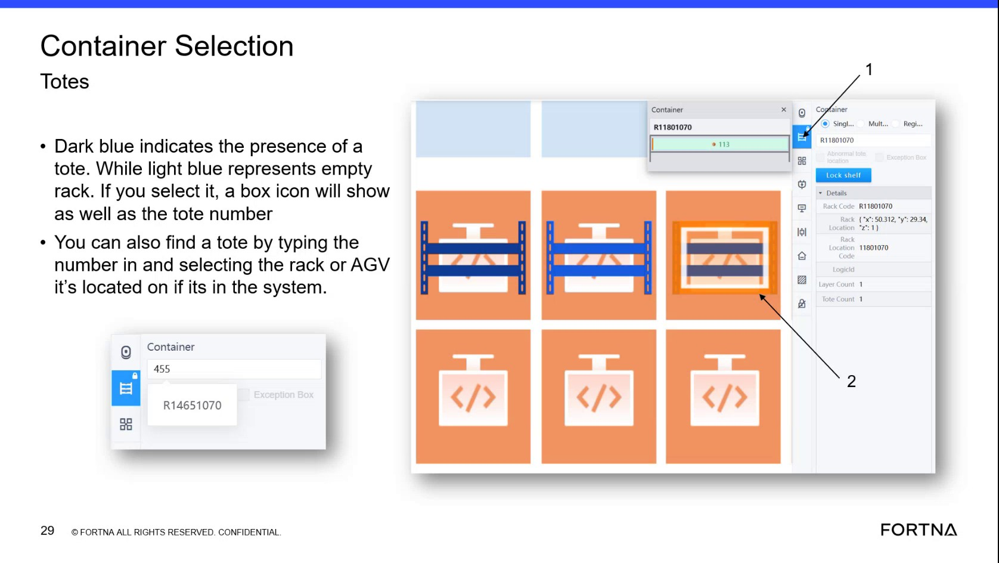

# Find a tote location in RMS by typing the tote number in the container section

## Runbook Header

| Field | Value |
| --- | --- |
| Procedure ID | `proc_find_tote_location_in_rms_by_typing_tote_number_v1` |
| Title | Find a tote location in RMS by typing the tote number in the container section |
| Procedure Type | `operation` |
| Primary Role | `L1_support` |
| Supporting Roles | None |
| Support Safe | Yes |
| Capability Tags | `device_roster_state` |
| Access Surface | `rms_ui` |
| Audience Roles | `L1_support` |
| Failure Pattern Tags | None |
| Validation Status | `needs_sme_review` |
| Merge Status | `source_finalized` |

## Summary

Use the RMS / fleet status UI container section tote lookup to enter a tote number and navigate the map to where that tote is currently represented/added in the system.

## When To Use

When you need to locate where a specific tote is in the system so you can navigate the RMS map to that tote’s current location for follow-on recovery actions.

## Access Or Tools Needed

* RMS / fleet status UI (rms_ui)

## Related Operational Context

* ctx_training_video_tote_search_container_section_v1

## Visual References

*RMS container/rack area context showing container selection and tote/rack identification; includes the segment where tote lookup by typing tote number is described.*

## Procedure Steps

### Step 1 — Open RMS / fleet status UI and locate the container section tote lookup

**Responsible role:** L1_support

**Instruction:**
In the RMS / fleet status UI (map view), locate the container selection/container section that allows you to look up a tote by typing its tote number.

**Expected result:**
You are positioned in the RMS container section where a tote number can be entered for lookup.

---

### Step 2 — Enter the tote number into the container section

**Responsible role:** L1_support

**Instruction:**
Type the tote number into the tote number search/entry field in the container section.

**Expected result:**
The tote number is entered into the container section tote lookup field.

---

### Step 3 — Submit/confirm the tote lookup so the map navigates

**Responsible role:** L1_support

**Instruction:**
Submit/confirm the tote number entry (if the UI requires an action) so the map navigates to the tote’s location.

**Expected result:**
RMS updates the map view in response to the tote lookup submission.

---

### Step 4 — Verify the map view moves to the tote’s location

**Responsible role:** L1_support

**Instruction:**
Verify the map view moves to the part of the map where that tote is located/has been added.

**Expected result:**
The RMS map view is positioned at the tote’s represented location (where that tote has been added in the system).

**Stop or Escalate If:**

* Stop and escalate if the tote number does not take you to any location where the tote is expected to be found (possible incorrect tote association or missing tote state).

---

## Success Criteria

* After entering a tote number and submitting (if required), RMS navigates the map to the part of the map where that tote is represented/added in the system.

## Failure Conditions

* Tote lookup does not navigate to any location where the tote is expected to be found, suggesting incorrect tote association or missing tote state.

## Escalation Guidance

* If the tote lookup does not take you to the expected tote location, escalate for investigation of possible incorrect tote association or missing tote state.

## Missing Details / Known Gaps

* The packet does not provide the exact UI control label/name for the tote number search/entry field in the RMS container section; the procedure uses the generic “tote number search/entry field” wording.

## Source Lineage

- Candidate IDs: candidate_training_video_rms_find_tote_by_typing_tote_number
- Source ID: `training_video_day1`
- Source Type: `training_video`
