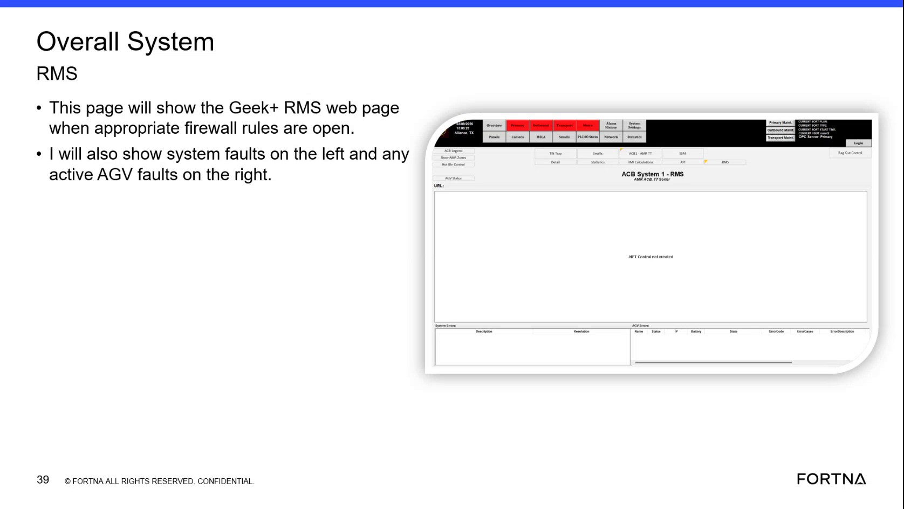

# Check RMS screen for system faults as the first step during an OptiSweep support call

## Runbook Header

| Field | Value |
| --- | --- |
| Procedure ID | `proc_check_rms_screen_for_system_faults_first_step_v1` |
| Title | Check RMS screen for system faults as the first step during an OptiSweep support call |
| Procedure Type | `diagnostic` |
| Primary Role | `L1_support` |
| Supporting Roles | `operator` |
| Support Safe | Yes |
| Capability Tags | `fleet_system_status` |
| Access Surface | `rms_ui` |
| Audience Roles | `L1_support` |
| Failure Pattern Tags | None |
| Validation Status | `needs_sme_review` |
| Merge Status | `source_finalized` |

## Summary

During an OptiSweep support call, check the RMS / fleet status UI first to determine whether any system faults are present. This quickly establishes whether the issue is likely fleet-wide/system-level before deeper diagnostics.

## When To Use

Use at the start of a support call to answer: “Are there any system faults?” and to decide whether to proceed with deeper diagnostics based on whether system faults are visible on the RMS screen.

## Do Not Use For

* Do not use this procedure as the only step when the RMS screen is blank/unreachable; the segment indicates escalation is needed, but does not provide alternate access steps.

## Access Or Tools Needed

* RMS / fleet status UI (rms_ui)
* RMS dashboard URL (provided to support users per segment)

## Related Operational Context

* ctx_training_video_rms_system_faults_first_check_v1

## Visual References

*RMS page showing where system faults are displayed (system faults on the left; active AGV faults on the right).*

*RMS page behavior note: firewall not open can result in the RMS page showing blank.*

## Procedure Steps

### Step 1 — Open the RMS / fleet status UI (RMS screen) using the provided dashboard URL

**Responsible role:** L1_support

**Instruction:**
Open the RMS / fleet status UI (RMS screen) using the provided RMS dashboard URL.

**Expected result:**
The RMS screen loads and is ready to view system-fault indications.

**Stop or Escalate If:**

* RMS screen cannot be accessed or does not load (blank/unreachable).

---

### Step 2 — Check the RMS screen for system-fault indications

**Responsible role:** L1_support

**Instruction:**
On the RMS screen, look for the system-faults area/list/status indicator (system faults shown on the left).

**Expected result:**
You can observe whether system faults are present (system-fault indications visible) or absent (no system-fault indication shown).

---

### Step 3 — If system faults are present, record what is shown on the RMS screen

**Responsible role:** L1_support

**Instruction:**
Record the system-fault indicators shown on the RMS screen, including any visible fault identifiers/status text.

**Expected result:**
A clear note exists describing the visible system-fault indicators and any fault identifiers/status text shown on the RMS screen.

---

### Step 4 — If no system faults are present, record absence and proceed with further evidence gathering

**Responsible role:** L1_support

**Instruction:**
Record that the RMS screen shows no system-fault indication, then proceed with further evidence gathering (the segment does not specify which next surfaces/steps to use).

**Expected result:**
A note exists stating that no system-fault indication is visible on the RMS screen.

---

## Success Criteria

* RMS / fleet status UI is opened successfully (or escalation is triggered if it cannot be accessed).
* System-fault presence/absence is observed on the RMS screen and recorded (including visible fault identifiers/status text when present).

## Failure Conditions

* RMS screen cannot be accessed or does not load (e.g., blank).
* System-fault indications are visible on the RMS screen.

## Escalation Guidance

* If the RMS screen cannot be accessed or does not load, escalate using the support process. (This segment does not provide alternate access steps.)

## Missing Details / Known Gaps

* The segment does not provide specific alternate surfaces/steps to use when the RMS screen cannot be accessed or does not load; it only states to escalate using the support process.
* The segment does not name specific RMS widget labels/fields beyond the general placement of system faults (left side) and active AGV faults (right side).

## Source Lineage

- Candidate IDs: candidate_training_video_rms_first_check_system_faults
- Source ID: `training_video_day1`
- Source Type: `training_video`
