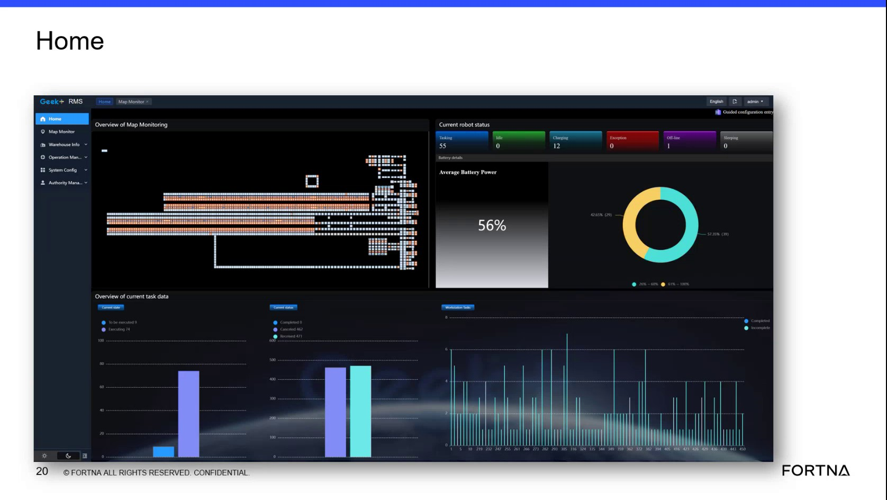

# Access RMS web application via site Argus server IP and verify the RMS overview screen loads

## Runbook Header

| Field | Value |
| --- | --- |
| Procedure ID | `proc_access_rms_web_ui_via_site_argus_ip_and_verify_overview_v1` |
| Title | Access RMS web application via site Argus server IP and verify the RMS overview screen loads |
| Procedure Type | `diagnostic` |
| Primary Role | `L1_support` |
| Supporting Roles | None |
| Support Safe | Yes |
| Capability Tags | `fleet_system_status` |
| Access Surface | `rms_ui` |
| Audience Roles | `L1_support` |
| Failure Pattern Tags | None |
| Validation Status | `needs_sme_review` |
| Merge Status | `source_finalized` |

## Summary

Verify that the RMS / fleet status web UI is reachable from a supported workstation using the site-provided unique IP, that login succeeds with the provided username/password, and that the RMS overview screen loads. Use this as the first connectivity/login check when troubleshooting RMS web availability.

## When To Use

Use when you need a first-pass check that the RMS web application is reachable and that authentication leads to the RMS overview screen (the initial landing/overview page).

## Do Not Use For

* Do not use this procedure as a deep-dive into specific AGV faults or active error root cause after the overview screen is already reachable.

## Access Or Tools Needed

* RMS / fleet status UI (rms_ui)
* Web browser
* Site-provided RMS unique IP address
* RMS username and password

## Related Operational Context

* ctx_training_video_rms_system_overview_v1
* ctx_training_video_rms_site_access_model_v1
* ctx_training_video_rms_web_login_overview_screen_v1

## Visual References

*Training frame showing the RMS web application landing/overview context and the statement that each site has an Argus server and a unique IP to access the RMS web location; includes the overview screen reference.*

## Procedure Steps

### Step 1 — Open the RMS web location using the site-provided unique IP

**Responsible role:** L1_support

**Instruction:**
From a supported workstation, open a web browser and navigate to the site-provided RMS web location using the unique IP address for the RMS service.

**Expected result:**
The RMS web application landing page loads (i.e., the browser reaches the RMS web location).

**Stop or Escalate If:**

* If the RMS web application is unreachable (page won’t load), stop and escalate as an RMS web access/connectivity issue.

---

### Step 2 — Authenticate on the RMS login page

**Responsible role:** L1_support

**Instruction:**
On the RMS login page, enter the username and password provided for RMS access, then submit/login.

**Expected result:**
Login succeeds and the session proceeds to the RMS overview screen.

**Stop or Escalate If:**

* If login does not lead to the RMS overview screen, treat it as an RMS web access/connectivity issue and stop further RMS/API actions until connectivity is restored.

---

### Step 3 — Verify the RMS overview screen is displayed

**Responsible role:** L1_support

**Instruction:**
After login, verify you are on the RMS overview screen (the screen described as “this is what you will see… the overview screen”).

**Expected result:**
The RMS overview screen is displayed.

**Stop or Escalate If:**

* If the overview screen does not appear after successful login, stop further RMS/API actions and escalate as an RMS web access/connectivity issue.

---

## Success Criteria

* RMS web application is reachable using the site’s unique IP.
* Login succeeds using the provided username/password.
* The RMS overview screen is displayed after login.

## Failure Conditions

* RMS web application is unreachable (page won’t load).
* Login does not lead to the RMS overview screen.

## Escalation Guidance

* Escalate if the RMS web application is unreachable or if login does not lead to the RMS overview screen; treat as an RMS web access/connectivity issue and do not proceed with further RMS/API actions until connectivity is restored.

## Missing Details / Known Gaps

* The source does not provide the exact RMS login page URL path, specific button labels, or the exact UI field names for username/password; only the presence of username/password and the overview screen are described.

## Source Lineage

- Candidate IDs: candidate_training_video_rms_login_overview_check
- Source ID: `training_video_day1`
- Source Type: `training_video`
