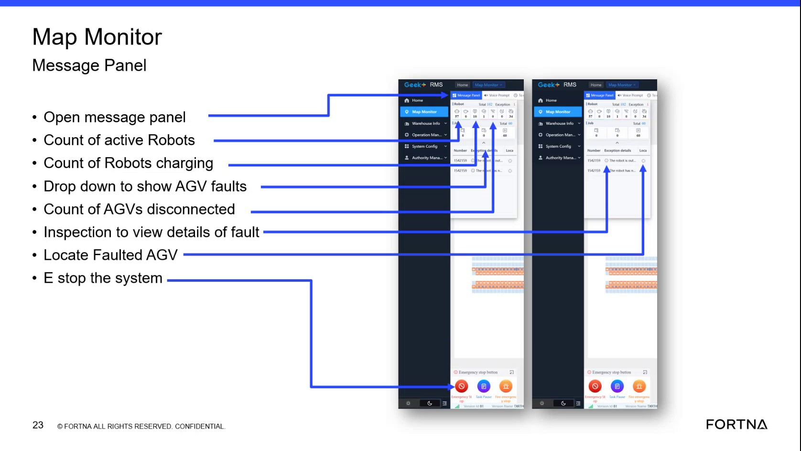

# Open RMS AGV fault drop-down to view current faults/errors

## Runbook Header

| Field | Value |
| --- | --- |
| Procedure ID | `proc_open_rms_agv_fault_dropdown_v1` |
| Title | Open RMS AGV fault drop-down to view current faults/errors |
| Procedure Type | `diagnostic` |
| Primary Role | `L1_support` |
| Supporting Roles | None |
| Support Safe | Yes |
| Capability Tags | `agv_active_errors` |
| Access Surface | `rms_ui` |
| Audience Roles | `L1_support` |
| Failure Pattern Tags | None |
| Validation Status | `needs_sme_review` |
| Merge Status | `source_finalized` |

## Summary

Use the small drop-down in the RMS / fleet status UI map monitor summary area to reveal current AGV fault/error items that need attention when the drop-down is hidden or collapsed.

## When To Use

When you need to view the current AGV faults/errors list from the RMS map monitor summary area and the drop-down is hidden/collapsed.

## Access Or Tools Needed

* RMS / fleet status UI (rms_ui)

## Related Operational Context

* ctx_training_video_agv_fault_dropdown_v1

## Visual References

*Map Monitor Message Panel area showing the small drop-down to show AGV faults (and related summary metrics).*

*Map Monitor Message Panel area showing the small drop-down to show AGV faults (and related summary metrics).*

## Procedure Steps

### Step 1 — Open the RMS / fleet status UI map monitor summary area

**Responsible role:** L1_support

**Instruction:**
Open the RMS / fleet status UI (rms_ui) and navigate to the map monitor summary area that contains the Map Monitor Message Panel metrics and the small drop-down for AGV faults.

**Expected result:**
The RMS map monitor summary area is visible, including the small drop-down control associated with showing AGV faults.

---

### Step 2 — Expand the AGV faults drop-down if it is hidden/collapsed

**Responsible role:** L1_support

**Instruction:**
Check whether the AGV faults drop-down is visible. If it is hidden/collapsed, locate the drop-down control in the summary area and click it to expand.

**Expected result:**
The AGV faults drop-down expands and displays the current fault/error items list.

---

### Step 3 — Read the current fault/error items from the expanded drop-down

**Responsible role:** L1_support

**Instruction:**
With the AGV faults drop-down expanded, read the list of current fault/error items shown in the drop-down.

**Expected result:**
The expanded drop-down shows a list of current fault/error items that need attention.

**Stop or Escalate If:**

* Escalate if the drop-down does not reveal any faults while other indicators (e.g., message panel) show active errors/warnings.

---

### Step 4 — Stop and escalate when the drop-down list is insufficient for deeper investigation

**Responsible role:** L1_support

**Instruction:**
If the expanded drop-down shows faults that require deeper investigation and you cannot identify the affected AGV(s) or fault details from the drop-down list, stop and escalate.

**Expected result:**
You escalate rather than guessing when the drop-down list alone cannot identify the affected AGV(s) or provide sufficient fault details.

**Stop or Escalate If:**

* Drop-down shows faults requiring deeper investigation and affected AGV(s)/fault details cannot be identified from the drop-down list.

---

## Success Criteria

* The AGV faults drop-down is expanded in the RMS map monitor summary area.
* The expanded drop-down displays the current fault/error items list.

## Failure Conditions

* AGV faults drop-down remains hidden/collapsed and cannot be expanded.
* Expanded drop-down shows no fault/error items while other RMS indicators show active errors/warnings.
* Fault/error items require deeper investigation but affected AGV(s) or fault details cannot be identified from the drop-down list.

## Escalation Guidance

* Escalate when the drop-down list does not provide enough information to identify affected AGV(s) or fault details, or when the drop-down shows no faults despite other RMS indicators showing active errors/warnings.

## Missing Details / Known Gaps

* The source does not provide exact UI label text for the AGV faults drop-down control or the exact fault/error list item formatting; image support is requested to capture the control and list items.

## Source Lineage

- Candidate IDs: candidate_training_video_rms_open_agv_fault_dropdown
- Source ID: `training_video_day1`
- Source Type: `training_video`
