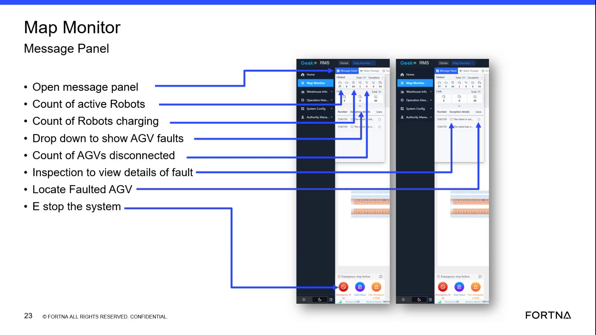

# Review RMS open message panel for active errors/warnings and alarm history (past 24–48 hours)

## Runbook Header

| Field | Value |
| --- | --- |
| Procedure ID | `proc_review_rms_open_message_panel_alarm_history_v1` |
| Title | Review RMS open message panel for active errors/warnings and alarm history (past 24–48 hours) |
| Procedure Type | `diagnostic` |
| Primary Role | `L1_support` |
| Supporting Roles | None |
| Support Safe | Yes |
| Capability Tags | `agv_active_errors` |
| Access Surface | `rms_ui` |
| Audience Roles | `L1_support` |
| Failure Pattern Tags | None |
| Validation Status | `needs_sme_review` |
| Merge Status | `source_finalized` |

## Summary

Use the RMS / fleet status UI open message panel to view pending messages containing active errors or warnings, and review the alarm history window covering roughly the past 24–48 hours.

## When To Use

When you need to quickly check whether the fleet has pending active error/warning messages and to review recent alarm history over the last ~24–48 hours.

## Access Or Tools Needed

* RMS / fleet status UI (rms_ui)

## Related Operational Context

* ctx_training_video_message_panel_alarm_history_v1

## Visual References

*Map Monitor Message Panel frame showing the open message panel area and related counts (active robots, charging, AGV faults dropdown, disconnected count) used to locate the open message panel and interpret what is shown.*

## Procedure Steps

### Step 1 — Open the RMS / fleet status UI map monitor summary area

**Responsible role:** L1_support

**Instruction:**
In the RMS / fleet status UI (rms_ui), navigate to the map monitor summary area where the open message panel is located.

**Expected result:**
You are viewing the map monitor summary area that contains the open message panel.

---

### Step 2 — Expand/open the open message panel to view pending active errors/warnings

**Responsible role:** L1_support

**Instruction:**
Open/expand the open message panel in the RMS / fleet status UI to display pending messages containing active errors or warnings.

**Expected result:**
The open message panel shows a list of pending messages that contain active errors or warnings.

**Stop or Escalate If:**

* Stop and escalate if the message panel shows active errors/warnings that require attention and you cannot identify the fault details from the panel contents.

---

### Step 3 — Review alarm history window in the same panel (past ~24–48 hours)

**Responsible role:** L1_support

**Instruction:**
Within the same open message panel view, review the alarm history list and confirm the displayed history window corresponds to roughly the past 24–48 hours.

**Expected result:**
The alarm history list is visible and the time window shown corresponds to roughly the past 24–48 hours.

---

### Step 4 — Stop and escalate when panel contents are insufficient to identify fault details

**Responsible role:** L1_support

**Instruction:**
If the open message panel indicates active errors/warnings requiring attention but you cannot identify the fault details from the panel contents, stop further interpretation and escalate.

**Expected result:**
You have identified the condition where fault details are not determinable from the panel contents and you initiate escalation.

**Stop or Escalate If:**

* Active errors/warnings require attention AND fault details cannot be identified from the panel contents.

---

## Success Criteria

* Open message panel shows pending messages containing active errors or warnings (when present).
* Alarm history window shown in the panel corresponds to roughly the past 24–48 hours.

## Failure Conditions

* No pending active errors/warnings are shown when the system is known to be faulting.
* You cannot determine what the active errors/warnings are from the open message panel contents.
* Alarm history window shown does not correspond to roughly the past 24–48 hours.

## Escalation Guidance

* Escalate when active errors/warnings require attention but fault details cannot be identified from the open message panel contents.

## Missing Details / Known Gaps

* The candidate does not provide explicit UI field labels or exact click/expand control names for the open message panel; it only specifies the panel exists in the map monitor summary area.
* The candidate does not provide the exact alarm history time-window control/label text (only that it is roughly the past 24–48 hours).

## Source Lineage

- Candidate IDs: candidate_training_video_rms_open_message_panel_alarm_history
- Source ID: `training_video_day1`
- Source Type: `training_video`
