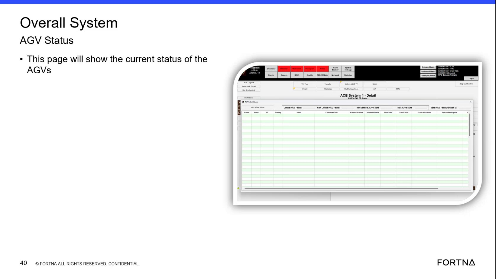

# Check RMS for Overall System AGV Status to confirm remote availability

## Runbook Header

| Field | Value |
| --- | --- |
| Procedure ID | `proc_check_rms_overall_system_agv_status_remote_availability_v1` |
| Title | Check RMS for Overall System AGV Status to confirm remote availability |
| Procedure Type | `diagnostic` |
| Primary Role | `L1_support` |
| Supporting Roles | None |
| Support Safe | Yes |
| Capability Tags | `fleet_system_status` |
| Access Surface | `rms_ui` |
| Audience Roles | `L1_support` |
| Failure Pattern Tags | None |
| Validation Status | `needs_sme_review` |
| Merge Status | `source_finalized` |

## Summary

Use the RMS / fleet status web UI to open the page titled “Overall System AGV Status” and confirm the page loads and displays the current overall system status content. This is used to verify remote availability of the RMS overview page.

## When To Use

When you need to confirm that the RMS fleet status UI is reachable remotely and that the “Overall System AGV Status” overview page is displaying the current overall system status.

## Do Not Use For

* Do not use this procedure as a deep-dive for a single AGV’s active error/fault details; this procedure only confirms the overall status page is reachable and populated.

## Access Or Tools Needed

* rms_ui (RMS / fleet status web UI)

## Related Operational Context

* ctx_training_video_rms_page_remote_availability_v1
* ctx_training_video_overall_system_agv_status_page_v1
* ctx_training_video_overall_system_agv_status_current_status_v1

## Visual References

*Frame showing the “Overall System AGV Status” page title and the statement that this page will show the current status (used as visual reference for what to look for on the page).*

## Procedure Steps

### Step 1 — Open the RMS / fleet status UI (RMS web UI)

**Responsible role:** L1_support

**Instruction:**
Open the RMS / fleet status web UI (rms_ui).

**Expected result:**
RMS / fleet status UI opens successfully (i.e., you can proceed to navigate within RMS).

**Stop or Escalate If:**

* RMS / fleet status UI is unreachable or fails to load

---

### Step 2 — Navigate to the “Overall System AGV Status” page

**Responsible role:** L1_support

**Instruction:**
Within RMS, navigate to the page titled “Overall System AGV Status”.

**Expected result:**
The “Overall System AGV Status” page is displayed (page title/header visible).

**Stop or Escalate If:**

* “Overall System AGV Status” page does not load

---

### Step 3 — Verify the page displays the current overall system status content

**Responsible role:** L1_support

**Instruction:**
On the “Overall System AGV Status” page, observe the page content that indicates the current overall system status (the page is described as showing the current status).

**Expected result:**
The “Overall System AGV Status” page loads and displays current overall system status information (not blank/unavailable).

**Stop or Escalate If:**

* The “Overall System AGV Status” content is missing/blank
* The page appears unreachable after navigation

---

## Success Criteria

* RMS / fleet status UI is reachable remotely.
* The “Overall System AGV Status” page loads successfully.
* The “Overall System AGV Status” page displays current overall system status content (not blank/unavailable).

## Failure Conditions

* RMS / fleet status UI cannot be reached remotely.
* “Overall System AGV Status” page does not load.
* “Overall System AGV Status” page content is missing/blank.

## Escalation Guidance

* If RMS is unreachable or the “Overall System AGV Status” content is missing/blank, escalate for remote access/network/service troubleshooting.

## Missing Details / Known Gaps

* The candidate does not provide the exact RMS navigation path/click sequence to reach “Overall System AGV Status” (only the page title is referenced).
* The candidate does not specify which exact fields/indicators on the page represent “current overall system status” beyond the general statement that the page shows current status.

## Source Lineage

- Candidate IDs: candidate_training_video_rms_overall_system_agv_status_check_remote_availability
- Source ID: `training_video_day1`
- Source Type: `training_video`
