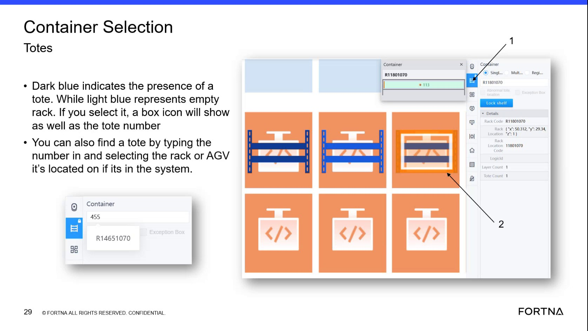

# Identify tote presence at sorter rack locations using RMS rack color (dark blue vs light blue)

## Runbook Header

| Field | Value |
| --- | --- |
| Procedure ID | `proc_identify_tote_presence_sorter_rack_color_rms_v1` |
| Title | Identify tote presence at sorter rack locations using RMS rack color (dark blue vs light blue) |
| Procedure Type | `diagnostic` |
| Primary Role | `L1_support` |
| Supporting Roles | `operator` |
| Support Safe | Yes |
| Capability Tags | `agv_active_errors` |
| Access Surface | `rms_ui` |
| Audience Roles | `L1_support` |
| Failure Pattern Tags | None |
| Validation Status | `needs_sme_review` |
| Merge Status | `source_finalized` |

## Summary

Use the RMS/map view rack location color to determine whether a sorter rack position is expected to have a tote present or is empty. Dark blue/violet indicates a tote is on the rack; light blue indicates the rack is empty. Use this to flag mismatches when a tote should exist at a sorter destination but the map shows the empty color.

## When To Use

When investigating a suspected tote addition/removal mismatch at a sorter destination and you need a quick, visual confirmation of tote presence/absence at specific rack locations in the RMS/map view.

## Access Or Tools Needed

* RMS / fleet status UI (rms_ui)

## Related Operational Context

* ctx_training_video_rack_color_tote_presence_v1

## Visual References

*RMS/map view example frame showing rack locations and the two distinct rack colors (dark blue/violet vs light blue) used to indicate tote presence vs empty.*

## Procedure Steps

### Step 1 — Open RMS/map view and locate the sorter destination rack locations

**Responsible role:** L1_support

**Instruction:**
In the RMS / fleet status UI (RMS/map view), locate the sorter destination rack locations on the map for the rack position(s) you are investigating.

**Expected result:**
You can visually identify the specific rack position(s) on the RMS map for the sorter destination you are checking.

---

### Step 2 — Interpret rack color as tote present vs empty

**Responsible role:** L1_support

**Instruction:**
Visually check the rack location color for the specific rack position you are investigating and interpret it using the RMS color meaning: dark blue/violet = tote present; light blue = rack empty.

**Expected result:**
For the rack position you are investigating, you determine one of two states based on color: dark blue/violet (tote present) or light blue (rack empty).

---

### Step 3 — Compare observed rack color to expected tote presence at the destination

**Responsible role:** L1_support

**Instruction:**
Compare the observed rack color state (tote present vs empty) to what you expect to be present at that sorter destination (for example, you expect a tote there but the rack shows light blue).

**Expected result:**
You conclude whether the rack color matches expected tote presence or indicates a mismatch (expected tote but observed empty/light blue).

**Stop or Escalate If:**

* Stop and escalate if the rack color indicates “empty” (light blue) where a tote should be present.

---

## Success Criteria

* For the investigated sorter destination rack position(s), you correctly interpret RMS rack color as tote present (dark blue/violet) or rack empty (light blue).
* You identify whether the observed rack color matches the expected tote presence at the destination, and you flag mismatches for escalation.

## Failure Conditions

* RMS shows light blue (rack empty) at a sorter destination where a tote is expected to be present (mismatch).

## Escalation Guidance

* Escalate when the RMS rack color indicates “empty” (light blue) where a tote should be present, suggesting a tote addition/removal process problem.

## Missing Details / Known Gaps

* The packet does not provide a separate, labeled screenshot specifically showing the exact sorter destination rack position(s) to investigate; it only provides the general rack-color meaning and an example frame.

## Source Lineage

- Candidate IDs: candidate_training_video_rms_rack_color_tote_presence
- Source ID: `training_video_day1`
- Source Type: `training_video`
