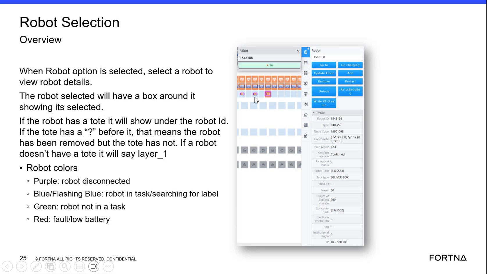
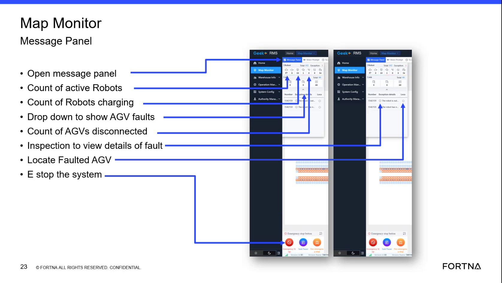

# Determine Robot Status From Robot LED Colors (Purple/Blue/Green/Red) in Robot Selection Overview

## Runbook Header

| Field | Value |
| --- | --- |
| Procedure ID | `proc_determine_robot_status_from_robot_led_colors_v1` |
| Title | Determine Robot Status From Robot LED Colors (Purple/Blue/Green/Red) in Robot Selection Overview |
| Procedure Type | `diagnostic` |
| Primary Role | `L1_support` |
| Supporting Roles | `L2_support` |
| Support Safe | Yes |
| Capability Tags | `agv_active_errors` |
| Access Surface | `rms_ui` |
| Audience Roles | `L1_support` |
| Failure Pattern Tags | `system_fault` |
| Validation Status | `needs_sme_review` |
| Merge Status | `source_finalized` |

## Summary

In the RMS / fleet status UI Robot Selection Overview, select a robot and use its two side LED color indications to determine whether it is disconnected, in task/searching for a label, idle, or in fault/low battery state.

## When To Use

Use when you need a first-pass determination of the selected robot’s state by reading the robot LED colors in the Robot Selection Overview.

## Do Not Use For

* Do not use this procedure as the only diagnostic when the LED indicates fault/low battery; you must also check the message panel details for the specific fault/low battery information.

## Access Or Tools Needed

* RMS / fleet status UI (rms_ui)

## Related Operational Context

* ctx_training_video_robot_led_color_statuses_v1
* ctx_training_video_message_panel_fault_battery_reference_v1

## Visual References

*Robot Selection Overview frame showing robot selection details and the LED color meanings (Purple/Blue/Green/Red).*

*Map Monitor / Message Panel frame context for opening the message panel to view active errors/warnings and alarm history.*

*Map Monitor / Message Panel frame context (navigation to the message panel area).*

## Procedure Steps

### Step 1 — Select the robot in the Robot Selection Overview

**Responsible role:** L1_support

**Instruction:**
In the RMS / fleet status UI Robot Selection Overview, click/select the robot so its details are shown (the selected robot is highlighted with a box).

**Expected result:**
The selected robot is visibly highlighted (box around the selected robot) and its details panel is available.

---

### Step 2 — Observe the robot’s two side LED colors

**Responsible role:** L1_support

**Instruction:**
Observe the robot’s two LEDs on each side in the Robot Selection Overview and note the LED color (purple, blue/flashing blue, green, or red).

**Expected result:**
You can identify the LED color state for the selected robot.

**Stop or Escalate If:**

* If the LED color does not match any documented color/state, stop and escalate for deeper RMS/WCS diagnostics (L2_support).

---

### Step 3 — Map purple LED to “robot disconnected”

**Responsible role:** L1_support

**Instruction:**
If the LED is purple (often described as flashing purple), record the robot status as “robot disconnected.”

**Expected result:**
Robot status is recorded as “robot disconnected” when the LED is purple/flashing purple.

---

### Step 4 — Map blue/flashing blue LED to “robot in task/searching for label”

**Responsible role:** L1_support

**Instruction:**
If the LED is blue or flashing blue, record the robot status as “robot in task/searching for label” (flashing blue indicates the robot is looking for a label).

**Expected result:**
Robot status is recorded as “robot in task/searching for label” when the LED is blue/flashing blue.

---

### Step 5 — Map green LED to “robot idle, not in a task”

**Responsible role:** L1_support

**Instruction:**
If the LED is green, record the robot status as “robot idle, not in a task.”

**Expected result:**
Robot status is recorded as “robot idle, not in a task” when the LED is green.

---

### Step 6 — Map red LED to “robot has fault or low battery” and check message panel

**Responsible role:** L1_support

**Instruction:**
If the LED is red, record the robot status as “robot has fault or low battery,” and then check the message panel for the fault/low battery details.

**Expected result:**
Robot status is recorded as “robot has fault or low battery,” and the corresponding fault/low battery condition appears in the message panel.

**Stop or Escalate If:**

* If the LED color/state does not match any documented colors/states, stop and escalate for deeper RMS/WCS diagnostics (L2_support).

---

## Success Criteria

* For the selected robot, the LED color is mapped to one of the documented states: purple=disconnected, blue/flashing blue=task/searching for label, green=idle, red=fault/low battery.
* When the LED is red, the fault/low battery condition is corroborated in the message panel.

## Failure Conditions

* LED color/state does not match any documented colors/states.
* Red LED is observed but fault/low battery details do not appear in the message panel.

## Escalation Guidance

* If the LED color/state does not match any documented colors/states, stop and escalate for deeper RMS/WCS diagnostics (L2_support).

## Missing Details / Known Gaps

* The packet provides LED-to-state meanings and message panel relationship, but does not provide exact RMS UI navigation steps (menu names/buttons) to reach the Robot Selection Overview or the message panel in the live system.

## Source Lineage

- Candidate IDs: candidate_training_video_robot_led_color_status_meanings
- Source ID: `training_video_day1`
- Source Type: `training_video`
