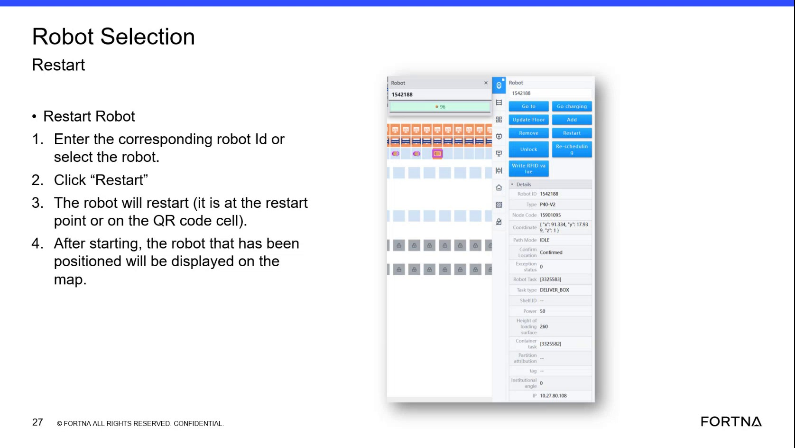

# Handle restart when robot cannot see a label: use indicator color states and verify map visibility after label reacquisition

## Runbook Header

| Field | Value |
| --- | --- |
| Procedure ID | `proc_handle_restart_robot_cannot_see_label_indicator_reacquisition_v1` |
| Title | Handle restart when robot cannot see a label: use indicator color states and verify map visibility after label reacquisition |
| Procedure Type | `recovery` |
| Primary Role | `operator` |
| Supporting Roles | None |
| Support Safe | Yes |
| Capability Tags | `robot_command_or_task_state`, `device_roster_state`, `e_stop_or_safety_stop` |
| Access Surface | `rms_ui`, `physical_floor` |
| Audience Roles | `operator` |
| Failure Pattern Tags | None |
| Validation Status | `needs_sme_review` |
| Merge Status | `source_finalized` |

## Summary

If a robot is restarted but does not snap back onto the map because it cannot see a label, use the documented indicator color behavior (flashing blue → solid blue; solid green indicates restart cycle/brakes locked) and perform the source-described physical label reacquisition steps. Then clear the E stop and confirm the robot appears successfully on the map.

## When To Use

Use when a robot was restarted but does not automatically snap back onto the map because it cannot see a label.

## Safety And Operational Notes

* Operator-only physical E-stop actions are required for the flashing-blue label reacquisition path.

## Access Or Tools Needed

* Physical floor access to push the robot onto the label
* Physical E-stop control (operator only)
* RMS / fleet status UI map view and robot indicator visibility

## Related Operational Context

* ctx_training_video_robot_map_visibility_after_restart_v1
* ctx_training_video_robot_indicator_color_states_v1
* ctx_training_video_robot_brake_lock_restart_behavior_v1

## Visual References

*Restart recovery segment showing the restart flow, the flashing blue sign (cannot see a label), the flashing blue → solid blue transition, and the solid green/brakes locked behavior.*

## Procedure Steps

### Step 1 — Check whether the restarted robot snaps back onto the map

**Responsible role:** operator

**Instruction:**
On the RMS / fleet status UI map view, observe whether the restarted robot is displayed/positioned on the map.

**Expected result:**
The robot is either displayed on the map (automatic recovery) or not displayed/positioned (needs further recovery steps).

---

### Step 2 — If robot is not on the map, identify the flashing blue indicator state (cannot see a label)

**Responsible role:** operator

**Instruction:**
Locate the robot’s indicator and look for the documented “flashing blue sign” state indicating the robot can’t see a label.

**Expected result:**
You observe the flashing blue indicator state when the robot cannot see a label.

---

### Step 3 — Perform physical label reacquisition: E stop the system and push the robot onto the label

**Responsible role:** operator

**Instruction:**
When the robot is in the flashing blue state, perform the physical recovery: E stop the system, walk into the floor, and push the robot onto the label.

**Expected result:**
After pushing the robot onto the label, the robot identifies the label and its indicator transitions from flashing blue to solid blue.

**Stop or Escalate If:**

* If the indicator does not transition from flashing blue to solid blue after pushing the robot onto the label, escalate.

---

### Step 4 — Verify indicator transition from flashing blue to solid blue after label pickup

**Responsible role:** operator

**Instruction:**
Observe the robot indicator and confirm it transitions from flashing blue to solid blue after it identifies the label.

**Expected result:**
Indicator goes from flashing blue to solid blue.

**Stop or Escalate If:**

* If the indicator does not transition from flashing blue to solid blue after pushing the robot onto the label, escalate.

---

### Step 5 — Clear E stop and verify the robot is successfully showing on the map

**Responsible role:** operator

**Instruction:**
Clear the E stop, then check the RMS / fleet status UI map view to confirm the robot is successfully showing on the map.

**Expected result:**
After clearing E stop, the robot appears successfully on the map.

**Stop or Escalate If:**

* If the robot still does not appear on the map after clearing E stop, escalate.

---

### Step 6 — If indicator is solid green, wait until it turns green before moving (brakes stay locked)

**Responsible role:** operator

**Instruction:**
If the robot is in the restart cycle state described as “solid green,” wait until it turns green before moving it because the brakes stay locked.

**Expected result:**
You do not move the robot while brakes are locked; you wait until the robot reaches the expected green state before moving.

**Stop or Escalate If:**

* Do not attempt to move the robot while brakes are described as locked (e.g., when not in the expected green state).

---

## Success Criteria

* Robot indicator transitions from flashing blue to solid blue after the robot is pushed onto the label.
* After clearing E stop, the robot is successfully showing on the RMS map.

## Failure Conditions

* Indicator does not transition from flashing blue to solid blue after pushing the robot onto the label.
* Robot still does not appear on the map after clearing E stop.
* Robot is moved while brakes are described as locked (not in the expected green state).

## Escalation Guidance

* Escalate if the indicator does not transition from flashing blue to solid blue after pushing the robot onto the label, or if the robot still does not appear on the map after clearing E stop.

## Missing Details / Known Gaps

* The source does not provide exact RMS UI screen/control names for the robot indicator or map view; steps rely on observable map visibility and the robot’s indicator color states.

## Source Lineage

- Candidate IDs: candidate_training_video_robot_restart_label_reacquisition_indicator_states
- Source ID: `training_video_day1`
- Source Type: `training_video`
