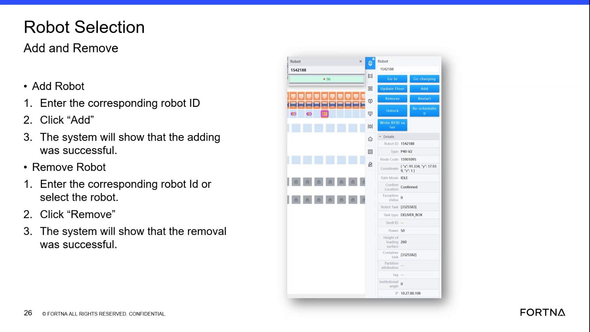

# Add or Remove a Robot in the Geek Plus RMS Robot Selection Web View

## Runbook Header

| Field | Value |
| --- | --- |
| Procedure ID | `proc_add_or_remove_robot_in_geek_plus_rms_robot_selection_web_view_v1` |
| Title | Add or Remove a Robot in the Geek Plus RMS Robot Selection Web View |
| Procedure Type | `operation` |
| Primary Role | `L1_support` |
| Supporting Roles | None |
| Support Safe | Yes |
| Capability Tags | `device_roster_state` |
| Access Surface | `rms_ui` |
| Audience Roles | `L1_support` |
| Failure Pattern Tags | None |
| Validation Status | `needs_sme_review` |
| Merge Status | `source_finalized` |

## Summary

Use the Geek Plus RMS Robot Selection web view to add a robot by robot ID or remove an existing robot, and confirm success messages after each action.

## When To Use

When you need to manage the Geek Plus RMS robot roster using the Robot Selection Add/Remove workflow and verify the on-screen success confirmations.

## Access Or Tools Needed

* Geek Plus RMS web application access via an OT network device (local) or authorized remote access
* Authorized remote authorization via UPS VPN through Zscaler (if not on OT network)

## Related Operational Context

* ctx_training_video_robot_selection_add_remove_v1
* ctx_training_video_robot_id_entry_reference_v1
* ctx_training_video_rms_access_otnet_v1
* ctx_training_video_remote_access_vpn_zscaler_v1
* ctx_training_video_hmi_station_availability_v1

## Visual References

*Robot Selection Add and Remove web view showing Robot ID entry, Add button, Remove section, and success confirmation messaging.*

## Procedure Steps

### Step 1 — Open Geek Plus RMS web application from an authorized network path

**Responsible role:** L1_support

**Instruction:**
From an OT network device, open the Geek Plus RMS web application using the site/RMS address. If you are supporting remotely, ensure you are authorized to use the UPS VPN through Zscaler and can reach the site/RMS address.

**Expected result:**
The Geek Plus RMS web application loads successfully and you can navigate to the Robot Selection screen.

**Stop or Escalate If:**

* If you cannot access the Geek Plus RMS web application, stop and escalate for support (the source does not provide remediation steps beyond access dependency).

---

### Step 2 — Navigate to the Robot Selection screen with Add Robot and Remove Robot controls

**Responsible role:** L1_support

**Instruction:**
In the Geek Plus RMS web application, navigate to the Robot Selection screen that contains the Robot ID entry field and the Add Robot and Remove Robot controls.

**Expected result:**
The Robot Selection screen is visible with the Robot ID entry field and the Add and Remove controls.

---

### Step 3 — Add a robot by robot ID

**Responsible role:** L1_support

**Instruction:**
In the Robot ID entry field, enter the corresponding robot ID. (If the robot is already introduced, partial numeric entry may surface matching robots.) Click the "Add" button.

**Expected result:**
A confirmation message appears indicating the robot was added successfully ("adding was successful" / "robot was added successfully").

**Stop or Escalate If:**

* If the success confirmation does not appear after clicking "Add", stop and escalate for support (the source does not provide troubleshooting steps for failures).

---

### Step 4 — Remove a robot by robot ID or by selecting it from the list

**Responsible role:** L1_support

**Instruction:**
Enter the corresponding robot ID in the Robot ID entry field or select the robot from the list shown for that ID. Click the "Remove" button.

**Expected result:**
A confirmation message appears indicating the robot was removed successfully ("removal was successful" / "remove what was successful").

**Stop or Escalate If:**

* If the success confirmation does not appear after clicking "Remove", stop and escalate for support (the source does not provide troubleshooting steps for failures).

---

## Success Criteria

* After clicking "Add", the Robot Selection screen displays an "adding was successful" confirmation message.
* After clicking "Remove", the Robot Selection screen displays a "removal was successful" confirmation message.

## Failure Conditions

* No success confirmation appears after clicking "Add".
* No success confirmation appears after clicking "Remove".

## Escalation Guidance

* If the success confirmation does not appear after clicking "Add" or "Remove", stop and escalate for support (the source does not provide troubleshooting steps for failures).

## Missing Details / Known Gaps

* The source does not provide specific troubleshooting steps for cases where the success confirmation does not appear after clicking "Add" or "Remove".
* The source does not provide the exact navigation path/menu labels to reach the Robot Selection screen within the Geek Plus RMS web application.

## Source Lineage

- Candidate IDs: candidate_training_video_robot_selection_add_remove
- Source ID: `training_video_day1`
- Source Type: `training_video`
