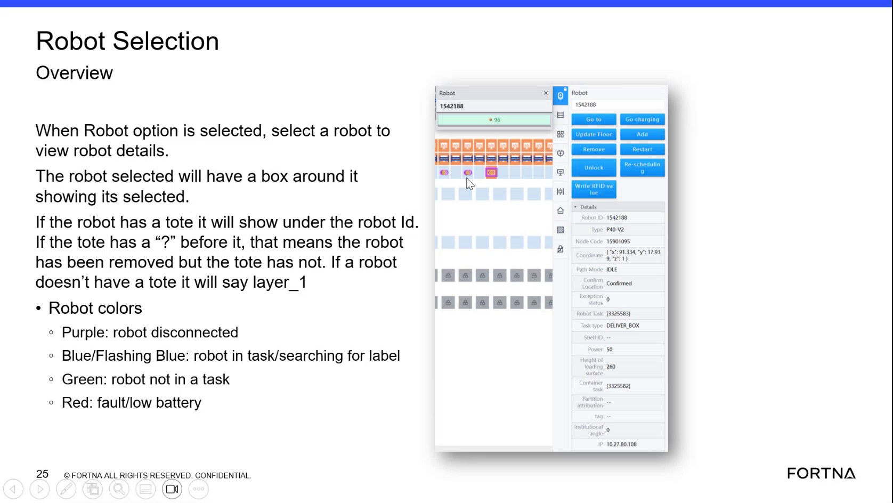

# Check Selected Robot Details (Robot ID, Location, Node Code/Cell Code, Tote ID) in Robot Selection Overview

## Runbook Header

| Field | Value |
| --- | --- |
| Procedure ID | `proc_check_selected_robot_details_robot_id_location_node_code_tote_v1` |
| Title | Check Selected Robot Details (Robot ID, Location, Node Code/Cell Code, Tote ID) in Robot Selection Overview |
| Procedure Type | `diagnostic` |
| Primary Role | `L1_support` |
| Supporting Roles | None |
| Support Safe | Yes |
| Capability Tags | `device_roster_state` |
| Access Surface | `rms_ui` |
| Audience Roles | `L1_support` |
| Failure Pattern Tags | None |
| Validation Status | `needs_sme_review` |
| Merge Status | `source_finalized` |

## Summary

Use the live RMS / fleet status UI Robot Selection Overview to select a robot and read its robot ID, location, node code (cell code), and tote presence/ID indicators—including the “?” tote mismatch case and the “layer_1” case when no tote is carried.

## When To Use

When you need to identify which robot is involved in an issue by checking the selected robot’s identifiers and tote status in the Robot Selection Overview detail panel.

## Access Or Tools Needed

* RMS / fleet status UI (rms_ui)

## Related Operational Context

* ctx_training_video_robot_selection_panel_overview_v1
* ctx_training_video_robot_detail_fields_v1
* ctx_training_video_tote_presence_indicators_v1

## Visual References

*Robot Selection Overview panel showing: Robot x Robot option, selecting a robot (box/outline), expandable detail section (small arrow), and the robot detail fields/indicators (robot ID/location, node code/cell code, tote ID with leading “?”, and “layer_1” when no tote).*

## Procedure Steps

### Step 1 — Open Robot Selection Overview and ensure Robot x Robot mode

**Responsible role:** L1_support

**Instruction:**
In the RMS / fleet status UI (rms_ui), open the Robot Selection Overview screen and ensure the view is in “Robot x Robot” mode (Robot option selected).

**Expected result:**
The Robot Selection Overview shows the Robot x Robot / Robot option selected and a robot list/grid that can be clicked to select a robot.

**Stop or Escalate If:**

* Robot ID/location/tote fields do not populate after selecting a robot (possible UI disconnect or not updating).

---

### Step 2 — Select the robot in the panel

**Responsible role:** L1_support

**Instruction:**
Click a specific robot on the Robot Selection Overview panel so it becomes the selected robot (it should show a box/outline around the selected robot).

**Expected result:**
A box/outline appears around the selected robot, indicating it is the active selection.

**Stop or Escalate If:**

* Robot ID/location/tote fields do not populate after selecting a robot (possible UI disconnect or not updating).

---

### Step 3 — Expand the robot detail section if hidden

**Responsible role:** L1_support

**Instruction:**
If the robot detail section is hidden, click the small arrow control to expand it so the full robot detail information is visible.

**Expected result:**
The expanded detail panel displays the robot ID, location, node code (cell code), and tote indicator fields.

**Stop or Escalate If:**

* Detail section cannot be expanded (small arrow does not reveal details).

---

### Step 4 — Record/verify robot ID and location

**Responsible role:** L1_support

**Instruction:**
In the expanded details, record/verify the robot ID and location fields for the selected robot.

**Expected result:**
The detail panel shows robot ID and location values for the selected robot.

**Stop or Escalate If:**

* Robot ID/location fields do not populate after selecting a robot (possible UI disconnect or not updating).

---

### Step 5 — Verify node code (cell code) for the robot

**Responsible role:** L1_support

**Instruction:**
Verify the node code field and confirm it corresponds to the cell code for the robot (use the displayed node code value as the cell code reference).

**Expected result:**
The detail panel shows a node code value, and you treat that node code as the cell code for the robot.

**Stop or Escalate If:**

* Node code field does not populate after selecting a robot (possible UI disconnect or not updating).

---

### Step 6 — Check tote ID/presence under the robot ID

**Responsible role:** L1_support

**Instruction:**
Under the robot ID in the tote section, check the tote entry: if a tote ID is shown (e.g., “tote #96”), note the tote ID.

**Expected result:**
A tote ID value is shown under the robot ID when the robot has a tote.

**Stop or Escalate If:**

* Tote fields do not populate after selecting a robot (possible UI disconnect or not updating).

---

### Step 7 — Interpret leading “?” tote mismatch indicator

**Responsible role:** L1_support

**Instruction:**
If the tote entry shows a “?” before the tote value, interpret it as: the robot was removed but the tote was not (tote mismatch).

**Expected result:**
A leading “?” appears before the tote value, indicating robot removed but tote not removed.

**Stop or Escalate If:**

* Tote fields do not populate after selecting a robot (possible UI disconnect or not updating).

---

### Step 8 — Confirm no-tote state shows “layer_1” and no brown-box tote indicator

**Responsible role:** L1_support

**Instruction:**
If no tote is present, confirm the UI shows “layer_1” and that the brown-box tote indicator is not shown.

**Expected result:**
The tote section indicates “layer_1” and there is no brown-box tote indicator.

**Stop or Escalate If:**

* Tote fields do not populate after selecting a robot (possible UI disconnect or not updating).

---

## Success Criteria

* You can identify the selected robot’s robot ID and location from the expanded Robot Selection Overview detail panel.
* You can read the node code value and use it as the cell code reference for the robot.
* You can determine tote state from the tote section: tote ID present, leading “?” tote mismatch, or “layer_1” no-tote state.

## Failure Conditions

* Detail section cannot be expanded (small arrow does not reveal details).
* Robot ID/location/tote fields do not populate after selecting a robot.
* Node code field is missing or does not populate after selection/expansion.

## Escalation Guidance

* If the detail section cannot be expanded or robot ID/location/tote fields do not populate after selecting a robot, stop and escalate to deeper RMS/WCS diagnostics (L2_support) because the UI may be disconnected or not updating.

## Missing Details / Known Gaps

* The packet does not provide the exact RMS screen name/menu path for “Robot Selection Overview”; it only specifies the Robot Selection Overview screen and the Robot x Robot mode behavior.

## Source Lineage

- Candidate IDs: candidate_training_video_robot_selection_overview_check_robot_details
- Source ID: `training_video_day1`
- Source Type: `training_video`
