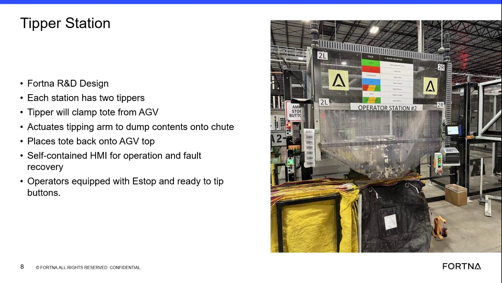

# Operate a Tipper Station using the self-contained tipper HMI (Ready to Tip) to dump tote contents to the chute

## Runbook Header

| Field | Value |
| --- | --- |
| Procedure ID | `proc_operate_tipper_station_ready_to_tip_v1` |
| Title | Operate a Tipper Station using the self-contained tipper HMI (Ready to Tip) to dump tote contents to the chute |
| Procedure Type | `operation` |
| Primary Role | `operator` |
| Supporting Roles | None |
| Support Safe | Yes |
| Capability Tags | `tipper_station_fault` |
| Access Surface | `tipper_hmi`, `physical_floor` |
| Audience Roles | `operator` |
| Failure Pattern Tags | None |
| Validation Status | `needs_sme_review` |
| Merge Status | `source_finalized` |

## Summary

At the operator station, use the self-contained tipper HMI to run a tip cycle: clamp the tote from the AGV, actuate the tipping arm to dump contents onto the chute, and place the tote back onto the AGV. Use the station’s operator E-stop and the “I’m ready to tip” button to initiate the cycle.

## When To Use

Use when a tote is presented to the tipper at an operator station and you need to perform the tip cycle (clamp → dump to chute → return tote to the AGV) using the station’s self-contained tipper HMI.

## Safety And Operational Notes

* If an E-stop is required for safety, do not continue the cycle.

## Access Or Tools Needed

* Tipper HMI / WebVisu / VISU (tipper station self-contained HMI)
* Operator station controls including E-stop and the “ready to tip” button

## Related Operational Context

* ctx_training_video_tipper_station_overview_v1
* ctx_training_video_tipper_operator_controls_v1

## Visual References

*Training frame showing operator station tipper behavior (clamp tote from AGV → actuate tipping arm to dump onto chute → place tote back onto AGV) and mentions of self-contained HMI with operator E-stop and a button that says “I’m ready to tip.”*

## Procedure Steps

### Step 1 — Identify the self-contained tipper HMI for the operator station

**Responsible role:** operator

**Instruction:**
At the operator station, identify the self-contained tipper HMI for that station.

**Expected result:**
You have located the station’s self-contained tipper HMI used for operation and fault recovery.

---

### Step 2 — Confirm the operator safety control (E-stop) is available at the station

**Responsible role:** operator

**Instruction:**
Confirm the operator safety control is present/available on the station (E-stop).

**Expected result:**
The station’s operator E-stop is present/available for use.

**Stop or Escalate If:**

* If an E-stop is required for safety, do not continue the cycle.

---

### Step 3 — Verify tote is presented and station is set up for the tip cycle

**Responsible role:** operator

**Instruction:**
Ensure a tote is presented to the tipper (tote coming in from the AGV) and that the station is set up for the tip cycle described (clamp tote, tip arm, dump to chute, then return tote).

**Expected result:**
A tote is at the station for tipping, and the station is ready to perform the clamp → dump → return sequence.

---

### Step 4 — Press “I’m ready to tip” on the tipper HMI to initiate the cycle

**Responsible role:** operator

**Instruction:**
On the tipper HMI, press the button that indicates you are ready to tip (“I’m ready to tip”).

**Expected result:**
The tip cycle is initiated from the tipper HMI using the “I’m ready to tip” button.

---

### Step 5 — Observe the tipper cycle: clamp tote, dump to chute, return tote to AGV

**Responsible role:** operator

**Instruction:**
Observe the tipper cycle behavior: the tipper clamps the tote from the AGV, actuates the tipping arm to dump contents onto the chute, and then places the tote back onto the AGV.

**Expected result:**
A successful tip cycle occurs: clamp tote from AGV → actuate tipping arm to dump contents onto chute → place tote back onto AGV.

**Stop or Escalate If:**

* Stop the operation if the tote does not clamp, the tipping arm does not actuate to dump, or the tote is not returned to the AGV as described.
* Escalate/stop if the station does not perform the clamp → tip/dump → return sequence described.

---

## Success Criteria

* Tip cycle completes with the tote clamped from the AGV, tipping arm actuates to dump contents onto the chute, and tote is placed back onto the AGV.

## Failure Conditions

* Station does not perform the clamp → tip/dump → return sequence described.
* Tote does not clamp.
* Tipping arm does not actuate to dump.
* Tote is not returned to the AGV as described.

## Escalation Guidance

* Escalate/stop if the station does not perform the clamp → tip/dump → return sequence described.
* If an E-stop is required for safety, do not continue the cycle.

## Missing Details / Known Gaps

* The packet does not provide explicit on-screen UI field names or exact HMI button label text beyond the transcript phrase “I’m ready to tip.”
* The packet does not provide station-specific identifiers (e.g., station number mapping to a specific HMI screen) or any explicit fault/alarm indicators to verify beyond the mechanical sequence.

## Source Lineage

- Candidate IDs: candidate_training_video_tipper_station_ready_to_tip_hmi
- Source ID: `training_video_day1`
- Source Type: `training_video`
