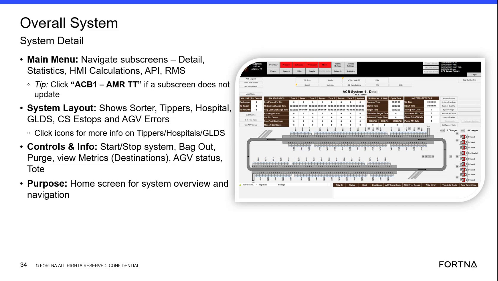

# Use Viva Main Overview to view system layout and operate high-level system controls (Start/Stop, Bag Out, Purge, Resume/Pause all AGVs)

## Runbook Header

| Field | Value |
| --- | --- |
| Procedure ID | `proc_use_viva_main_overview_system_controls_v1` |
| Title | Use Viva Main Overview to view system layout and operate high-level system controls (Start/Stop, Bag Out, Purge, Resume/Pause all AGVs) |
| Procedure Type | `operation` |
| Primary Role | `operator` |
| Supporting Roles | None |
| Support Safe | Yes |
| Capability Tags | `fleet_system_status` |
| Access Surface | `aveva_hmi` |
| Audience Roles | `operator` |
| Failure Pattern Tags | None |
| Validation Status | `needs_sme_review` |
| Merge Status | `source_finalized` |

## Summary

Use the Viva main overview (Hazlet) to confirm the overall system layout is visible and to operate high-level system controls from the right-hand control area: Start/Stop system, Bag Out, Purge, Resume, and Pause all AGVs. After issuing a control action, verify the on-screen system/AGV status area reflects the updated state.

## When To Use

Use when you need overall system visibility and to apply high-level system state actions (Start/Stop system, Bag Out, Purge, Resume, Pause all AGVs) from the Viva main overview.

## Access Or Tools Needed

* Viva HMI main overview screen access (Viva screens / Overall System System Detail)

## Related Operational Context

* ctx_training_video_viva_main_overview_v1
* ctx_training_video_viva_main_menu_navigation_v1
* ctx_training_video_viva_system_controls_panel_v1
* ctx_training_video_viva_system_layout_components_v1

## Visual References

*Viva main overview (Overall System / System Detail) showing: main menu subscreens (Detail/Statistics/HMI Calculations/API/RMS), system layout areas (Sorter/Tippers/Hospital/GLDS), and right-hand controls & info (Start/Stop system, Bag Out, Purge, Resume, Pause all AGVs).*

## Procedure Steps

### Step 1 — Open the Viva main overview (Overall System / System Detail) for Hazlet

**Responsible role:** operator

**Instruction:**
Open the Viva main overview screen for the Hazlet site (Overall System / System Detail).

**Expected result:**
The Viva main overview is displayed with the overall system view and the right-hand control area visible.

---

### Step 2 — Verify the main menu subscreens are visible (Detail, Statistics, HMI Calculations, API, RMS)

**Responsible role:** operator

**Instruction:**
On the Viva main overview, confirm the main menu is visible and includes subscreen navigation items: Detail, Statistics, HMI Calculations, API, and RMS.

**Expected result:**
The main menu shows the subscreens labeled: Detail, Statistics, HMI Calculations, API, and RMS.

---

### Step 3 — Verify the system layout areas are visible (Sorter, Tippers, Hospital, GLDS)

**Responsible role:** operator

**Instruction:**
On the main overview, confirm the system layout area shows the major zones/areas: Sorter, Tippers, Hospital, and GLDS.

**Expected result:**
The system layout region displays labeled icons/areas for Sorter, Tippers, Hospital, and GLDS.

---

### Step 4 — Locate the right-hand high-level controls (Start/Stop system, Bag Out, Purge, Resume, Pause all AGVs)

**Responsible role:** operator

**Instruction:**
On the right-hand side controls & info area, locate the high-level controls labeled: Start/Stop system, Bag Out, Purge, Resume, and Pause all AGVs.

**Expected result:**
The right-hand control area shows the labels for Start/Stop system, Bag Out, Purge, Resume, and Pause all AGVs.

---

### Step 5 — Execute the intended high-level control action

**Responsible role:** operator

**Instruction:**
Use the appropriate control (Start/Stop system, Bag Out, Purge, Resume, or Pause all AGVs) based on your intent for the overall system state.

**Expected result:**
The selected control action is issued from the Viva main overview right-hand control area.

---

### Step 6 — Verify on-screen system/AGV status updates after the control action

**Responsible role:** operator

**Instruction:**
After issuing the control action, observe for immediate on-screen evidence that the system state/control action took effect (including updates in the AGV status/system-state area on the Viva overview).

**Expected result:**
The Viva main overview reflects the updated overall state and the AGV status area updates accordingly.

**Stop or Escalate If:**

* Stop and escalate if the Viva overview does not update the AGV status/system state after the control action (Start/Stop system, Bag Out, Purge, Resume, or Pause all AGVs).

---

## Success Criteria

* Viva main overview shows the system layout areas labeled Sorter, Tippers, Hospital, and GLDS.
* Viva main overview shows the right-hand controls labeled Start/Stop system, Bag Out, Purge, Resume, and Pause all AGVs.
* After using a control, the Viva overview’s system/AGV status area visibly updates to reflect the new overall state.

## Failure Conditions

* Main menu subscreens are missing (Detail/Statistics/HMI Calculations/API/RMS).
* System layout areas are missing (Sorter/Tippers/Hospital/GLDS).
* Right-hand control labels are missing (Start/Stop system/Bag Out/Purge/Resume/Pause all AGVs).
* After issuing a control action, the Viva overview does not update the AGV status/system state.

## Escalation Guidance

* If the Viva overview does not reflect any change in system/AGV status after issuing the control action, stop and escalate.

## Missing Details / Known Gaps

* The packet does not provide exact button click sequences, confirmation dialogs, or the specific on-screen fields/labels that change after each control action (Start/Stop vs Bag Out vs Purge vs Resume vs Pause all AGVs). The verification step therefore requires observing any visible system/AGV status change on the Viva overview.

## Source Lineage

- Candidate IDs: candidate_training_video_viva_main_overview_system_controls
- Source ID: `training_video_day1`
- Source Type: `training_video`
