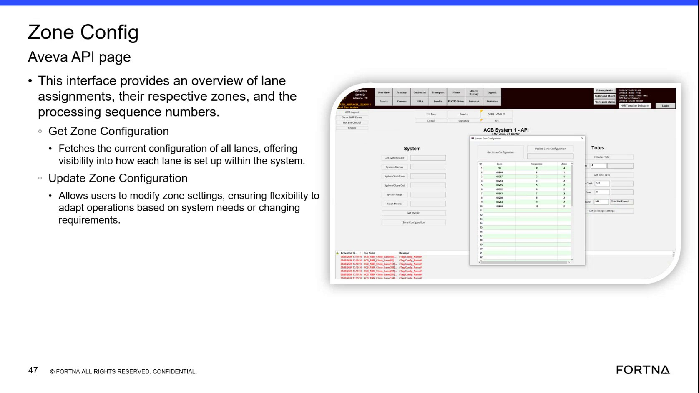

# Check Lane Zone Configuration Using the Zone Config (Aveva API) Page

## Runbook Header

| Field | Value |
| --- | --- |
| Procedure ID | `proc_check_lane_zone_configuration_using_zone_config_aveva_api_page_v1` |
| Title | Check Lane Zone Configuration Using the Zone Config (Aveva API) Page |
| Procedure Type | `diagnostic` |
| Primary Role | `L1_support` |
| Supporting Roles | None |
| Support Safe | Yes |
| Capability Tags | None |
| Access Surface | `aveva_hmi` |
| Audience Roles | `L1_support` |
| Failure Pattern Tags | None |
| Validation Status | `needs_sme_review` |
| Merge Status | `source_finalized` |

## Summary

Use the AVEVA HMI “Zone Config Aveva API” page to fetch and verify the current lane-to-zone assignments and processing sequence numbers using “Get Zone Configuration,” then confirm the displayed configuration matches the expected zone configuration state.

## When To Use

When you need to verify the current lane-to-zone assignments and processing sequence numbers shown in the system’s Zone Config Aveva API interface, and determine whether the displayed configuration matches the expected zone configuration state.

## Access Or Tools Needed

* AVEVA HMI / Zone Config page (site-visible interface)

## Related Operational Context

* ctx_training_video_zone_config_aveva_api_page_v1
* ctx_training_video_get_zone_configuration_v1

## Visual References

*Zone Config Aveva API page interface showing lane assignments, zones, processing sequence numbers, and the “Get Zone Configuration” control.*

## Procedure Steps

### Step 1 — Open the AVEVA HMI Zone Config Aveva API page

**Responsible role:** L1_support

**Instruction:**
Open the AVEVA HMI Zone Config page that shows the “Zone Config Aveva API” interface with lane assignments, zones, and processing sequence numbers.

**Expected result:**
The “Zone Config Aveva API” interface is visible and includes the lane assignment overview with zones and processing sequence numbers, along with the “Get Zone Configuration” function/control.

---

### Step 2 — Locate the “Get Zone Configuration” control/button

**Responsible role:** L1_support

**Instruction:**
On the Zone Config Aveva API page, locate the “Get Zone Configuration” control/button.

**Expected result:**
The “Get Zone Configuration” control/button is located and ready to be clicked/activated.

---

### Step 3 — Click “Get Zone Configuration” to fetch current lane configuration

**Responsible role:** L1_support

**Instruction:**
Click “Get Zone Configuration” on the Zone Config Aveva API page to fetch the current configuration of all lanes.

**Expected result:**
The page updates/refreshed data is loaded after activating “Get Zone Configuration.”

---

### Step 4 — Verify lane assignments, zones, and processing sequence numbers are populated

**Responsible role:** L1_support

**Instruction:**
After “Get Zone Configuration,” observe the page to confirm it displays lane assignments with their respective zones and processing sequence numbers (i.e., the configuration list/table is populated).

**Expected result:**
The Zone Config Aveva API page shows lane assignment entries populated with each lane’s assigned zone and processing sequence number.

**Stop or Escalate If:**

* Stop and escalate if the displayed lane configuration data is missing/empty after “Get Zone Configuration.”
* Stop and escalate if lane-to-zone assignments or processing sequence numbers appear inconsistent with the expected zone configuration state for the job.

---

## Success Criteria

* After clicking “Get Zone Configuration,” the Zone Config Aveva API page shows populated lane assignment entries including each lane’s assigned zone and processing sequence number.
* The displayed lane-to-zone assignments and processing sequence numbers match the expected zone configuration state for the job.

## Failure Conditions

* Lane configuration data is missing/empty after “Get Zone Configuration.”
* Lane-to-zone assignments or processing sequence numbers appear inconsistent with the expected zone configuration state for the job.

## Escalation Guidance

* Escalate if lane configuration data is missing/empty after “Get Zone Configuration,” or if lane-to-zone assignments/processing sequence numbers do not match the expected zone configuration state for the job.

## Missing Details / Known Gaps

* The packet does not provide explicit navigation steps to reach the Zone Config Aveva API page from another screen; this runbook assumes the Zone Config page is already open.
* The packet does not provide the exact expected lane/zone/processing sequence values to compare against; the operator must use the job’s expected zone configuration state (not included in the packet).

## Source Lineage

- Candidate IDs: candidate_training_video_zone_config_aveva_api_get_zone_configuration
- Source ID: `training_video_day1`
- Source Type: `training_video`
