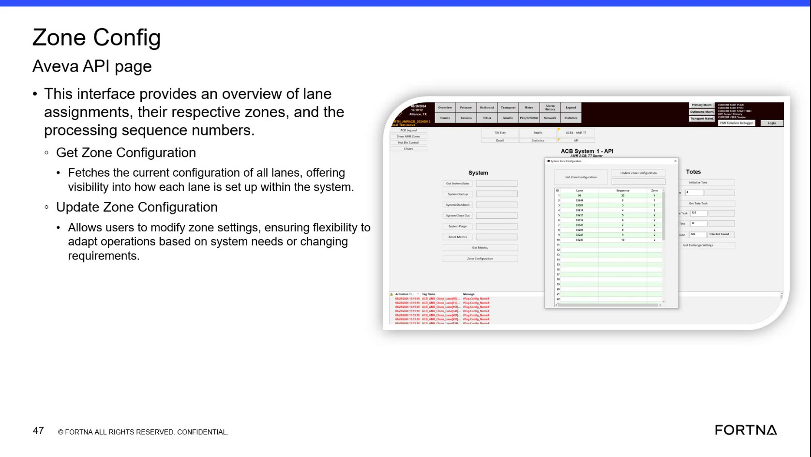
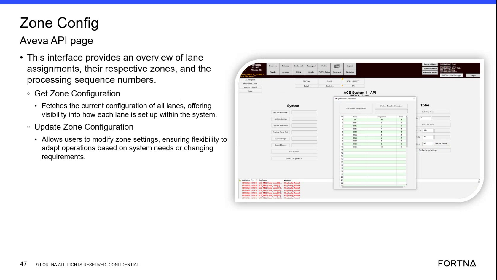

# Check Current Zone Configuration Using “Get Zone Configuration” (Zone Config Aveva API page)

## Runbook Header

| Field | Value |
| --- | --- |
| Procedure ID | `proc_check_current_zone_configuration_get_zone_configuration_v1` |
| Title | Check Current Zone Configuration Using “Get Zone Configuration” (Zone Config Aveva API page) |
| Procedure Type | `diagnostic` |
| Primary Role | `L2_support` |
| Supporting Roles | None |
| Support Safe | Yes |
| Capability Tags | `zone_config_state` |
| Access Surface | `aveva_hmi`, `wcs_api` |
| Audience Roles | `L2_support` |
| Failure Pattern Tags | `api_unresponsive`, `mapping_abnormal` |
| Validation Status | `needs_sme_review` |
| Merge Status | `source_finalized` |

## Summary

Use the Zone Config Aveva API page’s “Get Zone Configuration” function to retrieve the current lane-to-zone configuration and confirm that lane assignments, zones, and processing sequence numbers are present and populated.

## When To Use

When you need to verify the current zone configuration returned by the Zone Config interface—specifically that all lanes have assigned zones and processing sequence numbers populated.

## Do Not Use For

* Do not use this procedure to perform zone changes. “Update Zone Configuration” is a separate action and is not covered here.

## Safety And Operational Notes

* Avoid using “Update Zone Configuration” during this diagnostic unless explicitly authorized by the playbook/SME (it is described as allowing users to modify zone settings).

## Access Or Tools Needed

* Access to the “Zone Config Aveva API page” interface
* Ability to view the “Get Zone Configuration” results payload/table

## Related Operational Context

* ctx_training_video_zone_config_interface_overview_v1
* ctx_training_video_zone_config_get_configuration_v1

## Visual References

*Zone Config Aveva API page interface showing lane assignments, zones, processing sequence numbers, and the “Get Zone Configuration” control.*

*Zone Config Aveva API page interface context for navigating to the page and viewing the lane/zone/processing sequence display area.*

## Procedure Steps

### Step 1 — Open the “Zone Config Aveva API page” interface

**Responsible role:** L2_support

**Instruction:**
Open the “Zone Config Aveva API page” interface.

**Expected result:**
The Zone Config Aveva API page is displayed with the “Get Zone Configuration” function available and an area that presents lane assignments, zones, and processing sequence numbers.

---

### Step 2 — Run “Get Zone Configuration” to fetch current lane configuration

**Responsible role:** L2_support

**Instruction:**
Click/select “Get Zone Configuration” to fetch the current configuration of all lanes.

**Expected result:**
A fetch is performed and results are returned for the lane configuration (lane assignments with their respective zones and processing sequence numbers).

**Stop or Escalate If:**

* Fetch fails
* Returned configuration is empty

---

### Step 3 — Validate returned lane assignments, zones, and processing sequence numbers

**Responsible role:** L2_support

**Instruction:**
Observe the returned results and confirm that each lane has a zone and a processing sequence number populated.

**Expected result:**
The “Get Zone Configuration” fetch returns a non-empty configuration for all lanes, with each lane showing its respective zone and processing sequence number.

**Stop or Escalate If:**

* Returned configuration is missing lanes
* Zone values are null/blank
* Processing sequence number values are null/blank
* Fetch indicates an error/failed fetch

---

## Success Criteria

* “Get Zone Configuration” returns a non-empty configuration for lanes.
* Each lane entry includes a populated zone value and a populated processing sequence number.

## Failure Conditions

* Fetch fails or indicates an error/failed fetch.
* Returned configuration is empty.
* Missing lane entries (incomplete lane set).
* Null/blank zone values for one or more lanes.
* Null/blank processing sequence number values for one or more lanes.

## Escalation Guidance

* Escalate if the fetch fails or returns incomplete data (missing lanes, blank/null zone values, or blank/null processing sequence numbers).
* If the issue appears to require changing zone settings, note that “Update Zone Configuration” is a separate (higher-risk) action and should not be performed unless explicitly authorized by the playbook/SME.

## Missing Details / Known Gaps

* The packet does not provide exact UI field names/column headers for the returned results table/list; validation is limited to observable presence/non-empty and populated (non-null/blank) zone and processing sequence values.

## Source Lineage

- Candidate IDs: candidate_training_video_zone_config_get_zone_configuration
- Source ID: `training_video_day1`
- Source Type: `training_video`
