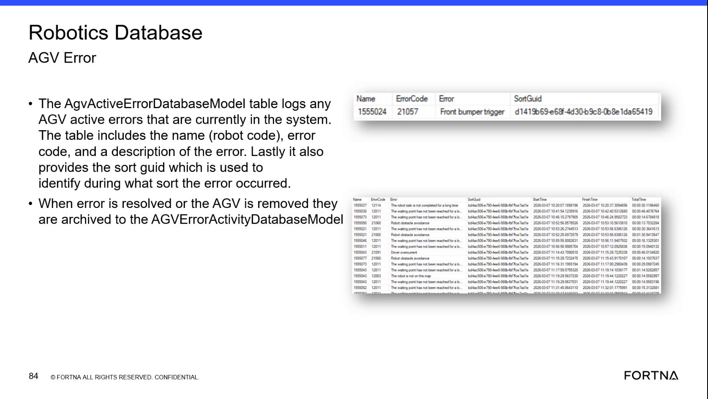

# Corroborate AGV Active Errors Using AGV Active Error Database Model + Error Code Dictionary + Sort GUID

## Runbook Header

| Field | Value |
| --- | --- |
| Procedure ID | `proc_corroborate_agv_active_errors_using_agv_active_error_db_model_error_code_dictionary_sort_guid_v1` |
| Title | Corroborate AGV Active Errors Using AGV Active Error Database Model + Error Code Dictionary + Sort GUID |
| Procedure Type | `diagnostic` |
| Primary Role | `L2_support` |
| Supporting Roles | `L2_support` |
| Support Safe | Yes |
| Capability Tags | `agv_active_errors` |
| Access Surface | `wcs_sql` |
| Audience Roles | `L2_support` |
| Failure Pattern Tags | None |
| Validation Status | `needs_sme_review` |
| Merge Status | `source_finalized` |

## Summary

Use WCS / Helix DB (SSMS) to corroborate which AGVs currently have active errors by cross-checking the active-error model (robot code/name, error code, description, SortGuid) against the AGV error dictionary model (error code → description and critical vs non-critical classification). Use SortGuid to identify which sort occurrence the active error is associated with.

## When To Use

When you need to confirm which AGVs currently have active errors and map each active error code to its description/classification, including which sort occurrence (SortGuid) the error is tied to.

## Access Or Tools Needed

* WCS / Helix DB (SSMS)

## Related Operational Context

* ctx_training_video_agv_active_error_table_v1
* ctx_training_video_agv_error_dictionary_v1
* ctx_training_video_sort_guid_reference_v1
* ctx_training_video_robot_task_table_archival_v1

## Visual References

*Training frame showing the AGV Active Error Database model fields: robot code (Name), error code, description, and SortGuid; also states that active errors are logged and archived when resolved/removed.*

## Procedure Steps

### Step 1 — Open WCS / Helix DB (SSMS) and connect to the OptiSweep database containing the Robotics / AGV error models

**Responsible role:** L2_support

**Instruction:**
Using WCS / Helix DB (SSMS), connect to the OptiSweep database that contains the Robotics / AGV error models.

**Expected result:**
SSMS is connected to the OptiSweep database that contains the Robotics/AGV error model tables.

---

### Step 2 — Open the AGV Active Error Database model table (AgvActiveErrorDatabaseModel)

**Responsible role:** L2_support

**Instruction:**
In SSMS, open the “AGV Active Error Database model table” (AgvActiveErrorDatabaseModel).

**Expected result:**
The AgvActiveErrorDatabaseModel table view/query results show active error rows with fields including robot code (Name), error code, description, and SortGuid.

---

### Step 3 — Verify active error rows include Name, Error code, Description, and SortGuid; record error code and SortGuid for one or more rows

**Responsible role:** L2_support

**Instruction:**
Verify the table shows active error rows that include robot code (Name), error code (Error code), description (Description), and SortGuid (Sort id). For one or more active error rows, note the error code and SortGuid values.

**Expected result:**
You have at least one active error instance recorded with its Error code and SortGuid (and can see the corresponding Description and robot Name in the same row).

---

### Step 4 — Open the AGV error model table (error code dictionary) and locate matching error code

**Responsible role:** L2_support

**Instruction:**
Open the “AGV error model table” (AgvErrorModel / error dictionary) and locate the matching error code to confirm the error description and critical vs non-critical classification.

**Expected result:**
The matching error code is found in the AgvErrorModel dictionary and provides the description and critical vs non-critical classification for that error code.

**Stop or Escalate If:**

* If an active error row’s error code cannot be found in the AGV error dictionary table, escalate for data integrity/mapping issues.

---

### Step 5 — Use SortGuid to identify which sort the error occurred during

**Responsible role:** L2_support

**Instruction:**
Use the SortGuid value from the active-error row to identify which sort the error occurred during (SortGuid is the identifier for the sort occurrence).

**Expected result:**
For each recorded active error row, you can associate the error instance with the corresponding sort occurrence using its SortGuid value.

---

## Success Criteria

* AgvActiveErrorDatabaseModel shows active error rows with Name (robot code), Error code, Description, and SortGuid.
* For each sampled active error row, the Error code exists in AgvErrorModel and provides a description and critical vs non-critical classification.
* Each active error instance can be associated to a sort occurrence using SortGuid.

## Failure Conditions

* AgvActiveErrorDatabaseModel returns no active error rows.
* An active-error row contains an Error code that cannot be found in AgvErrorModel.
* SortGuid is missing/blank for an active-error row.

## Escalation Guidance

* If AGV Active Error Database shows no active errors while RMS indicates errors, escalate for reconciliation between RMS and WCS/DB truth.
* If an active error row’s error code cannot be found in the AGV error dictionary table, escalate for data integrity/mapping issues.

## Missing Details / Known Gaps

* The packet does not provide exact SSMS navigation steps (e.g., database name, schema, or specific query/view names) beyond the model/table names (AgvActiveErrorDatabaseModel and AgvErrorModel).
* The packet does not provide the exact method to translate SortGuid into a human-readable sort occurrence (e.g., which table/field to query for sort details). It only states that SortGuid is the sort-occurrence identifier.

## Source Lineage

- Candidate IDs: candidate_training_video_agv_active_error_lookup_and_sort_guid_check
- Source ID: `training_video_day2`
- Source Type: `training_video`
