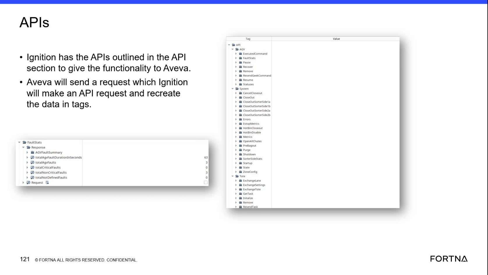
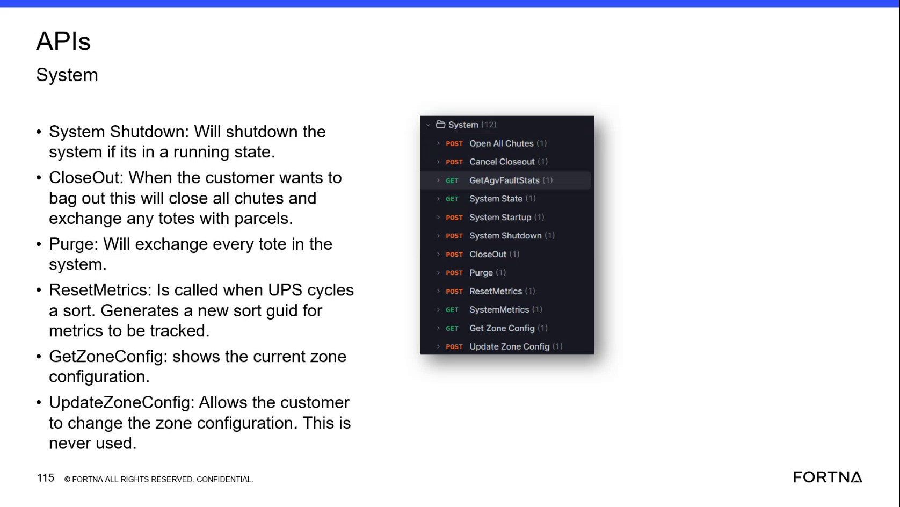
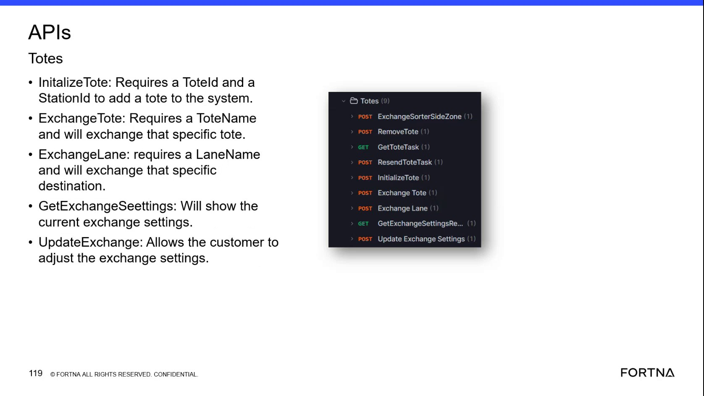

# Cancel active exchanges after a manual bag out (purge/close recovery)

## Runbook Header

| Field | Value |
| --- | --- |
| Procedure ID | `proc_cancel_active_exchanges_after_manual_bag_out_purge_close_recovery_v1` |
| Title | Cancel active exchanges after a manual bag out (purge/close recovery) |
| Procedure Type | `recovery` |
| Primary Role | `L2_support` |
| Supporting Roles | None |
| Support Safe | Yes |
| Capability Tags | `bag_out_or_closeout_state`, `wcs_api_responsiveness` |
| Access Surface | `apidog`, `wcs_api` |
| Audience Roles | `L2_support` |
| Failure Pattern Tags | `api_unresponsive`, `system_fault` |
| Validation Status | `needs_sme_review` |
| Merge Status | `source_finalized` |

## Summary

After a manual bag out/back out was used because recovery took too long, and the system is back up and running, cancel the active exchanges that were marked by the bag out so operators don’t have to complete the remaining bag out exchange/tote processing.

## When To Use

Use when a manual bag out/back out occurred as a fallback because recovery took too long, and the system is now back up and running; then cancel active exchanges that were marked to exchange by the bag out.

## Do Not Use For

* Do not use if the system is not actually back up and running yet (cancel may not have the intended effect).
* Do not use as a generic response to unrelated exchange activity without evidence of a manual bag out/back out event.

## Safety And Operational Notes

* Manual bag out/back out is described as a major, labor-intensive event; only proceed with cancel after confirming the system is back up and running.

## Access Or Tools Needed

* Apidog / WCS API client (API Dog) on a primary server
* Primary server access to run the API calls

## Related Operational Context

* ctx_training_video_cancel_exchanges_after_bag_out_v1
* ctx_training_video_manual_bag_out_overview_v1

## Visual References

*Training frame showing: manual back out due to slow recovery; once system is back up, cancel all active exchanges; bag out marks everything to exchange and cancel cancels those bag out requests.*

*Training frame listing related API system actions (e.g., Closeout/Purge) and describing bag out context; used here only as supporting context for the API action set.*

*Training frame describing tote/exchange-related API concepts (e.g., ExchangeTote / ExchangeLane / GetToteTask) that relate to exchange activity verification context.*

## Procedure Steps

### Step 1 — Confirm manual bag out/back out occurred and the system is back up and running

**Responsible role:** L2_support

**Instruction:**
Confirm the situation matches a manual bag out/back out fallback (recovery took too long) and that the system is now back up and running before attempting to cancel active exchanges.

**Expected result:**
You have confirmation that (1) the event was a manual bag out/back out due to slow recovery and (2) the system is back up and running.

**Stop or Escalate If:**

* System is not actually back up and running yet.

---

### Step 2 — Locate the cancel function for active exchanges after bag out and identify required request parameters

**Responsible role:** L2_support

**Instruction:**
On the live API surface (Apidog / API Dog on a primary server), locate the cancel function described for canceling active exchanges after bag out and identify the request parameters needed for the cancel action.

**Expected result:**
You have identified the specific cancel endpoint/function in Apidog and the request parameters required to execute it.

**Stop or Escalate If:**

* You cannot identify the cancel request parameters needed for the cancel action.

---

### Step 3 — Execute the cancel request for bag-out-marked active exchanges

**Responsible role:** L2_support

**Instruction:**
Using Apidog on the primary server, execute the cancel request for the active exchanges created by the bag out event using the request parameters identified in the previous step.

**Expected result:**
The cancel request returns a successful response in Apidog.

**Stop or Escalate If:**

* Cancel request does not return a successful response.

---

### Step 4 — Verify bag-out-marked exchanges are canceled (not remaining active)

**Responsible role:** L2_support

**Instruction:**
Verify on the live exchange/exchange-request status view that active exchanges marked by the bag out are canceled after the cancel request.

**Expected result:**
Active exchanges that were marked by the bag out are canceled (i.e., they are no longer active).

**Stop or Escalate If:**

* Exchange requests remain active after the cancel attempt.

---

### Step 5 — Stop and escalate if cancel fails or exchanges remain active

**Responsible role:** L2_support

**Instruction:**
If the cancel request fails or if exchange requests remain active after the cancel attempt, stop and escalate.

**Expected result:**
Escalation is triggered when cancel response is not successful or when exchanges remain active.

**Stop or Escalate If:**

* Cancel request does not return a successful response.
* Exchange requests remain active after the cancel attempt.
* System is not actually back up and running yet.

---

## Success Criteria

* Cancel request returns a successful response in Apidog.
* Bag-out-marked exchange requests are no longer active after the cancel attempt.

## Failure Conditions

* System is not back up and running yet.
* Cancel request does not return a successful response.
* Exchange requests remain active after the cancel attempt.

## Escalation Guidance

* Escalate if the cancel request fails (no successful response) or if exchange requests remain active after the cancel attempt.
* Escalate if the system is not actually back up and running yet (cancel may not have the intended effect).

## Missing Details / Known Gaps

* The packet does not include the exact Apidog cancel endpoint/function name and the specific request parameter field names/values needed to execute the cancel action.
* The packet does not include a captured live view (RMS/fleet status UI or other exchange-request status UI) showing the canceled vs active exchange state after cancel; therefore the verification step cannot name the exact live UI fields/labels to check.

## Source Lineage

- Candidate IDs: candidate_training_video_cancel_active_exchanges_after_bag_out
- Source ID: `training_video_day2`
- Source Type: `training_video`
