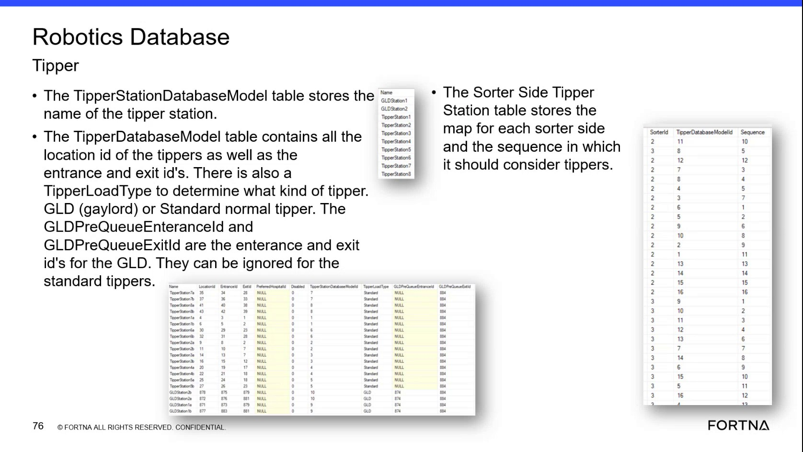

# Check Charging Area Configuration in SSMS / Helix DB

## Runbook Header

| Field | Value |
| --- | --- |
| Procedure ID | `proc_check_charging_area_configuration_in_ssms_helix_db_v1` |
| Title | Check Charging Area Configuration in SSMS / Helix DB |
| Procedure Type | `diagnostic` |
| Primary Role | `L2_support` |
| Supporting Roles | None |
| Support Safe | Yes |
| Capability Tags | `agv_charging_state` |
| Access Surface | `wcs_sql` |
| Audience Roles | `L2_support` |
| Failure Pattern Tags | None |
| Validation Status | `needs_sme_review` |
| Merge Status | `source_finalized` |

## Summary

Use the WCS / Helix DB (SSMS) to inspect charging-area records and confirm that each area has entrance IDs, exit IDs, and an explicit disabled status. This is a read-only diagnostic.

## When To Use

Use when investigating charging-area configuration in the live WCS / Helix DB (SSMS), including a suspected missing, inconsistent, or disabled charging area.

## Do Not Use For

* Changing charging-area configuration.
* Determining charging-threshold behavior; the source identifies charging thresholds as a separate database model.
* Replacing a live operational check of AGV or charger behavior.

## Safety And Operational Notes

* This procedure is read-only. Do not change charging-area configuration during the diagnostic.

## Access Or Tools Needed

* WCS / Helix DB (SSMS)
* Access to the charging database model table for charging areas

## Related Operational Context

* ctx_training_video_charging_database_models_v1
* ctx_training_video_charging_area_reference_v1

## Visual References

*WCS / Helix SSMS view showing the Robotics database model inventory and the charging-area configuration concepts, including entrance IDs, exit IDs, and disabled status.*

## Procedure Steps

### Step 1 — Open the charging database model in WCS / Helix DB (SSMS)

**Responsible role:** L2_support

**Instruction:**
In WCS / Helix DB (SSMS), open the Robotics database model inventory and locate the charging database model table for charging areas. The source identifies this model as ChargingDatabaseModel; use the available live SSMS navigation rather than modifying the database.

**Expected result:**
The charging database model is available for inspection and the charging-area records can be viewed.

**Stop or Escalate If:**

* The charging database model or relevant charging-area records are missing.

---

### Step 2 — Inspect charging-area fields

**Responsible role:** L2_support

**Instruction:**
In the charging-area records in WCS / Helix DB (SSMS), inspect the entrance ID, exit ID, and disabled fields for the relevant charging area.

**Expected result:**
The relevant charging-area row contains values or explicit status entries for entrance ID, exit ID, and disabled status.

**Stop or Escalate If:**

* Required entrance or exit identifiers are empty or inconsistent.
* The disabled status is not explicitly represented.

---

### Step 3 — Compare the record with the investigated charging area

**Responsible role:** L2_support

**Instruction:**
Compare the charging-area row in WCS / Helix DB (SSMS) with the charging area being investigated. Confirm that the entrance and exit identifiers are usable for that area and determine whether the disabled status is expected.

**Expected result:**
The relevant row is matched to the investigated charging area, its entrance and exit locations are identifiable, and its disabled status is explicitly understood as expected or unexpected.

**Stop or Escalate If:**

* The charging-area row cannot be matched to the area being investigated.
* The area is unexpectedly marked disabled.
* The configuration is missing or inconsistent.

---

## Success Criteria

* The relevant charging-area row is present in the WCS / Helix DB (SSMS).
* The row contains identifiable entrance ID and exit ID values.
* The disabled field explicitly represents the area's status.
* The status is not unexpectedly disabled for the charging area under investigation.
* No configuration changes are made during the diagnostic.

## Failure Conditions

* The charging-area row is missing.
* The entrance ID or exit ID is empty or inconsistent.
* The disabled status is missing, unclear, or unexpectedly set to disabled.
* The database record cannot be matched to the charging area being investigated.

## Escalation Guidance

* Escalate to L2/engineering if the charging-area row is missing, required entrance or exit identifiers are empty or inconsistent, or the area is unexpectedly marked disabled.
* Do not modify charging-area configuration as part of this diagnostic.

## Missing Details / Known Gaps

* The source does not provide the exact database name, server name, SSMS navigation sequence, or SQL statement for locating the charging-area records.
* The source does not define site-specific expected entrance ID and exit ID values for the charging area under investigation.
* The source does not define how to determine from the database alone whether a disabled status is expected for a particular incident.
* The source identifies charging locations and charging thresholds as separate models but does not provide additional checks for those models in this procedure.
* The escalation owner, response target, and engineering contact path are not specified.

## Source Lineage

- Candidate IDs: candidate_training_video_charging_area_db_check
- Source ID: `training_video_day2`
- Source Type: `training_video`
